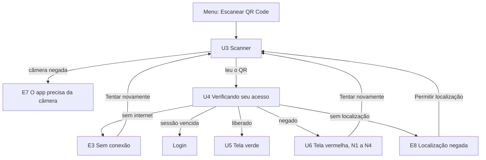

# Validação de acesso por QR Code: guia da apresentação

> Cola para apresentar a issue ao grupo: o que a funcionalidade faz, as regras, o que foi
> feito, como demonstrar e as perguntas que podem aparecer.
> Entregue no PR #17 (commit `4721075`). O backend não mudou: a rota `POST /access/qr` já existia.

1. [Em 30 segundos](#1-em-30-segundos)
2. [Critérios de aceite](#2-critérios-de-aceite)
3. [Fluxo das telas](#3-fluxo-das-telas)
4. [Regras do QR Code](#4-regras-do-qr-code)
5. [Regras da decisão (backend)](#5-regras-da-decisão-backend)
6. [Regras do app](#6-regras-do-app)
7. [O que foi feito](#7-o-que-foi-feito)
8. [Decisões e por quê](#8-decisões-e-por-quê)
9. [Como foi testado](#9-como-foi-testado)
10. [Roteiro da demonstração](#10-roteiro-da-demonstração)
11. [Se algo der errado na hora](#11-se-algo-der-errado-na-hora)
12. [Perguntas que podem aparecer](#12-perguntas-que-podem-aparecer)
13. [O que ainda falta](#13-o-que-ainda-falta)

---

## 1. Em 30 segundos

O morador ou visitante abre o app, toca em **Escanear QR Code** e aponta para o QR da catraca.
O app manda o QR e a posição do celular para a API. A API decide e o app mostra:

- **Tela verde:** acesso liberado, com a catraca e os usos restantes.
- **Tela vermelha:** acesso negado, com o motivo e o que fazer.

Toda tentativa fica no histórico, e a catraca recebe a ordem de abrir ou não.

> **Frase-chave:** quem decide é sempre o backend. O app só lê, envia e mostra.

---

## 2. Critérios de aceite

| Critério | Situação | Como foi conferido |
|---|---|---|
| Ler o QR do simulador no celular libera ou nega conforme a autorização | Teste manual | [Roteiro da demonstração](#10-roteiro-da-demonstração) |
| Os 13 motivos de negação aparecem com o texto correto | ✅ | Um teste automático para cada motivo |
| `flutter analyze` e `flutter test` passam | ✅ | Sem avisos; 110 testes passando |

---

## 3. Fluxo das telas



| Tela | Arquivo (`frontend/lib/`) | O que faz |
|---|---|---|
| U3 Scanner + E7 | `views/user/scanner_qr_view.dart` | Câmera, moldura, lanterna; câmera negada mostra a E7 |
| U4 Validando + E3 | `views/user/validando_acesso_view.dart` | Chama a API e decide qual tela mostrar |
| U5 Liberado | `views/user/acesso_liberado_view.dart` | Catraca, caminho, hora e usos restantes |
| U6 Negado (N1–N4) + E8 | `views/user/acesso_negado_view.dart` | Motivo e o que fazer, vindos da API |

---

## 4. Regras do QR Code

| Regra | Valor |
|---|---|
| Quem gera | O **backend** gera o texto; o terminal só desenha o QR |
| Conteúdo | Texto de 78 caracteres (`P1.…`) assinado com **HMAC-SHA256** |
| Troca | A cada **10 s** |
| Validade | Cerca de **30 s** |
| Uso único | Cada QR libera **uma vez só** |
| Alterou qualquer parte | A assinatura não confere: `QR_INVALIDO` |

**Detalhe importante:** o QR só é marcado como usado quando **libera**. Se negar, a pessoa pode
tentar de novo com o mesmo QR enquanto ele valer.

Formato e motivo da escolha: `docs/terminal-iot.md`.

---

## 5. Regras da decisão (backend)

A API confere nesta ordem e **para no primeiro problema**:

| # | Confere | Se falhar |
|---|---|---|
| 1 | QR válido e dentro do prazo | `QR_INVALIDO`, `QR_EXPIRADO` |
| 2 | A catraca tem terminal | `TERMINAL_DESCONHECIDO` |
| 3 | O cadastro está ativo | `USUARIO_INATIVO` |
| 4 | Tem autorização válida para essa catraca | `SEM_AUTORIZACAO`, `AUTORIZACAO_CANCELADA`, `AUTORIZACAO_EXPIRADA`, `AUTORIZACAO_NAO_INICIADA`, `FORA_DO_HORARIO`, `SEM_USOS` |
| 5 | O app mandou a posição | `LOCALIZACAO_AUSENTE` |
| 6 | Está a até 100 m | `LONGE_DO_TERMINAL` |
| 7 | O QR ainda não foi usado | `QR_JA_UTILIZADO` |
| 8 | Desconta um uso | **Libera** |

**Outras regras:**

- A resposta é **sempre 200**, mesmo negando. Quem decide é o campo `liberado`.
- A janela de horário pode passar da meia-noite (ex.: 22:00 às 06:00).
- Com várias autorizações e nenhuma válida, aparece o motivo da que "chegou mais perto".
- Dois acessos ao mesmo tempo não passam do limite de usos.
- A distância é medida até o terminal (se tiver posição cadastrada) ou até a catraca.
  O raio padrão é 100 m, configurável de 10 a 1000 m.
- Toda tentativa vira um evento no histórico, e o terminal recebe `ABRIR` ou `NEGAR`.

### Os 13 motivos

| `motivo` | Tela | Título que aparece |
|---|---|---|
| `QR_INVALIDO` | U6 | QR Code não reconhecido |
| `QR_EXPIRADO` | U6 | O QR Code já mudou |
| `QR_JA_UTILIZADO` | U6 | Este QR Code já foi usado |
| `TERMINAL_DESCONHECIDO` | U6 | Catraca não cadastrada |
| `USUARIO_INATIVO` | U6 | Seu cadastro está desativado |
| `SEM_AUTORIZACAO` | U6 | Você não tem autorização para esta catraca |
| `AUTORIZACAO_CANCELADA` | N4 | Sua autorização foi cancelada |
| `AUTORIZACAO_EXPIRADA` | N1 | Sua autorização expirou |
| `AUTORIZACAO_NAO_INICIADA` | U6 | Sua autorização ainda não começou |
| `FORA_DO_HORARIO` | U6 | Fora do horário permitido |
| `SEM_USOS` | N2 | Você não tem mais usos |
| `LOCALIZACAO_AUSENTE` | E8 | Não conseguimos sua localização |
| `LONGE_DO_TERMINAL` | N3 | Você está longe da catraca |

Os textos completos (título e "o que fazer") estão em `backend/src/modules/access/access.rules.ts`.

---

## 6. Regras do app

- **O scanner para na primeira leitura**, para não mandar o mesmo QR duas vezes.
- **Texto com menos de 10 ou mais de 2000 caracteres não é QR de catraca:** aparece "Esse QR Code
  não é de uma catraca" e o app nem chama a API.
- **A posição é pega antes de enviar**, com limite de **8 s** (o QR só vale 30 s).
- **Sem permissão de localização ou com o GPS desligado**, o app manda só o QR. A API responde
  `LOCALIZACAO_AUSENTE` e o app mostra a E8.
- **Os textos de negação vêm da API.** O app não tem tabela própria de mensagens.
- **"Tentar novamente" sempre reabre o scanner**, porque o QR troca a cada 10 s.
- **Sem internet**, mostra a E3 e lembra que a tag NFC funciona direto no terminal.
- **Sessão vencida (401)** apaga o token e volta ao login.
- **O Voltar do celular não interrompe** uma validação em andamento.
- **As telas verde e vermelha são iguais no modo claro e no escuro**, para dar para ver de longe.

---

## 7. O que foi feito

**Arquivos novos**

| Arquivo | Para quê |
|---|---|
| `lib/models/decisao_acesso.dart` | Modelo da resposta da API (`DecisaoAcesso` com `fromJson`) |
| `lib/services/localizacao_service.dart` | GPS: permissão, posição com limite de tempo, configurações |
| `lib/controllers/acesso_qr_controller.dart` | `validar(token)`: pega a posição e chama `POST /access/qr` |
| `lib/views/user/scanner_qr_view.dart` | U3 e E7 |
| `lib/views/user/validando_acesso_view.dart` | U4, E3 e sessão vencida |
| `lib/views/user/acesso_liberado_view.dart` | U5 |
| `lib/views/user/acesso_negado_view.dart` | U6, N1–N4 e E8 |
| `lib/views/widgets/estado_erro.dart` | Layout comum de E3, E7 e E8 |
| `test/models/decisao_acesso_test.dart` | Testes do modelo |
| `test/controllers/acesso_qr_controller_test.dart` | Testes do controller |
| `test/views/user/acesso_qr_test.dart` | Testes das telas |

**Arquivos alterados**

| Arquivo | Mudança |
|---|---|
| `android/app/src/main/AndroidManifest.xml` | Permissões de câmera e localização |
| `ios/Runner/Info.plist` | Textos que o iPhone mostra ao pedir câmera e localização |
| `lib/views/resident/resident_menu_view.dart` | "Escanear QR Code" abre o scanner |
| `lib/views/visitor/visitor_menu_view.dart` | Idem, no menu do visitante |
| `lib/controllers/resident_menu_controller.dart` e `visitor_menu_controller.dart` | Comentário atualizado |
| `test/support/api_falsa.dart` | API falsa ganhou o `POST /access/qr` |
| `test/views/resident/…` e `test/views/visitor/…` | Testes dos menus: o scanner abre |

---

## 8. Decisões e por quê

| Decisão | Por quê |
|---|---|
| Sem localização, o app **envia mesmo assim** em vez de bloquear | A tentativa fica no histórico; quem não tem autorização vê o motivo real; o QR não é gasto |
| "Tentar novamente" em **todas** as negações | É o que o design mostra em N1–N4 |
| A E8 mostra o texto da API e a explicação do design como dica | Cumpre o critério dos 13 textos sem perder a explicação |
| E3 com o visual da E2 ("Sem conexão") | No design, a E3 é "Autorizações · carregando"; o doc de integração chama de "scanner sem internet" |
| U4 com 2 etapas em vez de 3 | A API confere autorização e distância na mesma chamada; mostrar separado seria progresso falso |
| Permissão de NFC ficou fora | O fluxo de QR não usa NFC, e no iOS ela exige configurar o Xcode |

---

## 9. Como foi testado

- `flutter analyze`: **sem avisos**.
- `flutter test`: **110 testes passando** (os 8 pulados são os de integração, que só rodam com a API real).

| Arquivo | Testes | O que cobre |
|---|---|---|
| `decisao_acesso_test.dart` | 4 | Ler liberado, negado, QR sem catraca e a E8 |
| `acesso_qr_controller_test.dart` | 6 | Token enviado sem alteração e com a posição, sem posição, negado, sem internet, 401, limites de tamanho |
| `acesso_qr_test.dart` | 23 | Verificando, liberado, voltar, **cada motivo**, tentar novamente, distância, E8, E3, erro 500, 401, fonte 2× |
| Testes dos menus | 2 | "Escanear QR Code" abre o scanner (morador e visitante) |

**Como a API falsa funciona:** o texto do QR escolhe a resposta. `P1.LIBERADO` libera,
`P1.SEM_USOS` nega com esse motivo e `P1.SESSAO_VENCIDA` responde 401.

**O que não tem teste automático:** a câmera e o GPS de verdade, porque o `flutter test` não
tem nenhum dos dois. Isso fica para o teste no celular.

---

## 10. Roteiro da demonstração

### Antes de começar (checklist)

- [ ] API no ar: `curl http://localhost:3000/health` responde `{"status":"ok",…}`
- [ ] Celular no mesmo Wi-Fi do PC, com a depuração USB ligada
- [ ] No navegador do celular, `http://<IP-do-PC>:3000/health` abre (IP com `hostname -I`)
- [ ] Catraca posicionada na sala (comando abaixo)
- [ ] App rodando no celular
- [ ] Simulador aberto no PC: `http://localhost:3000/simulador/`
- [ ] Logado como `morador@passe.com` / `passe123`

### Comandos

```bash
# Token de admin (vale 8 h)
TOKEN=$(curl -s -X POST http://localhost:3000/auth/login -H 'content-type: application/json' \
  -d '{"login":"admin@passe.com","senha":"passe123"}' | jq -r .token)

# Pôr a catraca onde você está (coordenada do Google Maps: toque e segure no ponto azul)
curl -s -X PATCH http://localhost:3000/locations/access-points/00000000-0000-4000-8000-000000000004 \
  -H "authorization: Bearer $TOKEN" -H 'content-type: application/json' \
  -d '{"latitude": SUA_LATITUDE, "longitude": SUA_LONGITUDE}'

# Rodar o app no celular
cd frontend
flutter run -d <id-do-celular> --dart-define=API_URL=http://<IP-do-PC>:3000

# Ver o histórico de tentativas
curl -s "http://localhost:3000/access-events?limite=5" -H "authorization: Bearer $TOKEN" \
  | jq '.itens[] | {resultado, motivo, metodo}'
```

### Ordem sugerida (cerca de 5 minutos)

| # | Faça | Mostre / fale |
|---|---|---|
| 1 | Menu → **Escanear QR Code** | A tela U3, igual ao design |
| 2 | Ler o QR do simulador | U4 e depois a **tela verde**: catraca, caminho, usos |
| 3 | Ler um print do mesmo QR | "Este QR Code já foi usado": **uso único** |
| 4 | Sair e entrar como `visitante@passe.com` | Negado (ex.: "Sua autorização expirou"). **O texto vem da API** |
| 5 | Mudar a catraca para longe (`-23.3053, -45.9658`) e ler de novo | "Você está longe da catraca" e a distância |
| 6 | Rodar o comando do histórico | **Toda tentativa ficou registrada** |
| 7 | (Opcional) `flutter test` | Os 110 testes passando |

---

## 11. Se algo der errado na hora

| Sintoma | Causa provável | O que fazer |
|---|---|---|
| Sempre "Você está longe da catraca" | Catraca no lugar errado, ou GPS impreciso dentro do prédio | Refazer o PATCH com a posição atual |
| "Sem conexão com a internet" | O celular não alcança a API | Conferir o IP (`hostname -I`), o mesmo Wi-Fi, a porta 3000 no firewall e a API no ar |
| "O app precisa da câmera" | Permissão negada | Configurações › Apps › public › Permissões |
| "O QR Code já mudou" | Passaram mais de 30 s | Ler de novo |
| "Este QR Code já foi usado" sem querer | Leu o mesmo QR depois de liberar | Esperar o QR novo (10 s) |
| Visitante sempre "expirou" | A autorização do seed só vale no dia em que o seed rodou, das 14:00 às 16:00 | É esperado: use para mostrar o N1 |
| Morador "Fora do horário" | Depois das 23:00 ou antes das 06:00 | Usar como demonstração, ou ajustar o horário |
| Login não funciona | Seed não rodou | `npm run db:seed` na pasta `backend` |
| Celular não aparece em `flutter devices` | Depuração USB desligada ou chave não aceita | Ligar a depuração, aceitar a chave no celular, trocar o cabo |

---

## 12. Perguntas que podem aparecer

**Por que a API responde 200 quando nega?**
Negar não é erro da requisição, é uma decisão válida. Os códigos de erro ficam para problemas
reais: sessão vencida (401), dados inválidos (400), servidor fora (5xx).

**Por que pedir a localização?**
Para garantir que a pessoa está na catraca, e não usando o QR de longe (RF13: até 100 m).

**E se alguém tirar foto do QR e mandar para outra pessoa?**
Não adianta: o QR vale 30 s, só libera uma vez e a pessoa precisa estar a até 100 m.

**E sem internet no celular?**
O app não consegue validar, e a E3 avisa. A tag NFC continua funcionando direto no terminal.

**Por que o QR é gerado no backend e não no terminal?**
O segredo da assinatura nunca sai do servidor, e o controle de uso único fica no banco
(`docs/terminal-iot.md`, opção C).

**Por que os textos dos motivos vêm da API?**
Fica num lugar só: mudou lá, muda no app e no terminal ao mesmo tempo.

**Por que o scanner não tem teste automático?**
O `flutter test` não tem câmera nem GPS. Todo o resto do fluxo é testado com uma API falsa,
e o scanner é testado no celular.

**O backend mudou?**
Não. A rota `POST /access/qr` já existia e já devolvia os textos.

**Funciona no iPhone?**
As permissões já estão no `Info.plist`, mas não foi testado: precisa de Mac, e o iOS bloqueia
`http://` da API local (pendência P2.5 do doc de integração).

---

## 13. O que ainda falta

Fora do escopo desta issue:

- Permissão de NFC (vai na issue de NFC).
- As outras opções dos menus ainda mostram "tela em construção".
- Tela de início (U2) com o botão de escanear.
- Teste no iPhone (precisa de Mac; o iOS bloqueia `http://`).
- Textos dos motivos no histórico de acessos (pendência P2.4).
