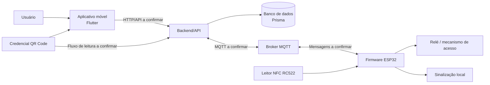

# Diagrama de Componentes

**Projeto:** 4DSM-ABP-2026-2  
**Revisão:** 11/11/2026

> O desenho usa apenas componentes identificados na análise anterior. Protocolos, direções e contratos precisam ser confirmados nos fontes.

## 1. Diagrama

## 2. Componentes

| Componente | Responsabilidade identificada | Tecnologia |
|---|---|---|
| Aplicativo móvel | Interface e fluxos de credencial | Flutter |
| Backend/API | Regras de negócio, autenticação, autorização e serviços | Confirmar stack |
| Persistência | Armazenamento das entidades | Prisma como ORM; banco a confirmar |
| Broker | Transporte de mensagens dos terminais | MQTT |
| Terminal | Lógica embarcada e acionamento físico | ESP32 |
| Leitor NFC | Leitura de cartões/tags | RC522 |
| Atuador | Acionamento do acesso | Relé |
| QR Code | Credencial visual | Formato/biblioteca a confirmar |

## 3. Interfaces a documentar

- URL base e endpoints HTTP consumidos pelo aplicativo.
- Autenticação das requisições.
- Tópicos MQTT publicados e assinados.
- Formato dos payloads e identificadores dos dispositivos.
- QoS, retenção, autenticação e ACL do broker.
- Comandos aceitos e eventos enviados pelo firmware.
- Comportamento em timeout, reconexão e modo offline.

## 4. Limites

Este desenho não representa topologia física, portas, endereços, redes, balanceadores ou serviços de nuvem. Esses elementos pertencem ao documento de infraestrutura e dependem da inspeção dos arquivos de deploy.
