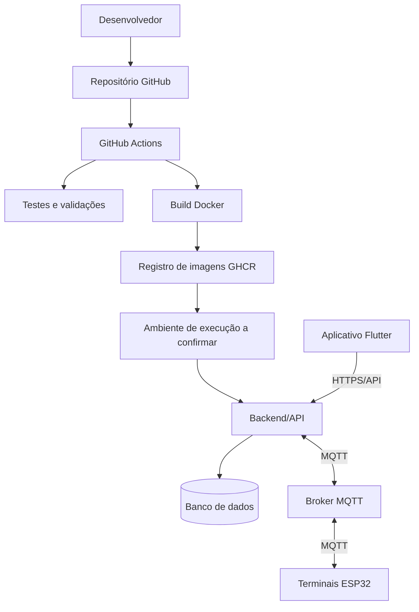

# Infraestrutura e Implantação

**Projeto:** 4DSM-ABP-2026-2  
**Status:** Rascunho — topologia e ambientes pendentes de confirmação  
**Revisão:** 11/11/2026

> A análise anterior identificou Docker, GitHub Actions, publicação de imagens no GHCR e integração/tentativa de deploy no Render. O estado atual precisa ser confirmado nos arquivos e execuções recentes. Nunca registrar valores de secrets neste documento.

## 1. Objetivo

Documentar ambientes, serviços, dependências, build/deploy, configuração operacional, observabilidade e recuperação.

## 2. Elementos identificados

| Elemento | Evidência anterior | Validar |
|---|---|---|
| Docker | Contêineres/arquivos Docker | Dockerfiles e Compose |
| GitHub Actions | Workflows CI/CD | Jobs e gatilhos atuais |
| GHCR | Publicação de imagens configurada | Nomes, tags e permissões |
| Render | Integração ou tentativa de deploy | Serviço, ambiente e status |
| MQTT | Comunicação com terminais | Provedor, endpoint, TLS e ACL |
| Banco | Persistência via Prisma | Tecnologia, hosts e backup |

## 3. Visão conceitual

O desenho é conceitual; não confirma que todos os componentes estejam implantados no mesmo ambiente ou que o deploy automatizado esteja operacional.

## 4. Ambientes

| Ambiente | Finalidade | URL/host | Banco | Broker | Status |
|---|---|---|---|---|---|
| Desenvolvimento | Desenvolvimento local | A confirmar | A confirmar | A confirmar | Pendente |
| Testes/CI | Testes automatizados | A confirmar | A confirmar | A confirmar | Pendente |
| Homologação | Validação pré-produção | A confirmar | A confirmar | A confirmar | Pendente |
| Produção | Operação real | A confirmar | A confirmar | A confirmar | Pendente |

## 5. Pipeline CI/CD

Documentar gatilhos, instalação de dependências, lint, testes, build, publicação de artefatos/imagens, deploy, verificações pós-deploy e rollback.

**Histórico a validar:** análise anterior relatou falha na publicação GHCR por permissão `write_package`, com deploy no Render não executado em consequência. Confirmar se o problema permanece ou foi corrigido consultando a execução mais recente.

## 6. Configuração e secrets

Registrar apenas nomes de variáveis e finalidades, nunca valores de tokens, senhas, chaves privadas ou strings de conexão. Para cada variável, informar componente consumidor, obrigatoriedade e ambiente.

## 7. Rede e segurança

Verificar domínios e portas expostas, HTTPS/TLS da API, TLS e autenticação MQTT, ACL por dispositivo/tópico, firewall, armazenamento de secrets e atualização do firmware.

A análise anterior apontou uso de `setInsecure()` como fallback TLS no firmware. Confirmar no código atual e tratar como risco até que haja validação adequada de certificado.

## 8. Backup e recuperação

Registrar tecnologia/versão do banco, frequência e retenção dos backups, criptografia, responsáveis, procedimento de restauração e RPO/RTO definidos pela equipe. Não há evidência suficiente nesta sessão para afirmar uma política existente.

## 9. Monitoramento e operação

Documentar ferramentas e procedimentos efetivamente usados para logs da API, broker e terminais; métricas de disponibilidade; falhas de autenticação/autorização; eventos negados; alertas; atualização e reinicialização de dispositivos.

## 10. Checklist

- [ ] Conferir Dockerfiles e Compose.
- [ ] Listar workflows atuais.
- [ ] Confirmar permissões GHCR.
- [ ] Confirmar destino e status do deploy.
- [ ] Identificar ambientes e URLs.
- [ ] Identificar banco, broker e backups.
- [ ] Documentar variáveis sem expor valores.
- [ ] Revisar TLS, ACLs, firewall e secrets.
- [ ] Definir rollback e recuperação.
- [ ] Validar o diagrama com a equipe de infraestrutura.
