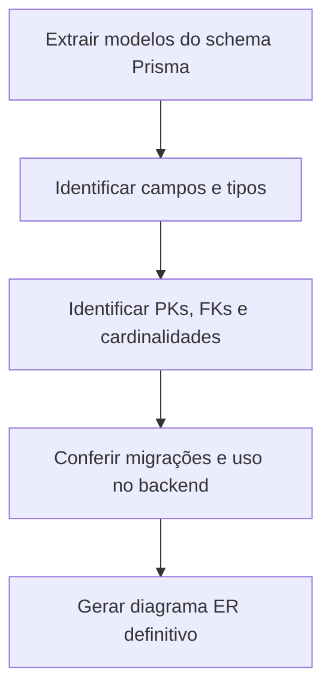

# Modelo de Dados

**Projeto:** 4DSM-ABP-2026-2  
**Status:** Pendente de extração e validação do schema  
**Revisão:** 11/11/2026

> A análise anterior registrou dez modelos Prisma, mas o `schema.prisma` não está disponível para conferência nesta sessão. Para evitar inventar entidades, campos ou cardinalidades, este documento define a estrutura a completar.

## 1. Objetivo

Descrever entidades persistidas, atributos, chaves, relacionamentos, restrições e índices relevantes ao sistema.

## 2. Fonte de verdade

Usar o schema Prisma versionado no repositório como fonte primária. Conferir também migrações e consultas do backend.

**Arquivo a localizar:** `prisma/schema.prisma` ou caminho equivalente.

## 3. Inventário preliminar

A análise anterior registrou dez modelos. Os nomes e detalhes precisam ser extraídos do schema atual.

| Nº | Modelo | Finalidade | Situação |
|---:|---|---|---|
| 1 | A confirmar | Extrair do schema | Pendente |
| 2 | A confirmar | Extrair do schema | Pendente |
| 3 | A confirmar | Extrair do schema | Pendente |
| 4 | A confirmar | Extrair do schema | Pendente |
| 5 | A confirmar | Extrair do schema | Pendente |
| 6 | A confirmar | Extrair do schema | Pendente |
| 7 | A confirmar | Extrair do schema | Pendente |
| 8 | A confirmar | Extrair do schema | Pendente |
| 9 | A confirmar | Extrair do schema | Pendente |
| 10 | A confirmar | Extrair do schema | Pendente |

## 4. Processo para gerar o DER

## 5. Detalhamento por entidade

Para cada modelo, registrar nome e finalidade, campos e tipos, nulabilidade, defaults, chave primária, chaves estrangeiras, cardinalidades, índices, restrições únicas, regras de exclusão/atualização, dados sensíveis e serviços que leem ou alteram a entidade.

## 6. Integridade e transações

Conferir especialmente operações de autorização e registro de acesso. A análise anterior apontou risco de não atomicidade entre decremento de utilização e persistência do evento. Verificar se essas operações estão em transação no código atual e documentar o comportamento esperado em caso de falha.

## 7. Migrações e evolução

Registrar ferramenta e comandos de migração, estratégia por ambiente, backups antes de alterações, procedimento de rollback/correção e compatibilidade entre versões do backend e schema.

## 8. Checklist

- [ ] Obter o schema Prisma atual.
- [ ] Listar os modelos reais e conferir a contagem.
- [ ] Documentar campos e relacionamentos.
- [ ] Conferir migrações e operações transacionais.
- [ ] Gerar diagrama ER.
- [ ] Revisar com a equipe responsável pelo backend.
