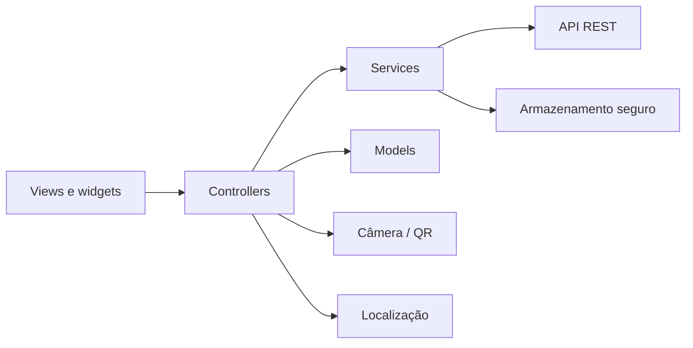
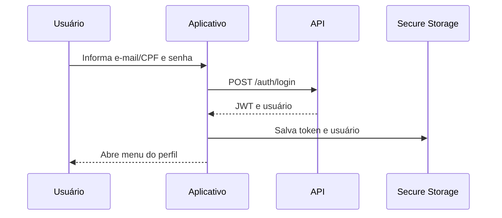
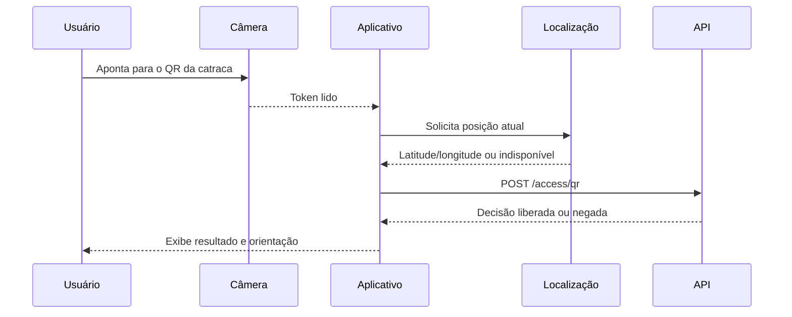

# Documentação técnica do aplicativo

| Campo | Valor |
|---|---|
| Projeto | Passe — Controle de acesso por QR Code e NFC |
| Componente | Aplicativo Flutter |
| Revisão | 11/11/2026 |
| Versão declarada | `1.0.0+1` |
| SDK Dart | `^3.13.5` |
| Pacote Flutter | `public` |
| Base da documentação | Código atual da pasta `frontend/` |

## 1. Objetivo

O aplicativo Passe fornece as interfaces utilizadas por administradores, controladores de acesso, moradores e visitantes. Ele consome a API REST do backend para autenticação, sessão, autorizações, QR Code, histórico, usuários, tags NFC, locais, terminais e painel.

O aplicativo não toma a decisão final de acesso. No fluxo QR, ele lê o token exibido pela catraca, obtém a localização do celular e envia os dados à API. O backend devolve a decisão de liberar ou negar.

## 2. Tecnologias

| Tecnologia ou pacote | Uso atual |
|---|---|
| Flutter | Interface multiplataforma |
| Dart | Linguagem do aplicativo |
| Material 3 | Componentes e temas visuais |
| `http` | Comunicação com a API REST |
| `flutter_secure_storage` | Armazenamento do JWT e do usuário da sessão |
| `mobile_scanner` | Leitura do QR Code pela câmera |
| `geolocator` | Obtenção da localização no acesso por QR |
| `intl` | Formatação de datas e textos |
| `flutter_localizations` | Localização dos componentes em português do Brasil |
| `flutter_test` | Testes unitários e de widgets |
| `flutter_lints` | Regras recomendadas de análise estática |

O `pubspec.yaml` também declara `provider`, `go_router`, `connectivity_plus`, `nfc_manager` e `google_fonts`, mas não há importações desses pacotes no código atual de `lib/`. O aplicativo usa `Navigator`/`MaterialPageRoute`, controllers próprios, fonte Inter local e tratamento de conexão pelo cliente HTTP.

## 3. Arquitetura do aplicativo



O código segue uma separação simples por responsabilidades:

| Camada | Responsabilidade |
|---|---|
| Views | Renderizam telas, formulários, listas, estados e navegação |
| Widgets | Componentes visuais reutilizáveis |
| Controllers | Orquestram ações da tela e chamadas aos serviços |
| Services | Sessão, autenticação, HTTP e localização |
| Models | Convertem respostas JSON em objetos Dart |
| Core | Tema, cores, rotas centrais, constantes e formatação |

Os serviços principais possuem instâncias compartilhadas, mas aceitam dependências opcionais nos construtores. Isso permite substituir API, sessão, relógio e localização nos testes.

## 4. Estrutura de diretórios

| Caminho | Conteúdo |
|---|---|
| `lib/main.dart` | Inicialização, restauração de sessão e `MaterialApp` |
| `lib/core/constants/` | URL da API e funções de formatação |
| `lib/core/routes/` | Escolha do menu inicial por perfil |
| `lib/core/theme/` | Temas claro/escuro, cores e estilos |
| `lib/models/` | Usuário, autorização, evento, local, terminal e decisão |
| `lib/services/` | Cliente HTTP, autenticação, sessão e localização |
| `lib/controllers/` | Lógica de cada área do aplicativo |
| `lib/views/user/` | Login, QR, autorizações, perfil, tag e ajuda |
| `lib/views/teams/` | Painel, usuários, visitantes, locais, tags, terminais e autorizações |
| `lib/views/shared/` | Telas utilizadas por mais de um perfil |
| `lib/views/widgets/` | Componentes visuais reutilizáveis |
| `test/` | Testes de serviços, controllers, modelos, widgets e integração |

## 5. Inicialização

O ponto de entrada executa a seguinte sequência:

1. Inicializa os bindings do Flutter.
2. Tenta restaurar a sessão pelo `AuthService`.
3. Verifica localmente a expiração do JWT armazenado.
4. Quando há sessão válida local, consulta `GET /auth/me` por até 3 segundos.
5. Atualiza o usuário caso perfil ou dados tenham mudado.
6. Abre o login quando não há sessão.
7. Abre o menu correspondente quando a sessão foi restaurada.

Se a API não responder durante a restauração, o aplicativo mantém a cópia local ainda não expirada para conseguir abrir. Se a API responder `401`, a sessão é apagada e o usuário retorna ao login.

## 6. Aplicação e tema

O `MaterialApp` está configurado com:

- Título `Passe`.
- Banner de debug oculto.
- Tema Material 3 claro e escuro.
- Seleção do tema pelo modo do sistema.
- Localidade `pt_BR`.
- Fonte Inter armazenada nos assets.
- Estilo da barra do sistema ajustado ao brilho do tema.

O projeto define tamanhos e cores consistentes:

| Item | Configuração |
|---|---|
| Texto base | 16 a 18 sp |
| Botões principais | Altura mínima de 56 dp |
| Cantos | Raio base de 14 dp |
| Marca | Amarelo |
| Sucesso | Verde |
| Atenção | Laranja |
| Erro/negação | Vermelho |

Comentários no tema registram preocupação com contraste WCAG AA. Há testes de menu com escala de fonte ampliada.

## 7. Navegação

O aplicativo usa `Navigator.of(context).push` com `MaterialPageRoute`. O pacote `go_router` está declarado, mas não é usado no código atual.

Após o login, `menuDoPerfil` escolhe a entrada:

| Perfil da API | Enum no app | Tela inicial |
|---|---|---|
| `ADMIN` | `Perfil.admin` | `AdminMenuView` |
| `CONTROLADOR_ACESSO` | `Perfil.controladorAcesso` | `AccessControllerMenuView` |
| `CONDOMINO` | `Perfil.morador` | `InicioView` com menu do morador |
| `VISITANTE` | `Perfil.visitante` | `InicioView` com menu do visitante |

As telas de menu encaminham as opções pelo título. Opções sem tela exibem uma mensagem de “tela em construção”.

## 8. Perfis e funcionalidades

### 8.1 Administrador

Funcionalidades com tela atual:

- Painel.
- Autorizações.
- Histórico de acessos.
- Acessos negados.
- Usuários.
- Visitantes.
- Tags NFC.
- Terminais.
- Locais.
- Relatórios.

Opções apresentadas sem tela funcional completa:

- Comunicados.
- Configurações.

Somente o administrador pode criar locais, cadastrar terminais e trocar chaves. Essas permissões também são aplicadas pelo backend.

### 8.2 Controlador de acesso

Funcionalidades com tela atual:

- Painel.
- Autorizações.
- Histórico de acessos.
- Acessos negados.
- Usuários.
- Visitantes.
- Tags NFC.
- Consulta de terminais.

O controlador pode administrar somente usuários `CONDOMINO` e `VISITANTE`. A interface limita os perfis disponíveis, e a API repete a validação.

### 8.3 Morador

Funcionalidades com tela atual:

- Início com resumo de autorizações.
- Scanner de QR Code.
- Minhas autorizações e detalhes.
- Histórico pessoal.
- Acessos negados.
- Minha tag NFC, com possibilidade de bloqueio.
- Perfil.
- Ajuda.

Opção apresentada sem fluxo funcional completo:

- Meus visitantes.

### 8.4 Visitante

Funcionalidades com tela atual:

- Início com resumo de autorizações.
- Scanner de QR Code.
- Minhas autorizações e detalhes.
- Histórico pessoal.
- Acessos negados.
- Consulta da própria tag NFC.
- Perfil.
- Ajuda.

O visitante não recebe a opção “Meus visitantes” e não pode bloquear tags pela interface atual.

## 9. Telas principais

### 9.1 Autenticação e conta

| Tela | Classe | Situação atual |
|---|---|---|
| Login | `LoginView` | Integrada a `POST /auth/login` |
| Cadastro | `RegisterView` | Formulário existe, mas cadastro público não está disponível |
| Perfil | `PerfilView` | Integrada a `GET /auth/me` |
| Minha tag NFC | `MinhaTagView` | Consulta tags; morador pode bloquear a própria tag |
| Ajuda | `AjudaView` | Conteúdo local, sem chamada à API |

O login aceita e-mail ou CPF. Login por NFC e recuperação de senha não possuem endpoint próprio no backend atual. A troca de senha é realizada pela equipe na edição do usuário.

### 9.2 Acesso por QR

| Tela | Classe | Responsabilidade |
|---|---|---|
| Scanner | `ScannerQrView` | Abre a câmera e lê o token |
| Validação | `ValidandoAcessoView` | Obtém posição e chama a API |
| Liberado | `AcessoLiberadoView` | Exibe local, horário e usos restantes |
| Negado | `AcessoNegadoView` | Exibe motivo e orientação |

### 9.3 Autorizações pessoais

| Tela | Classe | Responsabilidade |
|---|---|---|
| Início | `InicioView` | Resume autorizações e oferece atalhos |
| Lista | `MinhasAutorizacoesView` | Agrupa vigentes e encerradas |
| Detalhe | `DetalheAutorizacaoView` | Mostra local, período, horário e usos |

### 9.4 Equipe

| Tela | Classe | Responsabilidade |
|---|---|---|
| Painel | `PainelView` | Totais do dia e recusas recentes |
| Usuários | `UsuariosView` | Busca, filtro, criação e edição |
| Formulário de usuário | `UsuarioFormView` | Cadastro, perfil, senha e situação |
| Visitantes | `VisitantesView` | Cadastro de visitante e autorização em dois passos |
| Tags | `TagsView` | Vínculo, bloqueio, ativação e remoção |
| Locais | `LocaisView` | Árvore de edifícios, portarias, portas e catracas |
| Formulário de catraca | `CatracaFormView` | Coordenadas e raio do ponto de acesso |
| Autorizações | `AutorizacoesView` | Lista, filtros, edição e cancelamento |
| Formulário de autorização | `AutorizacaoFormView` | Pessoa, catraca, período, horário e usos |
| Terminais | `TerminaisView` | Estado, cadastro e rotação de chave |
| Relatórios | `RelatoriosView` | Totais e agrupamentos sobre os eventos recentes |
| Histórico | `HistoricoView` | Eventos, filtros e paginação |

O relatório utiliza os totais completos devolvidos pela API, mas os agrupamentos detalhados por local e motivo são calculados no app sobre, no máximo, os 200 eventos mais recentes do período.

## 10. Fluxo de autenticação



O `AuthService` executa o login e inicia a sessão. O `SessaoService` armazena:

| Chave | Conteúdo |
|---|---|
| `passe.token` | JWT |
| `passe.usuario` | Usuário serializado em JSON |

O aplicativo lê o campo `exp` do JWT para verificar a expiração local. Essa leitura não valida a assinatura; a confirmação de validade e do perfil atual é realizada por `GET /auth/me` quando a API está disponível.

O logout é local: remove token e usuário do armazenamento. O backend não possui endpoint de revogação/logout, portanto o JWT continua válido no servidor até expirar ou até o cadastro/perfil ser alterado.

## 11. Cliente HTTP

O `ApiClient` centraliza `GET`, `POST`, `PATCH` e `DELETE`.

Configurações:

| Item | Valor |
|---|---|
| URL padrão | `http://localhost:3000` |
| Timeout | 10 segundos |
| Aceite | `application/json` |
| Corpo | JSON UTF-8 |
| Autenticação | `Authorization: Bearer <token>` quando existe sessão |

O cliente:

- Monta parâmetros de consulta com `Uri.replace`.
- Decodifica respostas como UTF-8.
- Aceita qualquer status de 200 a 299 como sucesso.
- Trata `204` como resposta sem conteúdo.
- Converte o formato de erro do backend em `ApiException`.
- Converte timeout e falha de rede em mensagem única de falta de conexão.

### 11.1 `ApiException`

| Campo | Finalidade |
|---|---|
| `mensagem` | Texto pronto para a interface |
| `status` | Código HTTP ou `null` quando não houve resposta |
| `codigo` | Código funcional, como `SEM_PERMISSAO` |
| `campos` | Mensagens de validação associadas aos campos |
| `semConexao` | Indica falha antes de obter resposta HTTP |
| `naoAutenticado` | Indica status 401 |
| `cadastroDesativado` | Identifica o código específico da API |

## 12. Configuração da API

A URL é definida em tempo de compilação com `--dart-define`:

```powershell
flutter run -d chrome --dart-define=API_URL=http://localhost:3000
```

Sem o parâmetro, o aplicativo usa `http://localhost:3000`.

Ambientes comuns:

| Execução | URL típica |
|---|---|
| Chrome no mesmo computador | `http://localhost:3000` |
| Emulador Android | `http://10.0.2.2:3000` |
| Celular na rede local | `http://<ip-do-computador>:3000` |
| Produção | URL HTTPS da API implantada |

Não existe arquivo `.env` nem tela para trocar a URL em tempo de execução.

## 13. Fluxo de acesso por QR Code



### 13.1 Scanner

O `ScannerQrView`:

- Usa `MobileScannerController`.
- Ignora novas leituras enquanto uma validação está em andamento.
- Rejeita localmente textos menores que 10 ou maiores que 2.000 caracteres.
- Para a câmera antes de abrir a validação.
- Permite ligar/desligar a lanterna.
- Exibe uma tela específica quando a permissão da câmera foi negada.

A validação local de tamanho não confirma assinatura ou origem; a validação real do token ocorre no backend.

### 13.2 Localização

O `LocalizacaoService`:

1. Verifica se o serviço de localização está ativo.
2. Confere a permissão atual.
3. Solicita permissão quando necessário.
4. Obtém uma posição de alta precisão.
5. Limita a espera a 8 segundos.
6. Retorna `null` em recusa, GPS desligado, timeout ou erro.

Sem posição, o aplicativo envia somente o token. A API responde uma decisão negada com `LOCALIZACAO_AUSENTE`.

### 13.3 Decisão

Uma decisão negada normalmente também chega com status HTTP 200. A tela verifica o campo `liberado`, não apenas o status HTTP.

O modelo `DecisaoAcesso` representa:

- Liberação ou negação.
- Código e textos do motivo.
- Catraca e caminho do local.
- Usos restantes.
- Distância calculada.
- Identificador e horário do evento.

## 14. Modelos principais

| Modelo | Origem | Uso |
|---|---|---|
| `Usuario` | Login e `/auth/me` | Identidade e perfil da sessão |
| `UsuarioCadastro` | `/users` e `/auth/me` | Cadastro completo e tags |
| `TagNfc` | Usuários e perfil | UID e situação da tag |
| `Autorizacao` | `/me/authorizations` | Autorização pessoal |
| `AutorizacaoEquipe` | `/authorizations` | Autorização com pessoa associada |
| `Edificio`, `Portaria`, `Porta`, `Catraca` | `/locations` | Hierarquia física |
| `Terminal` | `/terminals` | Estado, sinal e chave recém-gerada |
| `EventoAcesso` | Histórico | Tentativa liberada ou negada |
| `PaginaEventos` | Histórico | Itens, totais e paginação |
| `Painel` | `/dashboard` | Indicadores do dia |
| `DecisaoAcesso` | `/access/qr` | Resultado da validação do QR |

Os factories `fromJson` falham com `FormatException` ou erro de tipo quando a API devolve um contrato incompatível. Não existe camada de compatibilidade entre versões do contrato.

## 15. Controllers e endpoints

| Controller/serviço | Endpoints utilizados |
|---|---|
| `AuthService` | `POST /auth/login`, `GET /auth/me` |
| `AcessoQrController` | `POST /access/qr` |
| `MinhasAutorizacoesController` | `GET /me/authorizations` |
| `PerfilController` | `GET /auth/me`, `PATCH /me/tags/:tagId` |
| `HistoricoController` | `GET /access-events` ou `GET /me/access-events`, `GET /locations` |
| `PainelController` | `GET /dashboard`, `GET /locations` |
| `UsuariosController` | `GET/POST/PATCH /users` e rotas de tags |
| `LocaisController` | `GET /locations` e rotas de criação/edição de locais |
| `AutorizacoesController` | Rotas de `/authorizations`, além de `/users` e `/locations` |
| `TerminaisController` | `/terminals` e `/locations` |

Várias telas carregam fontes independentes com `Future.wait`, reduzindo o tempo total de espera, como painel, terminais e opções de autorização.

## 16. Usuários e tags pela equipe

O `UsuariosController` permite:

- Pesquisar por nome, e-mail ou CPF.
- Filtrar por perfil.
- Criar usuário.
- Atualizar dados, senha, perfil e situação.
- Vincular tag por UID.
- Ativar ou bloquear tag.
- Remover tag.

Perfis exibidos no formulário:

- Administrador: todos os quatro perfis.
- Controlador: somente morador e visitante.

O aplicativo evita apresentar ações incompatíveis, mas a API continua sendo a fonte definitiva de autorização.

O pacote `nfc_manager` está declarado, porém o app atual não lê fisicamente uma tag NFC pelo celular. O vínculo da equipe recebe o UID digitado no formulário. A leitura de acesso NFC ocorre no terminal ESP32.

## 17. Autorizações

### 17.1 Usuário

As autorizações pessoais são carregadas por `GET /me/authorizations` e agrupadas em:

- Vigentes: `ATIVA` e `AGENDADA`.
- Encerradas: `ESGOTADA`, `EXPIRADA` e `CANCELADA`.

O detalhe mostra local, datas, horários, quantidade de usos e situação. A tela também pode encaminhar o usuário ao scanner.

### 17.2 Equipe

A equipe pode:

- Filtrar por pessoa, catraca, situação e período.
- Criar autorização.
- Atualizar local, datas, horários e usos.
- Cancelar autorização.

Os seletores de pessoa e catraca são carregados em paralelo por `/users` e `/locations`.

## 18. Histórico e relatórios

O `HistoricoController` escolhe a rota conforme o contexto:

| Contexto | Rota |
|---|---|
| Administrador/controlador | `/access-events` |
| Morador/visitante | `/me/access-events` |

Filtros disponíveis:

- Tudo, hoje, 7 dias ou 30 dias.
- Liberados ou negados.
- QR ou NFC.
- Catraca, somente para a equipe.
- Paginação de 50 itens por padrão.

As datas são convertidas para UTC antes do envio. O fim do período utiliza 23:59:59 para não excluir eventos do último dia.

Os relatórios exibem:

- Totais liberados e negados.
- Acessos agrupados por local.
- Recusas agrupadas por motivo.

## 19. Terminais

A tela de terminais cruza `GET /terminals` com `GET /locations` para apresentar o nome da catraca.

| Perfil | Ações |
|---|---|
| Administrador | Consulta, cadastro e rotação de chave |
| Controlador | Consulta |

A chave aparece somente na resposta de cadastro ou rotação. A interface abre um diálogo para que seja copiada e gravada no terminal. Depois que o diálogo é fechado, a listagem comum não possui a chave.

## 20. Estados de interface

O projeto possui widgets reutilizáveis para estados comuns:

| Widget | Uso |
|---|---|
| `CarregaDados` | Mixin para carregamento, sucesso e falha |
| `TelaCarregando` | Operações que navegam após uma tarefa assíncrona |
| `EstadoErro` | Erro com ação e retorno |
| `CartaoErro` | Erro incorporado ao conteúdo |
| `EstadoVazio` | Listas sem dados |
| `TelaBase` | Estrutura comum com título, atualização e conteúdo |
| `BotaoAcao` | Ação principal padronizada |
| `CampoTexto` e `CampoSelecao` | Entradas e seletores consistentes |
| `Selo` e `SeloSituacao` | Situação visual de entidades |

Erros de API utilizam a mensagem fornecida pelo backend. Erros de validação podem ser associados aos campos do formulário por meio de `ApiException.campos`.

## 21. Permissões de plataforma

### 21.1 Android

O manifesto principal declara:

- `INTERNET` para chamar a API.
- `CAMERA` para ler QR Code.
- `ACCESS_FINE_LOCATION` para posição precisa.
- `ACCESS_COARSE_LOCATION` como alternativa de localização.

O manifesto de debug permite tráfego HTTP sem TLS para desenvolvimento. A configuração de release não libera tráfego claro, portanto a API de produção deve usar HTTPS.

### 21.2 iOS

O `Info.plist` contém textos de justificativa para:

- Uso da câmera.
- Localização enquanto o aplicativo está em uso.

Não há justificativa NFC no `Info.plist`, coerente com o fato de o app atual não iniciar leitura NFC pelo celular.

## 22. Plataformas

O repositório contém projetos gerados para:

- Android.
- iOS.
- Web.
- Windows.
- Linux.
- macOS.

A presença das pastas não significa que todos os fluxos foram validados em todas as plataformas. Câmera, localização e armazenamento seguro dependem do suporte e da configuração de cada alvo. O fluxo documentado pelo projeto prioriza Chrome para desenvolvimento, emulador Android e celular Android na rede local.

## 23. Assets

O aplicativo declara:

- Imagens em `assets/images/`.
- Ícones em `assets/icons/`.
- Fonte Inter local nos pesos 400, 500, 600, 700 e 800.

A logo principal está em `assets/images/logo_gorila.png`. A fonte local evita depender de download durante a execução.

## 24. Execução local

Pré-requisitos:

- Flutter compatível com o SDK Dart declarado.
- API em execução.
- Chrome, emulador ou dispositivo configurado.

Comandos:

```powershell
Set-Location .\frontend
flutter pub get
flutter devices
flutter run -d chrome --dart-define=API_URL=http://localhost:3000
```

Emulador Android:

```powershell
flutter run -d <id-do-emulador> --dart-define=API_URL=http://10.0.2.2:3000
```

Celular na mesma rede:

```powershell
flutter run -d <id-do-celular> --dart-define=API_URL=http://<ip-do-computador>:3000
```

## 25. Execução pelo Docker

O `frontend/Dockerfile` utiliza uma imagem Flutter estável, copia os arquivos de dependência e executa `flutter pub get`.

O Compose inicia o frontend como servidor web:

```powershell
docker compose -f docker-compose.dev.yml up --build frontend
```

Por padrão, o serviço expõe a aplicação web na porta 8080 e injeta a URL da API com `--dart-define`.

Esse Dockerfile é voltado ao desenvolvimento. Ele não gera um artefato web estático final nem uma imagem de hospedagem de produção.

## 26. Builds

Exemplos de build com URL de produção substituível:

```powershell
Set-Location .\frontend
flutter build apk --dart-define=API_URL=https://<host-da-api>
flutter build web --dart-define=API_URL=https://<host-da-api>
```

A URL é incorporada no build. Alterá-la depois exige novo build, salvo se a arquitetura for modificada para configuração em tempo de execução.

## 27. Testes

O projeto possui testes para:

- Models e regras derivadas.
- Cliente HTTP e conversão de erros.
- Sessão e expiração do JWT.
- Autenticação e restauração da sessão.
- Controllers de QR e autorizações.
- Login e menus dos quatro perfis.
- Scanner, decisões de acesso e textos de negação.
- Autorizações e telas de gestão.
- Componentes compartilhados e estados de carregamento.
- Integração opcional contra uma API real.

Comandos:

```powershell
Set-Location .\frontend
flutter analyze
flutter test
```

Teste contra a API real:

```powershell
flutter test test\integracao --dart-define=API_REAL=http://localhost:3000
```

Sem `API_REAL`, a suíte de integração real é ignorada. O CI atual executa `flutter pub get`, `flutter analyze` e `flutter test`; portanto valida os testes com API falsa, mas não inicia a API real para essa suíte do frontend.

## 28. API falsa nos testes

`test/support/api_falsa.dart` implementa contratos compatíveis com o backend para testes determinísticos. Ela fornece:

- Perfis e sessão simulados.
- JWT com campo de expiração.
- Respostas e códigos de erro.
- Motivos de acesso negado.
- Dados necessários aos testes de tela.

As credenciais presentes nessa infraestrutura são exclusivamente de demonstração e não devem ser usadas em produção.

## 29. Análise estática e CI

O `analysis_options.yaml` inclui `flutter_lints`. Diretórios gerados das plataformas e `build/` ficam fora da análise do Dart.

O job do frontend no GitHub Actions:

1. Obtém o código.
2. Instala Flutter estável com cache.
3. Executa `flutter pub get`.
4. Executa `flutter analyze`.
5. Executa `flutter test`.

O job atual não gera APK, IPA ou build web como etapa obrigatória do CI principal.

## 30. Segurança e privacidade

- JWT e usuário são armazenados com `flutter_secure_storage`.
- O token é enviado apenas no cabeçalho `Authorization`.
- Senhas não são persistidas pelo aplicativo.
- A posição é solicitada no momento da validação do QR.
- O aplicativo envia a posição ao backend somente no fluxo de acesso por QR.
- O scanner envia o texto do QR, não uma imagem da câmera.
- O logout remove os dados locais da sessão.
- Produção deve utilizar API HTTPS.
- Mensagens de erro de rede não expõem detalhes internos.
- A assinatura do JWT não é validada localmente; a API continua sendo a fonte de confiança.

## 31. Limitações atuais

- Cadastro público existe visualmente, mas a submissão orienta procurar a portaria.
- Login por NFC não possui implementação funcional.
- Recuperação de senha não possui endpoint próprio.
- “Meus visitantes” do morador ainda não abre uma tela.
- Comunicados e configurações do administrador ainda exibem “tela em construção”.
- Leitura NFC pelo celular não está implementada, apesar da dependência declarada.
- A URL da API é definida em build e não pode ser alterada pelo usuário.
- Não há cache persistente dos dados de negócio além da sessão.
- O relatório detalhado considera no máximo os 200 eventos mais recentes.
- A navegação depende de textos dos itens do menu, sem rotas tipadas.
- Alguns pacotes declarados no `pubspec.yaml` ainda não são utilizados.
- A suíte com API real não faz parte da execução padrão do CI do frontend.

## 32. Arquivos relacionados

- `frontend/pubspec.yaml`: versão, dependências e assets.
- `frontend/lib/main.dart`: inicialização do aplicativo.
- `frontend/lib/core/routes/rotas.dart`: menu inicial por perfil.
- `frontend/lib/core/constants/api_constants.dart`: URL e timeout da API.
- `frontend/lib/core/theme/`: temas e paleta.
- `frontend/lib/services/api_client.dart`: comunicação HTTP.
- `frontend/lib/services/auth_service.dart`: autenticação e restauração.
- `frontend/lib/services/sessao_service.dart`: armazenamento da sessão.
- `frontend/lib/services/localizacao_service.dart`: GPS e permissões.
- `frontend/lib/controllers/`: integração entre telas e API.
- `frontend/lib/views/`: telas e componentes.
- `frontend/test/`: testes automatizados.
- `docs/documentacao-tecnica/api.md`: contrato consumido pelo aplicativo.
- `docs/documentacao-tecnica/backend.md`: implementação dos serviços da API.

