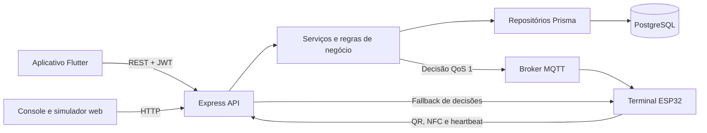

# Documentação técnica do backend

| Campo | Valor |
|---|---|
| Projeto | Passe — Controle de acesso por QR Code e NFC |
| Repositório | `4DSM-ABP-2026-2` |
| Componente | Backend/API |
| Revisão | 11/11/2026 |
| Base da documentação | Código-fonte atual da pasta `backend/` |

## 1. Objetivo

O backend centraliza as regras de negócio do sistema Passe. Ele autentica usuários e terminais, administra usuários, tags NFC, locais, terminais e autorizações, valida tentativas de acesso por QR Code ou NFC e registra o resultado de cada tentativa.

A API também envia decisões de abertura ou negação aos terminais por MQTT. Quando o broker não está disponível, o terminal pode consultar as decisões por HTTP.

## 2. Tecnologias

| Tecnologia | Utilização |
|---|---|
| Node.js 22 ou superior | Ambiente de execução definido pelo projeto; a imagem Docker usa Node.js 24 |
| TypeScript | Linguagem do backend |
| Express 5 | Servidor HTTP e definição das rotas REST |
| Prisma 7 | Acesso ao banco de dados e migrations |
| PostgreSQL 16 | Banco de dados relacional no ambiente Docker |
| Zod | Validação de variáveis de ambiente, parâmetros, consultas e corpos das requisições |
| JSON Web Token (JWT) | Autenticação dos usuários da aplicação |
| bcrypt | Hash e verificação das senhas dos usuários |
| MQTT/Mosquitto | Envio das decisões de acesso aos terminais |
| Helmet e CORS | Cabeçalhos HTTP de segurança e controle de origens |
| Vitest e Supertest | Testes unitários e testes da API |
| Docker | Execução padronizada da API e de suas dependências |

## 3. Arquitetura

O backend utiliza uma organização modular. Os controladores recebem as requisições, validam os dados e chamam os serviços. Os serviços aplicam as regras de negócio, enquanto os repositórios isolam o acesso ao PostgreSQL por meio do Prisma.



O arquivo `src/container.ts` realiza a injeção de dependências. Na execução normal são usados repositórios Prisma; nos testes são utilizados repositórios em memória. Essa separação permite testar as regras sem depender de um banco de dados real.

### 3.1 Estrutura principal

| Caminho | Responsabilidade |
|---|---|
| `src/server.ts` | Carrega o ambiente, conecta PostgreSQL e MQTT, cria o container e inicia o servidor |
| `src/app.ts` | Configura middlewares, rotas e tratamento global de erros |
| `src/container.ts` | Liga repositórios, serviços, relógio e notificadores |
| `src/config/` | Leitura e validação das variáveis de ambiente |
| `src/database/` | Cliente Prisma e implementação dos repositórios |
| `src/modules/` | Módulos funcionais da aplicação |
| `src/shared/` | Segurança, erros, validações HTTP, relógio e geolocalização |
| `prisma/schema.prisma` | Modelo relacional do banco de dados |
| `prisma/migrations/` | Histórico versionado das alterações do banco |
| `prisma/seed.ts` | Dados de demonstração para desenvolvimento |
| `public/console/` | Console web para testar a API sem o aplicativo Flutter |
| `public/simulador/` | Simulador web do terminal de acesso |
| `tests/api/` | Testes dos endpoints HTTP |
| `tests/unit/` | Testes isolados das regras e componentes |

### 3.2 Módulos

| Módulo | Responsabilidade |
|---|---|
| `auth` | Login por e-mail ou CPF e geração do JWT |
| `users` | Cadastro de usuários, perfis, ativação e tags NFC |
| `locations` | Edifícios, portarias, portas e pontos de acesso |
| `terminals` | Cadastro de terminais, troca de chave, QR e heartbeat |
| `authorizations` | Criação, atualização, consulta e cancelamento de autorizações |
| `access` | Decisão central de liberar ou negar acessos por QR ou NFC |
| `events` | Consulta do histórico de tentativas de acesso |
| `simulador` | Página web que simula o terminal físico |

## 4. Inicialização da aplicação

Durante a inicialização, o backend executa a seguinte sequência:

1. Carrega e valida as variáveis de ambiente.
2. Cria o cliente Prisma conectado ao PostgreSQL.
3. Conecta ao broker MQTT quando `MQTT_URL` está configurada.
4. Instancia repositórios, serviços e notificadores no container.
5. Configura Helmet, CORS e leitura de JSON com limite de 100 KB.
6. Registra as rotas da API, do console e do simulador.
7. Inicia o servidor na porta configurada.
8. Em `SIGINT` ou `SIGTERM`, encerra o HTTP, o MQTT e a conexão com o banco de forma controlada.

## 5. Autenticação e autorização

### 5.1 Usuários

O login aceita e-mail ou CPF e senha. Após a validação, a API devolve um JWT e os dados públicos do usuário. O hash da senha nunca é devolvido pela API.

As rotas autenticadas esperam o cabeçalho:

```http
Authorization: Bearer <token-jwt>
```

O JWT contém o identificador e o perfil do usuário. A cada requisição, a API também consulta o cadastro atual, impedindo que uma conta desativada continue usando um token ainda válido.

Perfis disponíveis:

| Perfil | Acesso principal |
|---|---|
| `ADMIN` | Administração completa, incluindo locais e terminais |
| `CONTROLADOR_ACESSO` | Operação da portaria e gestão de condôminos e visitantes |
| `CONDOMINO` | Recursos pessoais e solicitação de acesso por QR |
| `VISITANTE` | Recursos pessoais e solicitação de acesso por QR |

O controlador de acesso pode administrar apenas usuários dos perfis `CONDOMINO` e `VISITANTE`. O administrador pode administrar todos os perfis. Um usuário não pode desativar a própria conta nem alterar o próprio perfil.

### 5.2 Terminais

As rotas do dispositivo exigem dois cabeçalhos:

```http
X-Terminal-Id: <uuid-do-terminal>
X-Terminal-Key: <chave-do-terminal>
```

A chave é apresentada quando o terminal é cadastrado ou quando ocorre sua rotação, mas o banco armazena somente seu hash SHA-256. A comparação é feita de maneira resistente a diferenças de tempo.

## 6. Endpoints da API

### 6.1 Rotas públicas e pessoais

| Método | Rota | Acesso | Finalidade |
|---|---|---|---|
| `GET` | `/health` | Público | Verifica se a API está em execução |
| `POST` | `/auth/login` | Público | Autentica com e-mail/CPF e senha |
| `GET` | `/auth/me` | Usuário autenticado | Retorna o usuário da sessão |
| `GET` | `/me/authorizations` | Usuário autenticado | Lista as próprias autorizações |
| `GET` | `/me/access-events` | Usuário autenticado | Lista os próprios eventos de acesso |
| `PATCH` | `/me/tags/:tagId` | Usuário autenticado | Bloqueia uma tag própria; o desbloqueio cabe à portaria |
| `POST` | `/access/qr` | Usuário autenticado | Valida uma tentativa de acesso por QR Code |

O corpo de `POST /auth/login` possui `login` e `senha`. O corpo de `POST /access/qr` possui `token` e, para a validação de proximidade, `latitude` e `longitude`.

### 6.2 Administração de usuários e tags

As rotas abaixo exigem perfil `ADMIN` ou `CONTROLADOR_ACESSO`, respeitando os limites de gestão de cada perfil.

| Método | Rota | Finalidade |
|---|---|---|
| `GET` | `/users` | Lista usuários; aceita filtros `busca` e `perfil` |
| `POST` | `/users` | Cadastra um usuário |
| `GET` | `/users/:id` | Consulta um usuário |
| `PATCH` | `/users/:id` | Atualiza cadastro, perfil, senha ou situação |
| `POST` | `/users/:id/tags` | Vincula uma tag NFC ao usuário |
| `PATCH` | `/users/:id/tags/:tagId` | Ativa ou bloqueia a tag |
| `DELETE` | `/users/:id/tags/:tagId` | Remove a tag do usuário |

E-mail, CPF e UID de tag são únicos. O CPF é normalizado para conter apenas números e o UID NFC é normalizado para caracteres hexadecimais em letras maiúsculas.

### 6.3 Locais

| Método | Rota | Acesso | Finalidade |
|---|---|---|---|
| `GET` | `/locations` | Equipe | Retorna a árvore de locais |
| `POST` | `/locations/buildings` | Administrador | Cadastra um edifício |
| `POST` | `/locations/gates` | Administrador | Cadastra uma portaria |
| `POST` | `/locations/doors` | Administrador | Cadastra uma porta |
| `POST` | `/locations/access-points` | Administrador | Cadastra um ponto de acesso/catraca |
| `GET` | `/locations/access-points/:id` | Equipe | Consulta um ponto de acesso |
| `PATCH` | `/locations/access-points/:id` | Administrador | Atualiza um ponto de acesso |

Cada ponto de acesso possui latitude, longitude e raio permitido. O raio deve estar entre 10 e 1.000 metros e tem valor padrão de 100 metros.

### 6.4 Autorizações, eventos e painel

Estas rotas exigem perfil `ADMIN` ou `CONTROLADOR_ACESSO`.

| Método | Rota | Finalidade |
|---|---|---|
| `GET` | `/authorizations` | Lista autorizações com filtros por usuário, ponto de acesso, situação e período |
| `POST` | `/authorizations` | Cria uma autorização |
| `GET` | `/authorizations/:id` | Consulta uma autorização |
| `PATCH` | `/authorizations/:id` | Atualiza período, horários, local ou limite de usos |
| `POST` | `/authorizations/:id/cancel` | Cancela uma autorização |
| `GET` | `/access-events` | Consulta eventos com filtros e paginação |
| `GET` | `/dashboard` | Retorna o resumo diário e a quantidade de autorizações ativas |

Uma autorização relaciona um usuário a um ponto de acesso e define data inicial, data final, horário permitido e quantidade máxima de usos. Os horários usam o formato `HH:MM`, e as datas usam `AAAA-MM-DD`.

### 6.5 Gestão e operação dos terminais

| Método | Rota | Acesso | Finalidade |
|---|---|---|---|
| `GET` | `/terminals` | Equipe | Lista os terminais cadastrados |
| `POST` | `/terminals` | Administrador | Cadastra um terminal e gera sua chave |
| `POST` | `/terminals/:id/rotate-key` | Administrador | Invalida a chave anterior e gera outra |
| `GET` | `/terminal/qr-token` | Terminal autenticado | Gera o conteúdo do QR rotativo |
| `POST` | `/terminal/heartbeat` | Terminal autenticado | Registra sinal e posição do terminal |
| `POST` | `/terminal/nfc` | Terminal autenticado | Valida o UID NFC lido pelo terminal |
| `GET` | `/terminal/decisions` | Terminal autenticado | Consulta decisões posteriores à sequência indicada em `apos` |

### 6.6 Interfaces web auxiliares

| Rota | Finalidade |
|---|---|
| `/console/` | Interface estática para testar os recursos da API sem executar o Flutter |
| `/simulador/` | Simulador do terminal, com QR, NFC e recebimento de decisões |
| `/simulador/config.json` | Configuração do simulador; os dados de demonstração só são preenchidos em desenvolvimento |

## 7. Fluxo de validação de acesso

O `AccessService` é o componente responsável por todas as decisões. Tanto QR quanto NFC utilizam as mesmas regras de usuário e autorização, e toda tentativa gera um evento de auditoria.

### 7.1 Acesso por QR Code

1. O terminal chama `GET /terminal/qr-token`.
2. A API gera um token curto assinado com HMAC-SHA256, associado ao terminal.
3. Por padrão, o terminal troca o QR a cada 10 segundos e o token permanece válido por 30 segundos.
4. O aplicativo lê o QR e envia o token e sua localização para `POST /access/qr`.
5. A API confere formato, assinatura, validade e uso único do token.
6. A API localiza o terminal, o ponto de acesso e o usuário.
7. A autorização é validada por status, datas, horário e usos disponíveis.
8. A distância entre o celular e o terminal/ponto de acesso é calculada. A tentativa é negada quando a posição está ausente ou fora do raio configurado.
9. Em caso de liberação, um uso da autorização é consumido de forma protegida contra acessos simultâneos.
10. O evento é registrado e a decisão é enviada ao terminal.

### 7.2 Acesso por NFC

1. O terminal lê a tag e envia o UID para `POST /terminal/nfc`.
2. A API normaliza o UID e busca a tag e seu usuário.
3. A API verifica se a tag e o usuário estão ativos.
4. A autorização é avaliada pelas mesmas regras de data, horário e usos do fluxo QR.
5. A tentativa é registrada e a decisão é devolvida na resposta HTTP e enviada ao mecanismo de notificação.

### 7.3 Motivos de negação

Entre os motivos tratados estão QR inválido, expirado ou já utilizado; terminal ou tag desconhecidos; tag bloqueada; usuário inativo; ausência de autorização; autorização cancelada, expirada ou ainda não iniciada; tentativa fora do horário; falta de usos; localização ausente; e distância superior ao limite.

## 8. Comunicação com o terminal

As decisões usam o tópico MQTT:

```text
passe/terminais/{terminalId}/decisoes
```

As mensagens são publicadas com QoS 1. A API não bloqueia a resposta ao usuário esperando o broker. Se o MQTT estiver desconectado, a publicação é descartada para impedir que uma ordem antiga abra a catraca depois de uma reconexão. Nesse cenário, o terminal consulta `GET /terminal/decisions?apos=<sequencia>`.

A decisão informa, entre outros dados, a ação `ABRIR` ou `NEGAR`, o método utilizado, a mensagem, o motivo de uma eventual negação e o horário da decisão.

## 9. Modelo de dados

| Entidade Prisma | Responsabilidade |
|---|---|
| `User` | Usuário, credenciais, perfil e situação do cadastro |
| `NfcTag` | Tag NFC vinculada a um usuário |
| `Building` | Edifício cadastrado |
| `Gate` | Portaria de um edifício |
| `Door` | Porta pertencente a uma portaria |
| `AccessPoint` | Catraca/ponto de acesso com localização e raio permitido |
| `Terminal` | Dispositivo associado de forma exclusiva a um ponto de acesso |
| `Authorization` | Permissão de um usuário para acessar determinado ponto |
| `AccessEvent` | Auditoria das tentativas liberadas e negadas |
| `UsedQrToken` | Registro dos identificadores de QR já consumidos |

Relações principais:

- Um usuário pode possuir várias tags, autorizações e ocorrências de acesso.
- Um edifício possui portarias; uma portaria possui portas; uma porta possui pontos de acesso.
- Um ponto de acesso pode possuir um terminal e várias autorizações e ocorrências.
- Uma autorização pertence a um usuário e a um ponto de acesso.
- Um evento pode referenciar usuário, terminal, ponto de acesso e autorização.

Os enums persistidos são:

- `Perfil`: `ADMIN`, `CONTROLADOR_ACESSO`, `CONDOMINO` e `VISITANTE`.
- `StatusAutorizacao`: `ATIVA` e `CANCELADA`.
- `MetodoAcesso`: `QR` e `NFC`.
- `ResultadoAcesso`: `LIBERADO` e `NEGADO`.

## 10. Variáveis de ambiente

As variáveis esperadas estão documentadas em `backend/.env.example`. O arquivo `.env` real não deve ser versionado.

| Variável | Obrigatória | Finalidade |
|---|---|---|
| `DATABASE_URL` | Sim | Conexão com o PostgreSQL |
| `JWT_SECRET` | Sim | Assinatura dos tokens de sessão; mínimo de 16 caracteres |
| `QR_SECRET` | Sim | Assinatura dos tokens QR; mínimo de 16 caracteres |
| `NODE_ENV` | Não | Ambiente: `development`, `test` ou `production` |
| `PORT` | Não | Porta HTTP; padrão `3000` |
| `JWT_EXPIRES_IN` | Não | Duração do JWT; padrão `8h` |
| `QR_ROTATION_SECONDS` | Não | Intervalo de troca do QR; padrão `10` segundos |
| `QR_TOKEN_TTL_SECONDS` | Não | Validade do QR; padrão `30` segundos |
| `APP_TIMEZONE` | Não | Fuso das regras de data e horário; padrão `America/Sao_Paulo` |
| `CORS_ORIGIN` | Não | Origens permitidas; aceita lista separada por vírgulas |
| `MQTT_URL` | Não | Endereço do broker; sem ela, permanece o fallback HTTP |
| `MQTT_USERNAME` | Não | Usuário da API no broker |
| `MQTT_PASSWORD` | Não | Senha da API no broker |
| `MQTT_CA_FILE` | Não | Arquivo da autoridade certificadora para conexão MQTT com TLS |
| `MQTT_WS_URL` | Não | Endereço WebSocket usado pelo simulador no navegador |

Em produção, os segredos devem ser longos, aleatórios e fornecidos pelo ambiente de implantação, nunca gravados no código ou no Git.

## 11. Execução local

### 11.1 Ambiente completo com Docker

Na raiz do repositório:

```powershell
docker compose -f docker-compose.dev.yml up --build database mqtt backend
```

O Compose inicia PostgreSQL, Mosquitto e backend, aplica as migrations, carrega o seed de desenvolvimento e executa a API com recarga automática.

### 11.2 Backend no Node.js e dependências no Docker

Na raiz do repositório:

```powershell
docker compose -f docker-compose.dev.yml up -d database mqtt
Set-Location .\backend
Copy-Item .env.example .env
npm ci
npx prisma migrate deploy
npm run db:seed
npm run dev
```

Após a inicialização, a API fica disponível em `http://localhost:3000`. A verificação pode ser feita em `GET /health`.

## 12. Scripts disponíveis

| Comando | Finalidade |
|---|---|
| `npm run dev` | Executa o servidor em desenvolvimento com recarga automática |
| `npm run build` | Gera o cliente Prisma e compila o TypeScript |
| `npm start` | Executa o JavaScript compilado |
| `npm run start:prod` | Aplica migrations e inicia a versão compilada |
| `npm run lint` | Executa as regras do ESLint |
| `npm run typecheck` | Verifica os tipos sem gerar arquivos |
| `npm test` | Executa a suíte Vitest |
| `npm run test:coverage` | Executa os testes com relatório de cobertura |
| `npm run db:migrate` | Aplica migrations existentes |
| `npm run db:migrate:dev` | Cria/aplica migrations no desenvolvimento |
| `npm run db:seed` | Insere ou atualiza os dados de demonstração |

## 13. Testes e qualidade

O projeto possui testes de API com Supertest e testes unitários das regras de acesso, repositórios, MQTT e componentes compartilhados. A configuração do Vitest inclui os arquivos `tests/**/*.test.ts`; a cobertura considera `src/**/*.ts`, excetuando código gerado, inicialização do servidor e implementações Prisma.

Para realizar a validação técnica do backend:

```powershell
Set-Location .\backend
npm run lint
npm run typecheck
npm test
npm run build
```

## 14. Tratamento de erros

Os erros são devolvidos em JSON no formato:

```json
{
  "erro": {
    "codigo": "DADOS_INVALIDOS",
    "mensagem": "Descrição do problema",
    "detalhes": []
  }
}
```

Principais categorias HTTP:

| Status | Situação |
|---|---|
| `400` | Dados, JSON ou requisição inválidos |
| `401` | Usuário/terminal não autenticado ou cadastro desativado |
| `403` | Perfil sem permissão para a operação |
| `404` | Recurso ou rota não encontrada |
| `409` | Conflito de unicidade ou regra de negócio |
| `413` | Corpo da requisição maior que o limite |
| `500` | Erro interno não previsto |

## 15. Controles de segurança implementados

- Senhas armazenadas com bcrypt e custo 10.
- Chaves dos terminais armazenadas somente como hash SHA-256.
- Comparações sensíveis realizadas com função resistente a ataques de tempo.
- JWT validado em cada requisição e conferência do estado atual do usuário.
- QR assinado com HMAC-SHA256, com expiração e controle de uso único.
- Validação de entrada centralizada com Zod.
- Limite de 100 KB para corpos JSON.
- Cabeçalhos de segurança configurados com Helmet.
- CORS configurável por ambiente.
- Respostas públicas de usuário sem o hash da senha.
- ACL e autenticação no broker Mosquitto.
- Encerramento controlado das conexões HTTP, MQTT e PostgreSQL.

## 16. Arquivos relacionados

- `README.md`: visão geral e instruções do projeto.
- `backend/.env.example`: modelo das variáveis de ambiente.
- `backend/prisma/schema.prisma`: fonte oficial do modelo de dados.
- `docs/terminal-iot.md`: integração com o terminal físico.
- `docs/integracao-frontend-backend.md`: integração entre aplicativo e API.
- `docs/deploy-nuvem.md`: implantação e serviços de produção.

