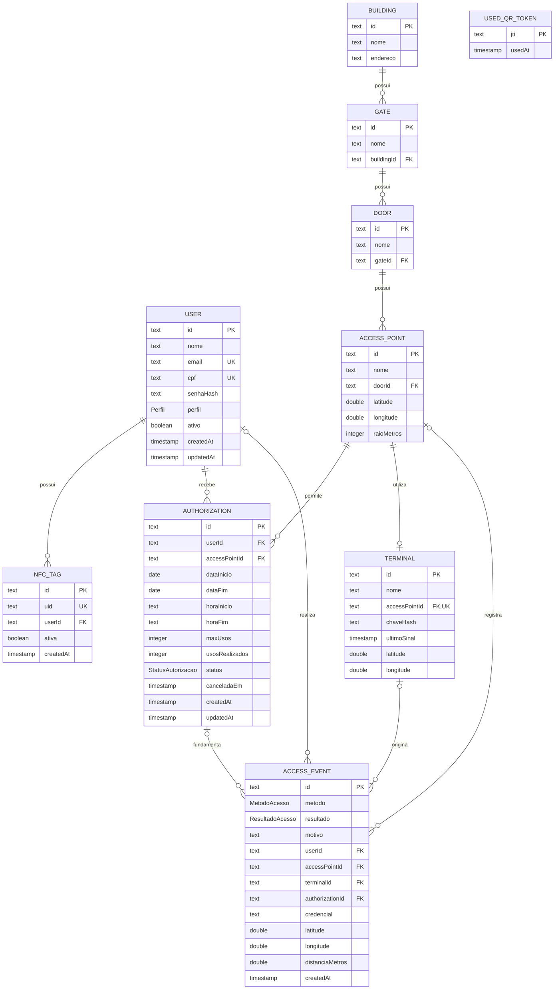

# Documentação técnica do banco de dados

| Campo | Valor |
|---|---|
| Projeto | Passe — Controle de acesso por QR Code e NFC |
| Componente | Persistência de dados |
| Revisão | 11/11/2026 |
| SGBD | PostgreSQL 16 no ambiente Docker |
| ORM | Prisma 7 com `@prisma/adapter-pg` |
| Fonte principal | `backend/prisma/schema.prisma` e migrations atuais |

## 1. Objetivo

O banco de dados armazena os usuários, tags NFC, estrutura física dos locais, terminais, autorizações, tentativas de acesso e identificadores dos QR Codes já utilizados pelo sistema Passe.

Esta documentação descreve o modelo implementado no repositório, incluindo tabelas, campos, tipos, chaves, relacionamentos, índices, regras de exclusão, acesso pelo backend, migrations e dados de desenvolvimento.

## 2. Tecnologias e configuração

| Item | Implementação |
|---|---|
| Banco relacional | PostgreSQL |
| Versão no Docker | PostgreSQL 16 Alpine |
| ORM | Prisma Client 7 |
| Adaptador | `@prisma/adapter-pg` |
| Linguagem de acesso | TypeScript |
| Schema padrão | `public` |
| Configuração da conexão | Variável `DATABASE_URL` |
| Histórico estrutural | `backend/prisma/migrations/` |
| Dados de desenvolvimento | `backend/prisma/seed.ts` |

O cliente é criado em `backend/src/database/prisma.ts` com a URL recebida do ambiente. O Prisma Client é gerado em `backend/src/generated/prisma` no formato ESM.

Exemplo de formato da URL, sem credenciais reais:

```text
postgresql://<usuario>:<senha>@<host>:<porta>/<banco>?schema=public
```

Em serviços de nuvem que exigem TLS, a URL deve conter os parâmetros exigidos pelo provedor, como `sslmode=require` quando aplicável.

## 3. Visão geral do modelo

O banco contém dez tabelas:

| Modelo Prisma | Tabela PostgreSQL | Finalidade |
|---|---|---|
| `User` | `users` | Pessoas que utilizam ou administram o sistema |
| `NfcTag` | `nfc_tags` | Tags NFC vinculadas aos usuários |
| `Building` | `buildings` | Edifícios cadastrados |
| `Gate` | `gates` | Portarias dos edifícios |
| `Door` | `doors` | Portas pertencentes às portarias |
| `AccessPoint` | `access_points` | Catracas ou pontos de controle de acesso |
| `Terminal` | `terminals` | Dispositivos físicos ou simulados associados às catracas |
| `Authorization` | `authorizations` | Permissões de acesso por usuário, local, período e quantidade |
| `AccessEvent` | `access_events` | Auditoria das tentativas liberadas e negadas |
| `UsedQrToken` | `used_qr_tokens` | Identificadores dos QR Codes já consumidos |

## 4. Diagrama entidade-relacionamento



`UsedQrToken` não possui chave estrangeira. Ele registra apenas o identificador único do token consumido e o momento do consumo.

## 5. Tipos e convenções

### 5.1 Identificadores

Os modelos usam `String @id @default(uuid())` no Prisma. Na migration atual, esses identificadores são armazenados como `TEXT`, não como o tipo nativo `UUID` do PostgreSQL.

O formato UUID é validado pela camada HTTP antes das operações normais da API.

### 5.2 Datas e horários

| Uso | Tipo PostgreSQL | Observação |
|---|---|---|
| Datas das autorizações | `DATE` | Convertidas pelo repositório para strings `AAAA-MM-DD` |
| Instantes de criação e atualização | `TIMESTAMP(3)` | Precisão de milissegundos |
| Horários das autorizações | `TEXT` | Formato `HH:MM`, validado pela aplicação |

Os campos `DateTime` da migration atual são `TIMESTAMP(3)` sem indicação de fuso no tipo PostgreSQL. O backend converte e interpreta os valores de acordo com as regras da aplicação, utilizando `APP_TIMEZONE` para as decisões de autorização.

### 5.3 Campos automáticos

- Identificadores são gerados como UUID pelo Prisma.
- Campos `createdAt` recebem `now()` quando definidos no schema.
- Campos `updatedAt` são atualizados pelo Prisma por meio de `@updatedAt`.
- `User.ativo` e `NfcTag.ativa` começam como `true`.
- `AccessPoint.raioMetros` começa como `100`.
- `Authorization.usosRealizados` começa como `0`.
- `Authorization.status` começa como `ATIVA`.

## 6. Enums

### 6.1 `Perfil`

| Valor | Significado |
|---|---|
| `ADMIN` | Administrador do sistema |
| `CONTROLADOR_ACESSO` | Operador da portaria |
| `CONDOMINO` | Morador/condômino |
| `VISITANTE` | Visitante autorizado |

### 6.2 `StatusAutorizacao`

| Valor | Significado |
|---|---|
| `ATIVA` | Registro não cancelado; a situação final ainda depende de datas e usos |
| `CANCELADA` | Autorização cancelada |

As situações `AGENDADA`, `EXPIRADA` e `ESGOTADA` não são gravadas no enum. Elas são calculadas pelo backend com base nas datas, na quantidade de usos e no status persistido.

### 6.3 `MetodoAcesso`

- `QR`
- `NFC`

### 6.4 `ResultadoAcesso`

- `LIBERADO`
- `NEGADO`

## 7. Dicionário de dados

### 7.1 `users`

Armazena as pessoas cadastradas no sistema.

| Campo | Tipo PostgreSQL | Nulo | Padrão | Regra |
|---|---|---|---|---|
| `id` | `TEXT` | Não | UUID pelo Prisma | Chave primária |
| `nome` | `TEXT` | Não | — | Nome da pessoa |
| `email` | `TEXT` | Não | — | Único |
| `cpf` | `TEXT` | Não | — | Único; armazenado somente com números pela aplicação |
| `senhaHash` | `TEXT` | Não | — | Hash bcrypt da senha |
| `perfil` | `Perfil` | Não | — | Perfil de acesso |
| `ativo` | `BOOLEAN` | Não | `true` | Situação do cadastro |
| `createdAt` | `TIMESTAMP(3)` | Não | `CURRENT_TIMESTAMP` | Criação |
| `updatedAt` | `TIMESTAMP(3)` | Não | Gerenciado pelo Prisma | Última atualização |

Índices e constraints:

- Chave primária `users_pkey` em `id`.
- Índice único `users_email_key` em `email`.
- Índice único `users_cpf_key` em `cpf`.

Dados sensíveis:

- `senhaHash` nunca é devolvido pelas rotas da API.
- O banco armazena hash bcrypt, não a senha original.

### 7.2 `nfc_tags`

Representa uma tag NFC vinculada a um usuário.

| Campo | Tipo PostgreSQL | Nulo | Padrão | Regra |
|---|---|---|---|---|
| `id` | `TEXT` | Não | UUID pelo Prisma | Chave primária |
| `uid` | `TEXT` | Não | — | Identificador NFC único |
| `userId` | `TEXT` | Não | — | FK para `users.id` |
| `ativa` | `BOOLEAN` | Não | `true` | Tag liberada ou bloqueada |
| `createdAt` | `TIMESTAMP(3)` | Não | `CURRENT_TIMESTAMP` | Criação |

O UID é normalizado pela aplicação, removendo separadores e convertendo caracteres hexadecimais para letras maiúsculas.

Relacionamento:

- `nfc_tags.userId → users.id` com `ON DELETE CASCADE`.
- Ao excluir um usuário, suas tags são removidas.

### 7.3 `buildings`

Armazena os edifícios da estrutura física.

| Campo | Tipo PostgreSQL | Nulo | Regra |
|---|---|---|---|
| `id` | `TEXT` | Não | Chave primária |
| `nome` | `TEXT` | Não | Nome do edifício |
| `endereco` | `TEXT` | Não | Endereço textual |

Um edifício pode possuir várias portarias.

### 7.4 `gates`

Armazena as portarias dos edifícios.

| Campo | Tipo PostgreSQL | Nulo | Regra |
|---|---|---|---|
| `id` | `TEXT` | Não | Chave primária |
| `nome` | `TEXT` | Não | Nome da portaria |
| `buildingId` | `TEXT` | Não | FK para `buildings.id` |

Relacionamento:

- `gates.buildingId → buildings.id` com `ON DELETE CASCADE`.

### 7.5 `doors`

Armazena as portas pertencentes a cada portaria.

| Campo | Tipo PostgreSQL | Nulo | Regra |
|---|---|---|---|
| `id` | `TEXT` | Não | Chave primária |
| `nome` | `TEXT` | Não | Nome da porta |
| `gateId` | `TEXT` | Não | FK para `gates.id` |

Relacionamento:

- `doors.gateId → gates.id` com `ON DELETE CASCADE`.

### 7.6 `access_points`

Representa catracas ou outros pontos de controle de acesso.

| Campo | Tipo PostgreSQL | Nulo | Padrão | Regra |
|---|---|---|---|---|
| `id` | `TEXT` | Não | UUID pelo Prisma | Chave primária |
| `nome` | `TEXT` | Não | — | Nome do ponto |
| `doorId` | `TEXT` | Não | — | FK para `doors.id` |
| `latitude` | `DOUBLE PRECISION` | Não | — | Latitude de referência |
| `longitude` | `DOUBLE PRECISION` | Não | — | Longitude de referência |
| `raioMetros` | `INTEGER` | Não | `100` | Distância permitida para o QR |

Relacionamento:

- `access_points.doorId → doors.id` com `ON DELETE CASCADE`.
- Um ponto pode possuir no máximo um terminal.
- Um ponto pode possuir várias autorizações e eventos.

A API valida latitude entre -90 e 90, longitude entre -180 e 180 e raio entre 10 e 1.000 metros. A migration atual não cria `CHECK` constraints para esses limites.

### 7.7 `terminals`

Armazena os dispositivos associados aos pontos de acesso.

| Campo | Tipo PostgreSQL | Nulo | Regra |
|---|---|---|---|
| `id` | `TEXT` | Não | Chave primária |
| `nome` | `TEXT` | Não | Nome do terminal |
| `accessPointId` | `TEXT` | Não | FK única para `access_points.id` |
| `chaveHash` | `TEXT` | Não | Hash SHA-256 da chave do terminal |
| `ultimoSinal` | `TIMESTAMP(3)` | Sim | Momento do heartbeat mais recente |
| `latitude` | `DOUBLE PRECISION` | Sim | Latitude informada pelo terminal |
| `longitude` | `DOUBLE PRECISION` | Sim | Longitude informada pelo terminal |

Índices e constraints:

- Chave primária `terminals_pkey`.
- Índice único `terminals_accessPointId_key`.
- FK `terminals.accessPointId → access_points.id` com `ON DELETE CASCADE`.

A unicidade de `accessPointId` implementa a relação de zero ou um terminal para cada ponto de acesso.

`chaveHash` é sensível e não é devolvido pelas rotas da API. A chave original é mostrada somente no cadastro ou na rotação.

### 7.8 `authorizations`

Define quando e quantas vezes um usuário pode utilizar um ponto de acesso.

| Campo | Tipo PostgreSQL | Nulo | Padrão | Regra |
|---|---|---|---|---|
| `id` | `TEXT` | Não | UUID pelo Prisma | Chave primária |
| `userId` | `TEXT` | Não | — | FK para `users.id` |
| `accessPointId` | `TEXT` | Não | — | FK para `access_points.id` |
| `dataInicio` | `DATE` | Não | — | Primeiro dia permitido |
| `dataFim` | `DATE` | Não | — | Último dia permitido |
| `horaInicio` | `TEXT` | Não | — | Início no formato `HH:MM` |
| `horaFim` | `TEXT` | Não | — | Fim no formato `HH:MM` |
| `maxUsos` | `INTEGER` | Não | — | Quantidade máxima permitida |
| `usosRealizados` | `INTEGER` | Não | `0` | Usos já consumidos |
| `status` | `StatusAutorizacao` | Não | `ATIVA` | Estado persistido |
| `canceladaEm` | `TIMESTAMP(3)` | Sim | — | Momento do cancelamento |
| `createdAt` | `TIMESTAMP(3)` | Não | `CURRENT_TIMESTAMP` | Criação |
| `updatedAt` | `TIMESTAMP(3)` | Não | Gerenciado pelo Prisma | Atualização |

Índices e relacionamentos:

- Índice composto `authorizations_userId_accessPointId_idx` para localizar autorizações de uma pessoa em uma catraca.
- `authorizations.userId → users.id` com `ON DELETE CASCADE`.
- `authorizations.accessPointId → access_points.id` com `ON DELETE CASCADE`.

Regras aplicadas pelo backend:

- `dataFim` não pode ser anterior a `dataInicio`.
- `horaInicio` e `horaFim` não podem ser iguais.
- `maxUsos` deve ficar entre 1 e 10.000.
- Uma autorização cancelada não pode ser editada.
- `maxUsos` não pode ser reduzido abaixo de `usosRealizados`.
- Janelas de horário que atravessam a meia-noite são aceitas.

Essas regras não estão implementadas como `CHECK` constraints na migration atual; dependem da aplicação para as escritas normais.

### 7.9 `access_events`

Registra cada tentativa de acesso, liberada ou negada.

| Campo | Tipo PostgreSQL | Nulo | Regra |
|---|---|---|---|
| `id` | `TEXT` | Não | Chave primária |
| `metodo` | `MetodoAcesso` | Não | `QR` ou `NFC` |
| `resultado` | `ResultadoAcesso` | Não | `LIBERADO` ou `NEGADO` |
| `motivo` | `TEXT` | Sim | Código da negação |
| `userId` | `TEXT` | Sim | FK para `users.id` |
| `accessPointId` | `TEXT` | Sim | FK para `access_points.id` |
| `terminalId` | `TEXT` | Sim | FK para `terminals.id` |
| `authorizationId` | `TEXT` | Sim | FK para `authorizations.id` |
| `credencial` | `TEXT` | Sim | JTI do QR ou UID NFC normalizado |
| `latitude` | `DOUBLE PRECISION` | Sim | Latitude do celular no fluxo QR |
| `longitude` | `DOUBLE PRECISION` | Sim | Longitude do celular no fluxo QR |
| `distanciaMetros` | `DOUBLE PRECISION` | Sim | Distância calculada |
| `createdAt` | `TIMESTAMP(3)` | Não | Momento da tentativa |

Índices e relacionamentos:

- Índice `access_events_createdAt_idx` para consultas cronológicas.
- As quatro FKs opcionais usam `ON DELETE SET NULL`.
- Excluir o usuário, ponto, terminal ou autorização não apaga o evento; somente remove a referência correspondente.

Os campos opcionais permitem registrar tentativas incompletas, como tag desconhecida, usuário desativado ou QR associado a um terminal inexistente.

### 7.10 `used_qr_tokens`

Impede o uso repetido do mesmo QR Code.

| Campo | Tipo PostgreSQL | Nulo | Padrão | Regra |
|---|---|---|---|---|
| `jti` | `TEXT` | Não | — | Chave primária e identificador único do token |
| `usedAt` | `TIMESTAMP(3)` | Não | `CURRENT_TIMESTAMP` | Momento do primeiro uso |

O repositório utiliza `createMany` com `skipDuplicates`. A inserção retorna sucesso somente para o primeiro uso do `jti`; tentativas posteriores não criam outra linha e são negadas como QR já utilizado.

O código atual não contém uma rotina de expurgo dos registros antigos dessa tabela. Esse crescimento deve ser considerado na manutenção de longo prazo.

## 8. Relacionamentos e comportamento de exclusão

| Tabela filha | FK | Tabela pai | Ao excluir o pai |
|---|---|---|---|
| `nfc_tags` | `userId` | `users` | `CASCADE` |
| `gates` | `buildingId` | `buildings` | `CASCADE` |
| `doors` | `gateId` | `gates` | `CASCADE` |
| `access_points` | `doorId` | `doors` | `CASCADE` |
| `terminals` | `accessPointId` | `access_points` | `CASCADE` |
| `authorizations` | `userId` | `users` | `CASCADE` |
| `authorizations` | `accessPointId` | `access_points` | `CASCADE` |
| `access_events` | `userId` | `users` | `SET NULL` |
| `access_events` | `accessPointId` | `access_points` | `SET NULL` |
| `access_events` | `terminalId` | `terminals` | `SET NULL` |
| `access_events` | `authorizationId` | `authorizations` | `SET NULL` |

Todos os relacionamentos utilizam `ON UPDATE CASCADE` na migration atual.

A exclusão da hierarquia física pode remover em cascata terminais e autorizações. Os eventos são preservados, porém as referências relacionadas ficam nulas. A API atual não expõe endpoints para excluir edifícios, portarias, portas ou pontos de acesso.

## 9. Índices e unicidade

| Índice | Tipo | Finalidade |
|---|---|---|
| `users_pkey` | Primário | Identificação de usuário |
| `users_email_key` | Único | Impede e-mail duplicado |
| `users_cpf_key` | Único | Impede CPF duplicado |
| `nfc_tags_pkey` | Primário | Identificação da tag |
| `nfc_tags_uid_key` | Único | Impede UID duplicado |
| `buildings_pkey` | Primário | Identificação de edifício |
| `gates_pkey` | Primário | Identificação de portaria |
| `doors_pkey` | Primário | Identificação de porta |
| `access_points_pkey` | Primário | Identificação de ponto de acesso |
| `terminals_pkey` | Primário | Identificação de terminal |
| `terminals_accessPointId_key` | Único | Limita um terminal por ponto de acesso |
| `authorizations_pkey` | Primário | Identificação de autorização |
| `authorizations_userId_accessPointId_idx` | Composto | Busca das autorizações aplicáveis a um acesso |
| `access_events_pkey` | Primário | Identificação de evento |
| `access_events_createdAt_idx` | Simples | Histórico e painel por período |
| `used_qr_tokens_pkey` | Primário | Garante uso único do JTI |

## 10. Camada de repositórios

O arquivo `backend/src/database/repositories.prisma.ts` implementa as interfaces utilizadas pelos serviços. As principais decisões são:

- Usuários são listados em ordem alfabética e podem ser pesquisados por nome, e-mail ou CPF.
- A árvore de locais é ordenada por nome em todos os níveis.
- Terminais são ordenados por nome.
- Autorizações convertem `DATE` para `AAAA-MM-DD` antes de chegar ao domínio.
- Consultas de autorização incluem um resumo do usuário e o caminho completo da catraca.
- Eventos são retornados do mais recente para o mais antigo.
- O histórico executa a busca paginada e a contagem agrupada por resultado.
- QR Codes usados são inseridos com tolerância a duplicidade para detectar reutilização.

O backend depende de interfaces de repositório, não diretamente do Prisma. Nos testes, essas interfaces são substituídas por repositórios em memória.

## 11. Concorrência e atomicidade

### 11.1 Consumo de usos

O consumo de uma autorização utiliza uma instrução SQL atômica equivalente a:

```sql
UPDATE "authorizations"
SET "usosRealizados" = "usosRealizados" + 1,
    "updatedAt" = now()
WHERE "id" = <id>
  AND "status" = 'ATIVA'
  AND "usosRealizados" < "maxUsos";
```

A operação só libera o acesso quando exatamente uma linha é atualizada. Assim, duas tentativas simultâneas não conseguem ultrapassar `maxUsos`.

### 11.2 Uso único do QR

O `jti` do QR é a chave primária de `used_qr_tokens`. A inserção com `skipDuplicates` faz com que somente a primeira tentativa marque o token como utilizado.

### 11.3 Limite transacional atual

No fluxo implementado, o incremento de `usosRealizados` e a criação de `access_events` são operações separadas, sem uma transação Prisma envolvendo as duas. Se ocorrer uma falha entre essas etapas, um uso pode ser consumido sem que o evento correspondente seja gravado.

No QR, a marcação do `jti` também ocorre antes da conclusão de todas as operações seguintes. Se houver uma falha posterior, o token permanece consumido. Esse comportamento é seguro contra reutilização, mas pode exigir análise operacional em caso de falha de persistência.

## 12. Migrations

O projeto possui uma migration inicial em:

```text
backend/prisma/migrations/20261016000000_init/migration.sql
```

Ela cria:

- O schema `public`.
- Os quatro enums.
- As dez tabelas.
- Chaves primárias e estrangeiras.
- Índices únicos e de consulta.
- Regras de exclusão e atualização.

### 12.1 Comandos

Dentro da pasta `backend`:

```powershell
# Gera o Prisma Client
npm run prisma:generate

# Cria e aplica uma migration no desenvolvimento
npm run db:migrate:dev

# Aplica migrations já versionadas
npm run db:migrate

# Carrega os dados de desenvolvimento
npm run db:seed
```

Em produção, `npm run start:prod` executa `prisma migrate deploy` antes de iniciar o servidor compilado.

### 12.2 Procedimento de evolução

1. Alterar `backend/prisma/schema.prisma`.
2. Gerar uma nova migration com `npm run db:migrate:dev` no ambiente de desenvolvimento.
3. Revisar o SQL gerado, especialmente operações destrutivas e mudanças de nulabilidade.
4. Executar lint, verificação de tipos e testes.
5. Versionar o schema e a migration no mesmo commit.
6. Aplicar migrations versionadas com `prisma migrate deploy` nos ambientes controlados.

O repositório atual não contém uma migration de rollback automático. Correções devem ser feitas por uma nova migration, e operações de produção devem ser precedidas pelo procedimento de backup do ambiente responsável pelo banco.

## 13. Seed de desenvolvimento

O arquivo `backend/prisma/seed.ts` cria dados suficientes para testar os fluxos principais:

- Um usuário para cada perfil.
- Um edifício, uma portaria, uma porta e um ponto de acesso.
- Um terminal associado ao ponto de acesso.
- Uma tag NFC vinculada a um usuário.
- Uma autorização de longa duração e uma autorização de visitante.

O seed utiliza `upsert`, portanto pode ser executado repetidamente sem duplicar esses registros. Ele é destinado ao desenvolvimento e à demonstração. As credenciais de demonstração não devem ser reutilizadas em produção.

## 14. Execução com Docker

Na raiz do repositório:

```powershell
docker compose -f docker-compose.dev.yml up -d database
```

O serviço `database` utiliza:

- Imagem `postgres:16-alpine`.
- Porta externa configurável, com padrão 5432.
- Volume persistente `postgres_data`.
- Verificação de saúde com `pg_isready` a cada 5 segundos.

Para iniciar banco e backend juntos:

```powershell
docker compose -f docker-compose.dev.yml up --build database backend
```

O container do backend aguarda o banco ficar saudável, gera o Prisma Client, aplica as migrations, executa o seed e inicia o servidor em desenvolvimento.

## 15. Persistência do ambiente local

Os dados do PostgreSQL executado pelo Compose ficam no volume nomeado `postgres_data`. Parar os containers não remove esse volume.

Comandos que removem volumes, como `docker compose down -v`, também removem os dados locais e devem ser usados somente quando a recriação do banco for intencional.

## 16. Segurança e proteção dos dados

- Senhas são armazenadas somente como hash bcrypt.
- Chaves de terminais são armazenadas somente como hash SHA-256.
- A URL do banco é fornecida por variável de ambiente.
- O arquivo `.env` real não deve ser enviado ao Git.
- Eventos preservam dados de auditoria mesmo quando entidades relacionadas são excluídas.
- Produção deve usar conexão TLS conforme os requisitos do provedor.
- Credenciais de desenvolvimento e seed não devem ser utilizadas em produção.
- Acesso direto ao banco deve ser limitado; várias validações de domínio estão na aplicação.

## 17. Validações que pertencem à aplicação

A migration atual não cria `CHECK` constraints para todas as regras de domínio. As seguintes validações são executadas principalmente pelo backend:

- Formato UUID recebido pela API.
- Formato e tamanho de CPF.
- Formato do UID NFC.
- Formato `AAAA-MM-DD` e existência da data.
- Formato `HH:MM`.
- Ordem das datas da autorização.
- Diferença entre horário inicial e final.
- Limites de latitude, longitude e raio.
- Limites de `maxUsos`.
- Coerência entre cancelamento e edição.
- Proibição de reduzir usos máximos abaixo dos já consumidos.

Escritas realizadas diretamente no PostgreSQL podem contornar essas validações. Por isso, a API e as migrations controladas são os caminhos recomendados de alteração.

## 18. Pontos operacionais

- Monitorar o crescimento de `access_events`, pois é a tabela de auditoria de todas as tentativas.
- Definir uma política futura de retenção para `used_qr_tokens`; o código atual não remove tokens antigos.
- Planejar backup antes de migrations de produção ou alterações manuais.
- Não alterar migrations que já foram aplicadas; criar uma migration corretiva.
- Conferir espaço do volume e conexões do PostgreSQL em ambientes de longa duração.
- Tratar a exclusão em cascata da hierarquia física com cuidado, mesmo que ela ainda não esteja exposta pela API.
- Considerar uma transação entre consumo de uso e registro do evento em uma evolução futura, caso seja necessária atomicidade completa entre as duas operações.

## 19. Arquivos relacionados

- `backend/prisma/schema.prisma`: fonte principal do modelo.
- `backend/prisma/migrations/`: SQL versionado das alterações.
- `backend/prisma/seed.ts`: dados de desenvolvimento.
- `backend/prisma.config.ts`: caminhos do schema, migrations e seed.
- `backend/src/database/prisma.ts`: criação do cliente.
- `backend/src/database/repositories.prisma.ts`: consultas e persistência da aplicação.
- `docker-compose.dev.yml`: PostgreSQL e volume do ambiente local.
- `docs/documentacao-tecnica/backend.md`: arquitetura interna do backend.
- `docs/documentacao-tecnica/api.md`: contratos HTTP que leem e alteram os dados.
