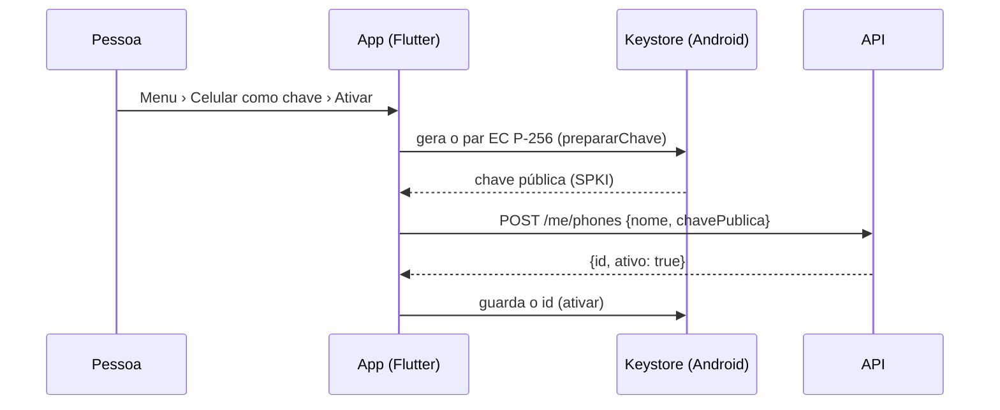
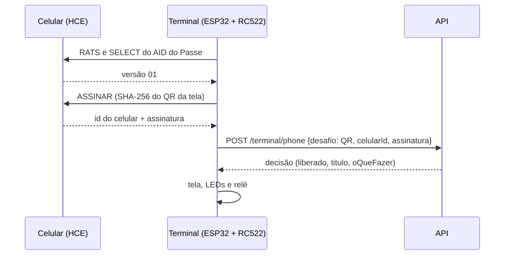

# Documentação técnica do celular como chave NFC

| Campo | Valor |
|---|---|
| Projeto | Passe — Controle de acesso por QR Code e NFC |
| Componente | Celular Android como credencial NFC (HCE) |
| Revisão | 24/11/2026 |
| Situação | Backend, firmware, app e simulador prontos e testados por software. Falta o teste com um celular de verdade no kit |

## 1. Objetivo

Além do QR Code e da tag, o morador ou o visitante pode passar encostando o **próprio celular Android** no leitor NFC da catraca, como faria com a tag. Depois que o celular é ativado no app, isso funciona com o app fechado e sem internet no celular. Basta a tela estar desbloqueada.

As regras de acesso são as mesmas dos outros métodos. O celular só prova quem é a pessoa, e quem decide continua sendo o `AccessService`.

## 2. Por que funciona assim

O leitor do terminal (MFRC522) só lê cartões. Para o celular ser lido, o app faz o Android **emular um cartão** ISO 14443-4, o recurso que o Android chama de HCE (*Host Card Emulation*).

| Ideia | Por que não foi usada |
|---|---|
| Cadastrar o UID do celular como uma tag | O Android sorteia um UID novo a cada aproximação |
| O celular ler um adesivo NFC colado no totem | O adesivo é fixo e pode ser copiado. Voltaria a precisar do GPS, como no QR |
| Segredo compartilhado (HMAC) entre app e API | O segredo ficaria guardado no banco. Com a chave pública, o banco não guarda nada que sirva para se passar pelo celular |

O que foi feito:

- **Identidade:** um par de chaves EC P-256 criado no Keystore do Android. A chave privada não sai do aparelho e a pública vai para a API na ativação.
- **Desafio:** o terminal entrega ao celular o SHA-256 do QR que está na tela naquele momento. Esse QR já é assinado pelo backend, vale 30 s e diz de qual terminal é. Assim a assinatura do celular só vale naquele terminal, naquela janela de tempo.
- **Sem GPS:** encostar no leitor, a 1 ou 2 cm, já prova que a pessoa está na catraca.

## 3. Arquivos

| Parte | Arquivo | Papel |
|---|---|---|
| Backend | `backend/src/modules/phones/phone-signature.ts` | Protocolo, desafio e conferência da assinatura |
| Backend | `backend/src/modules/phones/phones.service.ts` e `phones.controller.ts` | Ativar, listar, bloquear e remover celulares |
| Backend | `backend/src/modules/access/access.service.ts` | `validarCelular`: a decisão |
| Backend | `backend/src/modules/terminals/terminals.controller.ts` | `POST /terminal/phone` |
| Banco | `backend/prisma/migrations/20261124000000_celular_nfc/` | Tabela `nfc_phones` e método `CELULAR` |
| Firmware | `arduino/src/celular.cpp` | Conversa ISO 14443-4 com o celular pelo RC522 |
| Firmware | `arduino/src/main.cpp` | Separa o celular da tag e chama a API |
| App | `frontend/android/.../PasseHceService.kt` | Responde ao terminal (roda com o app fechado) |
| App | `frontend/android/.../ChaveCelular.kt` | Chave no Keystore e assinatura |
| App | `frontend/android/app/src/main/res/xml/apduservice.xml` | AID do Passe e exigência de desbloqueio |
| App | `frontend/lib/views/user/celular_chave_view.dart` | Tela "Celular como chave" |
| Simulador | `backend/public/simulador/app.js` | Celular de teste com WebCrypto, sem hardware |

## 4. Ativação no app



Cada ativação começa de uma chave nova. Se o aparelho já tinha uma, ela é apagada, e o cadastro antigo aparece em "Outros celulares" para a pessoa remover.

## 5. Acesso na catraca



O firmware só faz esse caminho quando o cartão fala ISO 14443-4 (SAK com o bit 6 ligado). Se o cartão não responde ao AID do Passe (um cartão de banco, ou um celular sem o app), ele segue como uma tag comum, pelo UID.

## 6. Protocolo (versão 1)

| Passo | Terminal → celular | Celular → terminal |
|---|---|---|
| SELECT | `00 A4 04 00 07 F0 50 41 53 53 45 01 00` | `01 90 00` (versão do protocolo) |
| ASSINAR | `80 10 00 00 20 <desafio, 32 bytes> 00` | `<id, 16 bytes> <assinatura, 64 bytes> 90 00` |
| ASSINAR, sem ativação | o mesmo | `69 85` |

- **AID:** `F0 50 41 53 53 45 01`, ou seja, `F0` (proprietário) + "PASSE" em ASCII + versão `01`.
- **Desafio:** SHA-256 do texto do QR (`P1.…`). São 32 bytes e cabem num quadro só do RC522.
- **Assinatura:** ECDSA P-256 com SHA-256 sobre `"PASSE-CEL1" || desafio`, no formato `r||s` (64 bytes). O Keystore entrega em DER e o `ChaveCelular.kt` converte.
- **id:** o UUID do celular no Passe, em 16 bytes.

Detalhes de rádio que o firmware trata, porque a biblioteca MFRC522 não trata:

- **Tempo:** o Keystore pode demorar dezenas de milissegundos para assinar. A biblioteca desiste em 36 ms; o `celular.cpp` espera o tempo que o celular informa no ATS (FWI), de 100 ms a 1,5 s.
- **Pedido de mais tempo (S(WTX)):** o chip NFC do celular pede mais tempo enquanto o app assina, e o firmware responde. Na primeira aproximação com o app fechado, o Android sobe o processo antes de responder ao SELECT, e o pedido se repete dezenas de vezes. Por isso o limite é de tempo (3 s por APDU), não de quantidade de pedidos.
- **Resposta em dois quadros:** os 82 bytes da resposta passam do quadro de 64 bytes do RC522. O celular manda em pedaços e o firmware junta (encadeamento com R(ACK)).
- **No fim:** o firmware manda DESELECT. O celular só volta a responder quando for afastado e aproximado de novo, o que evita abrir duas vezes com o celular parado no leitor.

## 7. Validação na API

`AccessService.validarCelular` segue esta ordem:

1. busca a catraca do terminal autenticado;
2. confere o QR do desafio: assinatura HMAC, validade e se é **deste** terminal (`DESAFIO_INVALIDO`);
3. busca o celular pelo id (`CELULAR_DESCONHECIDO`);
4. confere a assinatura com a chave pública (`CELULAR_NAO_CONFIRMADO`). Só a partir daqui a tentativa é atribuída ao dono do celular no histórico;
5. celular bloqueado pela equipe (`CELULAR_BLOQUEADO`) e cadastro desativado (`USUARIO_INATIVO`);
6. as mesmas regras de autorização do QR e da tag (data, horário, usos, cancelamento);
7. marca `<nonce do QR>.<id do celular>` como usado: a mesma assinatura não abre duas vezes (`DESAFIO_INVALIDO`), mas outro celular pode usar o mesmo QR;
8. consome o uso, registra o evento com `metodo: CELULAR` e avisa o terminal.

## 8. Banco de dados

| Tabela `nfc_phones` | Tipo | Regra |
|---|---|---|
| `id` | Texto (UUID) | Chave primária. É o id que o celular manda |
| `userId` | Texto | Dono. Apagar o usuário apaga os celulares |
| `nome` | Texto | Modelo do aparelho, para a pessoa reconhecer |
| `chavePublica` | Texto | SPKI DER em base64, única |
| `ativo` | Booleano | `false` quando a equipe bloqueia |
| `createdAt` | Data e hora | Ativação |

O enum `MetodoAcesso` ganhou `CELULAR`. No evento, `credencial` guarda o id do celular, e latitude, longitude e distância ficam vazias.

## 9. Segurança e limites

| Ponto | Como fica |
|---|---|
| Celular bloqueado | Não responde: o `apduservice.xml` exige desbloqueio e a chave do Keystore só assina com o aparelho desbloqueado (Android 9 ou mais) |
| Cópia da credencial | A chave privada não sai do Keystore. O banco só tem a chave pública |
| Assinatura capturada | Vale para um QR, de um terminal, por 30 s e uma vez só. Só o terminal, com a chave dele, consegue mandar para a API |
| Celular perdido | A pessoa remove pelo app em outro aparelho ("Outros celulares"), ou a portaria bloqueia |
| Repasse em tempo real (*relay*) | Não é bloqueado, como em qualquer cartão por aproximação. Aceitável para o protótipo |
| iPhone | Não funciona. A Apple só deixa apps de terceiros emularem cartão no Espaço Econômico Europeu, com autorização. No iPhone e na web, a tela "Celular como chave" explica e manda usar o QR ou a tag |

## 10. Como testar

### Automático

```bash
cd backend && npm test        # tests/api/celular.test.ts e tests/unit/phone-signature.test.ts
cd frontend && flutter test   # test/views/user/celular_chave_test.dart
```

O `backend/scripts/smoke.mjs`, que o CI roda contra o Postgres, também ativa um celular, abre a catraca, tenta repetir a assinatura e remove o celular.

### Sem hardware: simulador

1. Suba a API e abra `http://localhost:3000/simulador/` (precisa ser `localhost` ou `https`: o navegador só cria a chave nesses endereços).
2. Ligue o terminal e entre com `morador@passe.com` no celular de teste.
3. Em "Celular como chave (NFC)", toque em **Ativar como chave** e depois em **Encostar no leitor**.

O navegador faz o papel do app e do terminal juntos: guarda a chave, assina o SHA-256 do QR da tela e chama `POST /terminal/phone`.

### No kit, com um celular Android

1. Suba banco, broker e API (`docker compose -f docker-compose.dev.yml up -d database mqtt backend`). A migration nova roda sozinha.
2. Grave o firmware normal: `cd arduino && pio run -e oled -t upload`.
3. Instale o app no celular (precisa do Android SDK): `flutter run -d <celular> --dart-define=API_URL=http://<IP-do-PC>:3000`.
4. No app, entre como morador e abra **Menu › Celular como chave › Ativar este celular**.
5. Ligue o NFC, desbloqueie a tela e encoste o meio das costas do celular no leitor, quase colado.
6. Acompanhe a serial a 115200:

| Na serial | O que quer dizer |
|---|---|
| `Celular <id>` e depois `Decisao: ABRIR` | Funcionou |
| `Celular com o app, mas sem chave ativada` | O app está instalado, mas o celular não foi ativado |
| `Celular: a leitura caiu no meio` | O celular afastou ou demorou demais. Tente de novo, mais perto |
| `Tag XXXXXXXX` com um UID diferente a cada vez | O celular não respondeu ao AID do Passe: app sem o serviço HCE, ou NFC do celular desligado |

## 11. O que ainda não foi testado

- **Com celular e kit:** a conversa ISO 14443-4 só foi compilada. O RC522 tem antena pequena; com celular, o alcance costuma ser de 1 a 2 cm, e alguns celulares não conversam bem com leitores clones. Se não funcionar com nenhum celular, o plano B é trocar o leitor por um PN532, que fala ISO 14443-4 com folga.
- **Build Android:** o código Kotlin (`PasseHceService.kt`, `ChaveCelular.kt` e `MainActivity.kt`) ainda não passou por um `flutter build apk`, porque a máquina onde foi escrito não tinha o Android SDK. O CI também não compila o app Android.
