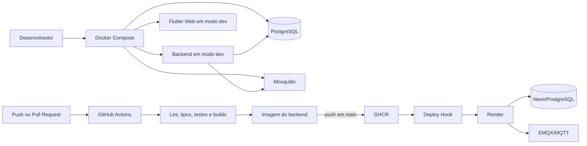
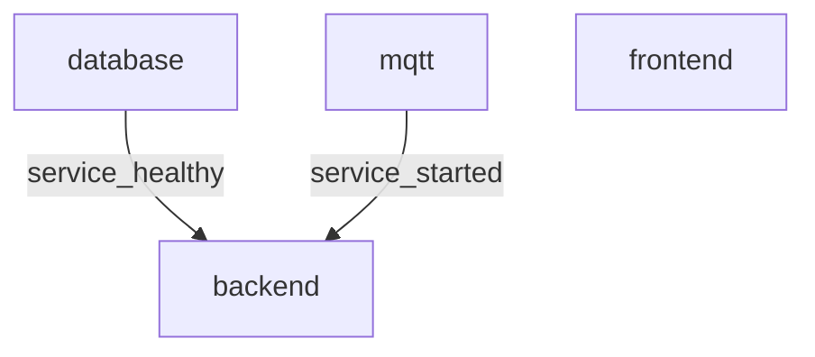
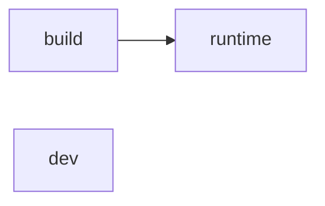
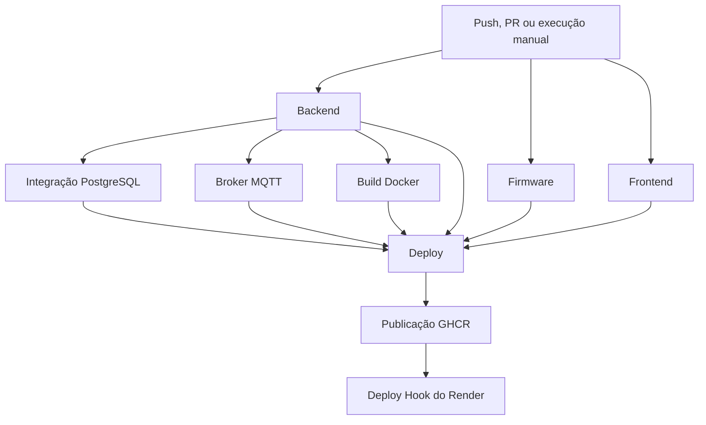

# Documentação técnica de Docker e CI/CD

| Campo | Valor |
|---|---|
| Projeto | Passe — Controle de acesso por QR Code e NFC |
| Componente | Contêineres, integração contínua e entrega contínua |
| Orquestração local | Docker Compose |
| Automação | GitHub Actions |
| Registro de imagens | GitHub Container Registry |
| Revisão | 11/11/2026 |
| Base da documentação | Arquivos Docker, Compose e workflows versionados no repositório |

## 1. Objetivo

O projeto usa Docker para padronizar o ambiente local, construir a imagem de produção do backend, executar PostgreSQL e Mosquitto e disponibilizar ambientes auxiliares para Flutter.

O GitHub Actions executa validações automáticas do backend, banco, broker MQTT, firmware, frontend e imagem Docker. Em um push para `main`, depois da conclusão com sucesso de todos os jobs exigidos pelo pipeline, o workflow publica a imagem do backend no GHCR e chama o hook de deploy configurado no Render.

Esta documentação descreve:

- serviços e volumes do ambiente local;
- estágios das imagens Docker;
- inicialização e dependências entre contêineres;
- portas, rede, healthchecks e variáveis;
- configuração Docker do Mosquitto;
- build auxiliar do aplicativo Flutter;
- gatilhos e jobs do CI/CD;
- publicação no GHCR;
- disparo de deploy no Render;
- workflow de IPA para iOS;
- segredos, cache, artefatos, falhas e limitações.

O documento representa a configuração versionada. O estado atual de serviços externos, execuções do GitHub Actions e configurações feitas nos painéis do GitHub, Render, Neon e EMQX não é confirmado apenas pelos arquivos locais.

## 2. Visão geral da infraestrutura



O Compose é voltado ao desenvolvimento. Não existe um arquivo Compose de produção no repositório. A produção depende de serviços gerenciados e de configuração externa.

## 3. Arquivos principais

| Caminho | Responsabilidade |
|---|---|
| `docker-compose.dev.yml` | Serviços e volumes do ambiente de desenvolvimento |
| `backend/Dockerfile` | Imagem de desenvolvimento e imagem final do backend |
| `backend/.dockerignore` | Exclusões do contexto de build do backend |
| `frontend/Dockerfile` | Ambiente Flutter Web para desenvolvimento |
| `docker/flutter/Dockerfile` | Ambiente auxiliar para gerar APK Android |
| `docker/mosquitto/mosquitto.conf` | Listeners e segurança do broker local |
| `docker/mosquitto/iniciar.sh` | Preparação da configuração dentro do contêiner |
| `docker/mosquitto/acl` | Permissões MQTT por usuário e tópico |
| `docker/mosquitto/gerar-certificados.sh` | CA e certificado TLS para o broker local |
| `.github/workflows/ci-cd.yml` | Pipeline principal de CI/CD |
| `.github/workflows/ios-ipa.yml` | Build separado do IPA de teste |
| `backend/scripts/smoke.mjs` | Teste de fumaça contra API e PostgreSQL reais |
| `backend/scripts/mqtt-acl.mjs` | Teste automático de autenticação, ACL e TLS MQTT |
| `scripts/preparar-rede-windows.ps1` | Regras locais de firewall para API e MQTT |
| `docs/deploy-nuvem.md` | Procedimento e configuração externa de produção |

## 4. Ambiente Docker de desenvolvimento

O arquivo `docker-compose.dev.yml` define o projeto Compose com nome `4dsm-abp` e quatro serviços:

| Serviço | Imagem ou build | Finalidade |
|---|---|---|
| `database` | `postgres:16-alpine` | Banco PostgreSQL local |
| `mqtt` | `eclipse-mosquitto:2` | Broker MQTT local |
| `backend` | Estágio `dev` de `backend/Dockerfile` | API com recarga automática |
| `frontend` | `frontend/Dockerfile` | Flutter Web em servidor de desenvolvimento |

O Docker Compose cria uma rede padrão privada para comunicação por nome de serviço. Dentro dessa rede:

- o backend acessa o banco pelo host `database`;
- o backend acessa o broker pelo host `mqtt`;
- contêineres não usam `localhost` para localizar outro serviço.

## 5. Portas publicadas

| Serviço | Porta no contêiner | Porta padrão no host | Variável de substituição |
|---|---:|---:|---|
| PostgreSQL | 5432 | 5432 | `POSTGRES_PORT` |
| MQTT comum | 1883 | 1883 | `MQTT_PORT` |
| MQTT sobre WebSocket | 9001 | 9001 | `MQTT_WS_PORT` |
| MQTT com TLS | 8883 | 8883 | `MQTT_TLS_PORT` |
| Backend | 3000 | 3000 | `SERVER_PORT` |
| Flutter Web | 8080 | 8080 | `FRONTEND_PORT` |

A publicação de `8883` não cria o listener TLS por si só. O listener passa a existir depois da geração dos certificados e do arquivo `conf.d/tls.conf`.

As portas publicadas podem ficar acessíveis pela rede do computador, dependendo do Docker e do firewall. Os valores padrão são destinados ao desenvolvimento em rede confiável.

## 6. Serviço `database`

Configuração atual:

| Item | Valor ou origem |
|---|---|
| Imagem | `postgres:16-alpine` |
| Banco | `POSTGRES_DB`, com padrão de desenvolvimento |
| Usuário | `POSTGRES_USER`, com padrão de desenvolvimento |
| Senha | `POSTGRES_PASSWORD`, com padrão de desenvolvimento |
| Dados | Volume `postgres_data` |
| Verificação | `pg_isready` |

O healthcheck executa a cada cinco segundos, com timeout de cinco segundos e até dez tentativas.

O volume é montado em:

```text
/var/lib/postgresql/data
```

Recriar o contêiner não remove os dados. Remover explicitamente o volume elimina o banco local e deve ocorrer somente quando a recriação for intencional.

## 7. Serviço `mqtt`

O Mosquitto usa a imagem oficial da série 2. A pasta local `docker/mosquitto` é montada como somente leitura em:

```text
/mosquitto/origem
```

O entrypoint personalizado executa `iniciar.sh`, que:

1. cria `/mosquitto/config`;
2. copia a configuração montada para a pasta interna;
3. transfere a propriedade para o usuário `mosquitto`;
4. restringe senha, ACL e chave privada para permissão `0600`;
5. inicia o broker com `mosquitto.conf`.

O broker local:

- desabilita acesso anônimo;
- usa arquivo de senhas;
- aplica ACL por tópico;
- grava logs no `stdout`;
- não mantém persistência MQTT;
- aceita MQTT comum em 1883;
- aceita WebSocket em 9001;
- aceita MQTT TLS em 8883 quando configurado.

Não há healthcheck do serviço MQTT no Compose. O backend depende apenas de `service_started`, e possui fallback HTTP se o broker ainda não estiver pronto.

## 8. ACL e autenticação MQTT

A ACL local permite:

| Identidade | Permissão |
|---|---|
| Backend | Publicar em `passe/terminais/+/decisoes` |
| Terminal | Ler apenas `passe/terminais/{seu-usuario}/decisoes` |

O arquivo de senhas contém hashes gerados pelo Mosquitto. Esta documentação não reproduz usuários, senhas ou hashes.

Depois de alterar senha ou ACL, o broker deve ser reiniciado para copiar novamente os arquivos para `/mosquitto/config`.

## 9. TLS local do Mosquitto

O script `gerar-certificados.sh`:

1. cria uma autoridade certificadora local, se ainda não existir;
2. cria chave e solicitação do servidor;
3. adiciona `localhost`, `mqtt`, `127.0.0.1` e hosts informados ao SAN;
4. assina o certificado do broker;
5. remove arquivos temporários;
6. cria `conf.d/tls.conf`;
7. configura TLS 1.2 na porta 8883.

Os diretórios de certificados e a configuração TLS gerada são ignorados pelo Git.

Exemplo com valores genéricos:

```powershell
sh docker/mosquitto/gerar-certificados.sh <ip-do-computador> <nome-dns-opcional>
docker compose -f docker-compose.dev.yml restart mqtt
```

A CA pública pode ser distribuída aos clientes. A chave privada da CA e a chave do servidor não devem sair do ambiente protegido.

## 10. Serviço `backend` em desenvolvimento

O Compose constrói:

```yaml
context: ./backend
target: dev
```

O estágio `dev` instala todas as dependências, incluindo `tsx`, TypeScript, ESLint e Vitest.

Na inicialização, o contêiner executa:

1. `prisma generate`;
2. `prisma migrate deploy`;
3. seed de demonstração;
4. servidor de desenvolvimento com recarga automática.

O código do host é montado em `/usr/src/app`. Um volume separado cobre `node_modules`, evitando que a montagem do código substitua as dependências Linux instaladas na imagem.

## 11. Variáveis do backend no Compose

O serviço recebe explicitamente:

| Variável | Origem ou finalidade |
|---|---|
| `PORT` | Porta interna 3000 |
| `NODE_ENV` | `development` |
| `DATABASE_URL` | Conexão com o serviço `database` |
| `JWT_SECRET` | Assinatura da sessão, com fallback apenas para desenvolvimento |
| `QR_SECRET` | Assinatura do QR, com fallback apenas para desenvolvimento |
| `MQTT_URL` | Broker no serviço `mqtt` pela porta 1883 |
| `MQTT_USERNAME` | Usuário da API no broker |
| `MQTT_PASSWORD` | Senha da API, substituível por variável do host |
| `MQTT_WS_URL` | WebSocket visto pelo navegador no host |

Os valores de fallback facilitam o desenvolvimento, mas não são adequados para produção.

Variáveis `${...}` podem ser substituídas pelo ambiente do shell ou pelo arquivo de variáveis lido pelo Docker Compose. A saída de `docker compose config` pode conter valores resolvidos e não deve ser publicada sem revisão.

## 12. Dependências de inicialização



O backend aguarda o healthcheck do PostgreSQL. Para o MQTT, aguarda apenas o início do contêiner.

O frontend não declara `depends_on`. Ele pode iniciar antes da API e apresentar falha temporária até que o backend esteja disponível.

## 13. Serviço `frontend`

O `frontend/Dockerfile` usa:

```text
ghcr.io/cirruslabs/flutter:stable
```

A imagem:

1. usa `/app` como diretório de trabalho;
2. copia `pubspec.*`;
3. executa `flutter pub get`;
4. expõe a porta 8080.

O Compose fornece o comando:

```text
flutter run -d web-server --web-hostname 0.0.0.0 --web-port 8080
```

O `API_URL` é informado por `--dart-define` e aponta para a porta do backend vista pelo navegador no computador.

O código é montado em `/app`, e o cache de pacotes Flutter fica no volume `flutter_pub_cache`.

Essa imagem é um ambiente de desenvolvimento. Ela não gera uma imagem web estática de produção e não usa Nginx ou outro servidor de arquivos final.

## 14. Volumes nomeados

| Volume | Serviço | Finalidade | Persistência relevante |
|---|---|---|---|
| `postgres_data` | `database` | Arquivos do PostgreSQL | Dados locais |
| `backend_node_modules` | `backend` | Dependências Node Linux | Cache de desenvolvimento |
| `flutter_pub_cache` | `frontend` | Pacotes Dart/Flutter | Cache de desenvolvimento |

Como o projeto Compose possui nome fixo, o Docker prefixa os volumes com `4dsm-abp_`.

Ao alterar dependências, pode ser necessário reconstruir a imagem e renovar somente o volume de dependências correspondente. O volume `postgres_data` não deve ser removido nesse procedimento.

## 15. Comandos de desenvolvimento

### Infraestrutura e backend

```powershell
docker compose -f docker-compose.dev.yml up --build database mqtt backend
```

### Somente banco e broker em segundo plano

```powershell
docker compose -f docker-compose.dev.yml up -d database mqtt
```

### Todos os serviços, incluindo Flutter Web

```powershell
docker compose -f docker-compose.dev.yml up --build
```

### Estado dos serviços

```powershell
docker compose -f docker-compose.dev.yml ps
```

### Logs

```powershell
docker compose -f docker-compose.dev.yml logs -f backend
docker compose -f docker-compose.dev.yml logs -f database
docker compose -f docker-compose.dev.yml logs -f mqtt
docker compose -f docker-compose.dev.yml logs -f frontend
```

### Encerrar preservando os volumes

```powershell
docker compose -f docker-compose.dev.yml down
```

Adicionar `-v` ao encerramento remove também os volumes nomeados, inclusive o banco local. Essa opção não deve ser usada sem a intenção explícita de apagar os dados.

## 16. Rede local no Windows

O script `scripts/preparar-rede-windows.ps1` pode:

- liberar 3000, 1883, 8883 e 9001 no firewall;
- limitar as regras a redes privadas;
- mostrar o IP da interface Wi-Fi;
- detectar uma faixa dinâmica de portas que conflita com Docker/WSL;
- opcionalmente restaurar a faixa dinâmica padrão.

O script exige PowerShell como administrador e altera o firewall. Ele não é executado automaticamente pelo Compose ou pelo CI.

## 17. Dockerfile do backend

O `backend/Dockerfile` possui três estágios:



| Estágio | Finalidade |
|---|---|
| `build` | Instala dependências, gera o código compilado e remove dependências de desenvolvimento |
| `dev` | Mantém dependências de desenvolvimento para Compose |
| `runtime` | Executa a API em produção com o conteúdo mínimo necessário |

Todos usam Node 24 sobre Alpine Linux.

## 18. Estágio `build`

Sequência:

1. define `/usr/src/app`;
2. copia `package.json` e `package-lock.json`;
3. executa `npm ci`;
4. copia o restante do contexto;
5. executa `npm run build`;
6. remove dependências de desenvolvimento com `npm prune --omit=dev`.

O script `npm run build` gera o Prisma Client e compila TypeScript para `dist/`.

Copiar primeiro os manifests permite reaproveitar a camada de dependências quando o código muda sem alterar o lockfile.

## 19. Estágio `dev`

O estágio de desenvolvimento copia apenas os manifests e executa `npm ci`. O código chega pelo bind mount do Compose.

Ele mantém as `devDependencies` porque:

- `tsx` executa o servidor em modo watch;
- o seed usa ferramentas de desenvolvimento;
- comandos locais podem usar lint, testes e TypeScript.

Esse estágio não é usado como imagem final de produção.

## 20. Estágio `runtime`

O estágio final:

- define `NODE_ENV=production`;
- copia manifests;
- copia `node_modules` já podado;
- copia `dist/`;
- copia migrations e schema em `prisma/`;
- copia os arquivos públicos;
- copia `prisma.config.ts`;
- troca para o usuário sem privilégios `node`;
- expõe 3000;
- configura healthcheck em `/health`;
- executa `npm run start:prod`.

O comando de produção executa migrations pendentes antes de iniciar `dist/server.js`.

O seed não faz parte da inicialização de produção, pois depende de ferramentas removidas da imagem final e não deve ser executado automaticamente a cada deploy.

## 21. Healthcheck da imagem do backend

A imagem final consulta:

```text
http://localhost:3000/health
```

Configuração:

| Item | Valor |
|---|---:|
| Intervalo | 30 s |
| Timeout | 5 s |
| Comando | `wget` com falha quando a rota não responde |

Esse healthcheck pertence ao estágio `runtime`. O serviço local `backend` usa o estágio `dev` e não herda essa instrução.

## 22. Contexto e `.dockerignore`

O contexto do backend exclui:

- `node_modules`;
- `dist`;
- `coverage`;
- `.env`;
- Prisma Client gerado em `src/generated`.

Isso reduz o contexto e impede a cópia acidental do `.env` para a imagem.

O repositório também ignora `.env`, certificados locais e configurações TLS geradas.

## 23. Imagem auxiliar para APK

`docker/flutter/Dockerfile` prepara Flutter, Android SDK e JDK para compilar APK sem instalar essas ferramentas no host.

Ele:

1. parte da imagem `ghcr.io/cirruslabs/flutter:latest`;
2. configura diretórios Git como seguros;
3. atualiza o checkout do Flutter para o canal estável;
4. limpa o cache anterior;
5. baixa componentes Android;
6. exibe a versão do Flutter;
7. usa `/app` como diretório de trabalho.

O Dockerfile não define `CMD`. A compilação é fornecida ao executar o contêiner. O procedimento documentado usa uma cópia limpa do código, monta uma pasta de saída e pode reutilizar um volume de cache do Gradle.

Esse build é manual e não faz parte do workflow principal atual.

## 24. Limitações do Docker local

- Não há Compose de produção.
- O frontend Docker é servidor de desenvolvimento, não entrega web otimizada.
- O Compose publica banco e broker no host.
- MQTT 1883 e WebSocket 9001 não usam TLS.
- Credenciais padrão são apenas de desenvolvimento.
- O broker local não persiste mensagens.
- MQTT e frontend não possuem healthcheck no Compose.
- O backend de desenvolvimento executa migrations e seed em cada inicialização.
- Não há limite de CPU ou memória declarado.
- Não há política de restart declarada.
- Neon, Render e EMQX não são provisionados por Docker ou infraestrutura como código.

## 25. Arquitetura de produção documentada

| Componente | Serviço previsto |
|---|---|
| API em contêiner | Render |
| PostgreSQL | Neon |
| Broker MQTT com TLS | EMQX Cloud |
| Imagem do backend | GHCR |

O Render recebe as variáveis de produção pelo painel. Neon e EMQX são serviços externos; não existem recursos Terraform, Kubernetes, Helm ou arquivos equivalentes no repositório.

O repositório não possui `render.yaml`. Configurações como branch, origem da imagem ou do código, healthcheck, variáveis, auto-deploy e hook dependem do painel do Render.

## 26. Pipeline principal

Arquivo:

```text
.github/workflows/ci-cd.yml
```



O job `deploy` só executa no push da branch `main`. Pull requests e outras branches terminam após as validações.

## 27. Gatilhos

O workflow principal executa em:

| Evento | Escopo |
|---|---|
| `push` | Todas as branches |
| `pull_request` | Pull requests |
| `workflow_dispatch` | Execução manual |

A concorrência usa a referência Git como grupo e cancela uma execução anterior ainda em andamento para a mesma referência. Isso evita gastar recursos validando commits superados na mesma branch.

## 28. Job `backend`

Nome exibido:

```text
Backend · lint, tipos, testes e build
```

Ambiente:

- `ubuntu-latest`;
- Node 24;
- cache npm baseado em `backend/package-lock.json`;
- diretório padrão `backend/`.

Etapas:

1. checkout;
2. configuração do Node;
3. `npm ci`;
4. geração do Prisma Client;
5. ESLint;
6. checagem de tipos sem emitir arquivos;
7. testes com cobertura V8;
8. build TypeScript;
9. resumo no GitHub Actions, inclusive em falha.

O job gera cobertura, mas o `vitest.config.ts` não define limite mínimo. O relatório também não é enviado como artefato pelo workflow atual.

## 29. Job `backend-integracao`

Nome exibido:

```text
Backend · integração com Postgres
```

Ele depende do job `backend` e usa um service container `postgres:16-alpine` com healthcheck.

Etapas:

1. checkout;
2. Node 24 com cache npm;
3. `npm ci`;
4. build do backend;
5. `prisma migrate deploy`;
6. seed de demonstração;
7. início de `node dist/server.js` em segundo plano;
8. execução de `scripts/smoke.mjs`;
9. impressão do log da API em caso de falha.

O teste de fumaça valida uma sequência real contra PostgreSQL, incluindo:

- healthcheck da API;
- autenticação;
- usuários e locais;
- cadastro de tag;
- autorização;
- QR e heartbeat;
- liberação e negação NFC;
- validação QR;
- fila de decisões;
- histórico;
- cancelamento;
- painel.

Os segredos e credenciais usados nesse job são valores exclusivos de teste definidos no workflow. Eles não devem ser reutilizados em produção.

O job inicia a aplicação diretamente com Node. Ele não executa o contêiner produzido pelo `backend/Dockerfile`.

## 30. Job `mqtt`

Nome exibido:

```text
Broker MQTT · login, ACL e TLS
```

Ele depende do backend e executa:

1. checkout;
2. Node 24 e dependências do backend;
3. geração de certificados de teste;
4. início do Mosquitto em um contêiner Docker;
5. espera fixa de três segundos;
6. teste sem TLS na porta 1883;
7. teste com TLS e CA própria na porta 8883;
8. log do broker quando há falha.

O script confirma:

- acesso anônimo recusado;
- senha incorreta recusada;
- terminal recebendo a decisão da API;
- terminal sem acesso às decisões de outro terminal;
- terminal impedido de publicar uma abertura falsa.

O workflow não testa o listener WebSocket da porta 9001.

## 31. Job `firmware`

Nome exibido:

```text
Firmware ESP32 · build
```

Etapas:

1. checkout;
2. Python 3.12;
3. cache de `~/.platformio` pela configuração do firmware;
4. instalação do PlatformIO;
5. criação de `credenciais.h` a partir do modelo;
6. compilação de ST7789, ILI9341, OLED e teste de bancada;
7. compilação adicional de ST7789 com MQTT TLS.

O job verifica compilação. Ele não grava uma placa nem valida display, NFC, relé, Wi-Fi ou leitura física do QR.

## 32. Job `frontend`

Nome exibido:

```text
Frontend · análise e testes
```

Etapas:

1. checkout;
2. Flutter no canal estável com cache;
3. `flutter pub get`;
4. `flutter analyze`;
5. `flutter test`.

O workflow principal não:

- executa a suíte de integração contra uma API real;
- gera APK;
- gera IPA;
- gera build Flutter Web;
- constrói `frontend/Dockerfile`.

Os testes padrão usam as implementações falsas e mocks existentes no projeto.

## 33. Job `docker`

Nome exibido:

```text
Imagem Docker do backend
```

Ele depende do backend e usa Buildx com `docker/build-push-action`.

Configuração:

| Item | Valor |
|---|---|
| Contexto | `backend` |
| Push | Não |
| Tag de build | `passe-backend:ci` |
| Cache de entrada | GitHub Actions |
| Cache de saída | GitHub Actions, modo máximo |

Como nenhum `target` é informado, o estágio final `runtime` é construído.

O job confirma que a imagem compila, mas não a inicia, não consulta seu healthcheck e não executa o smoke test dentro dela.

## 34. Dependências entre jobs

| Job | Depende de |
|---|---|
| `backend` | Nenhum |
| `firmware` | Nenhum |
| `frontend` | Nenhum |
| `backend-integracao` | `backend` |
| `mqtt` | `backend` |
| `docker` | `backend` |
| `deploy` | Todos os seis jobs anteriores |

Backend, firmware e frontend podem começar em paralelo. Integração, MQTT e Docker aguardam o backend. Qualquer falha em um job exigido impede o deploy.

## 35. Job `deploy`

Condição:

```text
evento = push e referência = refs/heads/main
```

O job usa o environment GitHub `producao` e solicita:

| Permissão | Uso |
|---|---|
| `contents: read` | Checkout do repositório |
| `packages: write` | Publicação no GHCR |

Etapas:

1. checkout;
2. configuração do Buildx;
3. login no GHCR com `GITHUB_TOKEN`;
4. conversão do caminho da imagem para minúsculas;
5. build e publicação da imagem;
6. chamada do Deploy Hook do Render.

Políticas de aprovação ou restrições do environment `producao`, se existirem, são configuradas no GitHub e não aparecem no YAML.

## 36. Nome e tags da imagem

O caminho é calculado como:

```text
ghcr.io/<proprietario>/<repositorio>/backend
```

O nome é convertido para minúsculas para ser compatível com o registro.

Cada deploy publica:

| Tag | Característica |
|---|---|
| `latest` | Mutável; aponta para o build mais recente da `main` |
| `<github.sha>` | Imutável por commit; permite identificar exatamente o código |

O workflow não publica versão semântica, tag de release, assinatura, SBOM ou atestado de proveniência.

A visibilidade pública ou privada do pacote é uma configuração do GHCR fora do YAML.

## 37. Cache da imagem

O job de validação Docker lê e grava cache no GitHub Actions. O deploy usa o mesmo tipo de cache como entrada para acelerar o build.

O cache melhora tempo de execução, mas não altera o conteúdo determinado pelo Dockerfile e pelo contexto.

## 38. Deploy Hook do Render

O hook é lido do secret:

```text
RENDER_DEPLOY_HOOK_URL
```

Se o secret não estiver configurado:

- o workflow emite um aviso;
- a imagem continua publicada;
- o job termina com sucesso;
- o deploy não é disparado.

Quando o secret existe, o workflow faz `POST` com:

- timeout de 60 segundos por tentativa;
- até quatro novas tentativas;
- intervalo de 15 segundos;
- repetição também em outros erros de transporte ou HTTP.

O hook não recebe explicitamente a tag SHA no corpo. A relação entre a imagem publicada e o artefato efetivamente implantado depende de como o serviço foi configurado no painel do Render.

Depois do disparo, o workflow não aguarda o término do deploy e não consulta `/health`. Portanto, um job verde confirma que o hook aceitou a solicitação, não que a nova versão ficou saudável.

## 39. Migrations no deploy

A imagem executa:

```text
prisma migrate deploy
```

antes de iniciar a API.

Consequências:

- migrations pendentes são aplicadas durante o boot;
- falha de banco ou migration impede a inicialização;
- o healthcheck só passa depois que a API sobe;
- o seed não é executado;
- migrations precisam ser compatíveis com a estratégia de deploy e com versões temporariamente concorrentes.

O pipeline não possui job separado de migration de produção nem aprovação específica apenas para alterações de banco.

## 40. Workflow de IPA para iOS

Arquivo:

```text
.github/workflows/ios-ipa.yml
```

Esse workflow é separado porque exige `macos-latest`.

Gatilhos:

| Evento | Regra |
|---|---|
| Push | Branch `davi-dev`, quando `frontend/**` ou o workflow muda |
| Manual | `workflow_dispatch` |

Etapas:

1. checkout;
2. Flutter estável com cache;
3. `flutter pub get`;
4. build iOS release sem assinatura;
5. criação da pasta `Payload`;
6. cópia de `Runner.app`;
7. compactação como `passe-ios.ipa`;
8. upload do artefato.

O `API_URL` vem de uma variável do repositório e possui fallback configurado no workflow.

O artefato:

- chama-se `passe-ios-ipa`;
- fica disponível por 14 dias;
- não possui assinatura;
- não é enviado para App Store ou TestFlight;
- não participa dos requisitos do deploy da API.

## 41. Cache no CI

| Componente | Cache |
|---|---|
| Backend | Cache npm pelo `package-lock.json` |
| MQTT | Cache npm das dependências do backend |
| Firmware | `~/.platformio` pelo hash de `platformio.ini` |
| Frontend | Cache da action Flutter |
| IPA | Cache da action Flutter |
| Docker | Cache de camadas no GitHub Actions |

O cache reduz downloads e builds repetidos. Dependências ainda são instaladas por `npm ci` e `flutter pub get` para preservar reprodutibilidade baseada nos manifests.

## 42. Artefatos e relatórios

| Saída | Destino atual |
|---|---|
| Resumo do backend | `GITHUB_STEP_SUMMARY` |
| Log da API em falha | Console do job de integração |
| Log do Mosquitto em falha | Console do job MQTT |
| Imagem do backend | GHCR somente no deploy da `main` |
| IPA sem assinatura | Artifact do workflow iOS |
| Cobertura do backend | Gerada no job, mas não enviada como artifact |
| APK | Não gerado pelo CI principal |
| Firmware binário | Compilado, mas não enviado como artifact |

## 43. Segredos e variáveis do GitHub

| Nome | Tipo | Uso |
|---|---|---|
| `GITHUB_TOKEN` | Token automático | Login e escrita no GHCR |
| `RENDER_DEPLOY_HOOK_URL` | Secret do environment `producao` | Disparo do Render |
| `API_URL` | Variable | URL incorporada ao IPA |

As variáveis de produção da API permanecem no Render, e não no workflow.

Segredos não devem ser:

- gravados no Dockerfile;
- enviados como build args sem necessidade;
- copiados para a imagem;
- incluídos em logs ou resumos;
- inseridos no repositório;
- reproduzidos nesta documentação.

## 44. Segurança da cadeia de build

Controles existentes:

- `npm ci` usa lockfile;
- `.dockerignore` exclui `.env`;
- imagem final usa usuário `node`;
- dependências de desenvolvimento são removidas;
- GHCR usa token automático com permissão limitada ao job;
- deploy depende dos jobs de validação;
- broker possui teste de autenticação e ACL;
- build MQTT TLS e firmware TLS são testados;
- tag por SHA permite rastrear a imagem até o commit.

Controles não presentes no workflow atual:

- scanner de vulnerabilidades da imagem;
- análise de dependências com política de bloqueio;
- geração de SBOM;
- assinatura da imagem;
- pinagem de actions e imagens por digest;
- atestado de proveniência;
- teste de execução da imagem final;
- teste de saúde pós-deploy;
- rollback automático.

## 45. Estratégia de falha

| Falha | Resultado atual |
|---|---|
| Lint, tipos, testes ou build do backend falham | Jobs dependentes e deploy não executam |
| PostgreSQL do CI não fica saudável | Integração falha |
| Smoke test falha | Log da API é exibido e deploy é bloqueado |
| Teste MQTT falha | Log do broker é exibido e deploy é bloqueado |
| Firmware não compila | Deploy é bloqueado |
| Flutter analyze/test falha | Deploy é bloqueado |
| Imagem Docker não compila | Deploy é bloqueado |
| Login ou push no GHCR falha | Deploy falha antes do hook |
| Hook não configurado | Aviso; job continua verde e não há deploy |
| Hook falha após tentativas | Job falha |
| Render aceita o hook, mas implantação falha depois | Workflow pode permanecer verde |

## 46. Rollback e recuperação

Não existe rollback automático no workflow.

A tag por SHA permite manter uma referência imutável de cada imagem publicada. Um rollback pode ser realizado configurando o serviço para uma imagem SHA anterior ou revertendo o commit na `main` e executando o pipeline novamente, conforme o modo de implantação configurado no Render.

Antes de rollback de aplicação, deve-se avaliar migrations já aplicadas. O repositório não contém migrations reversas automáticas. Alterações destrutivas de banco exigem planejamento e backup.

O volume local `postgres_data` protege dados contra recriação de contêiner, mas não substitui backup. Neon possui políticas próprias fora do repositório.

## 47. Observabilidade

Recursos atuais:

- logs do backend em stdout/stderr;
- logs do Mosquitto em stdout;
- healthcheck `/health` da API;
- status de jobs no GitHub Actions;
- resumos do backend e deploy;
- terminal online por heartbeat da aplicação.

Não foram identificados no repositório:

- métricas centralizadas;
- tracing distribuído;
- alertas de produção;
- agregação de logs;
- SLO ou SLA automatizado;
- monitoramento pós-deploy pelo pipeline.

## 48. Solução de problemas do Compose

### PostgreSQL não fica saudável

- conferir logs do serviço `database`;
- verificar se a porta do host já está ocupada;
- conferir variáveis `POSTGRES_*`;
- confirmar integridade e permissão do volume;
- não remover o volume sem decidir recriar os dados.

### Backend informa que não alcança o banco

- confirmar que `database` está saudável;
- dentro do Compose, usar `database:5432`, não `localhost`;
- conferir a URL montada no contêiner;
- verificar se uma migration falhou.

### Backend inicia sem `tsx`

- confirmar que o Compose usa `target: dev`;
- reconstruir a imagem após mudança do Dockerfile ou lockfile;
- revisar o volume `backend_node_modules`;
- não usar o estágio `runtime` para desenvolvimento com watch.

### Porta MQTT não pode ser publicada no Windows

- verificar se 1883 está ocupada ou reservada;
- usar outra porta no host por variável, mantendo 1883 dentro do contêiner;
- executar apenas com autorização o diagnóstico do script de rede;
- reiniciar Docker/WSL quando necessário.

### MQTT TLS não conecta

- gerar os certificados;
- incluir IP ou DNS usado pelo cliente no SAN;
- reiniciar o serviço MQTT;
- conferir se `tls.conf` foi criado;
- fornecer a CA correta ao backend e ao firmware.

### Frontend abre, mas não acessa a API

- confirmar a porta publicada do backend;
- lembrar que o código Flutter Web roda no navegador do host;
- conferir o `API_URL` incorporado pelo comando;
- revisar CORS e firewall;
- aguardar a inicialização do backend, pois não há `depends_on` no frontend.

## 49. Solução de problemas do CI/CD

### Backend falha antes dos testes

- conferir versão do Node;
- verificar sincronização entre `package.json` e `package-lock.json`;
- executar `npm ci` localmente;
- gerar novamente o Prisma Client;
- revisar lint e TypeScript.

### Integração falha

- abrir o log da API exibido pelo job;
- identificar falha de migration ou seed;
- conferir se o service container ficou saudável;
- executar o smoke test contra um PostgreSQL limpo.

### MQTT falha no CI

- consultar `docker logs mqtt` no job;
- conferir senha e ACL versionadas para teste;
- validar os certificados gerados;
- verificar os testes nas portas 1883 e 8883.

### Push no GHCR é recusado

- conferir `packages: write`;
- conferir políticas do repositório e da organização;
- verificar se o nome da imagem foi convertido para minúsculas;
- revisar permissões do `GITHUB_TOKEN` e do pacote existente.

### Imagem publica, mas Render não atualiza

- confirmar o secret no environment `producao`;
- verificar log da etapa do hook;
- conferir no painel do Render qual origem e tag o serviço utiliza;
- confirmar que o auto-deploy está coerente com o uso do hook;
- consultar os logs do deploy e a rota `/health`;
- não presumir que a aceitação do hook confirma a saúde da nova versão.

## 50. Checklist de desenvolvimento local

- [ ] Docker está em execução.
- [ ] As portas necessárias estão livres.
- [ ] Variáveis locais não contêm credenciais de produção.
- [ ] `database` está saudável.
- [ ] Migrations terminaram sem erro.
- [ ] O seed terminou quando desejado.
- [ ] A API responde em `/health`.
- [ ] O broker rejeita acesso anônimo.
- [ ] O backend conecta ao broker ou usa fallback HTTP.
- [ ] O frontend aponta para a API correta.
- [ ] Volumes de dados não são removidos acidentalmente.
- [ ] Certificados e chaves privadas permanecem fora do Git.

## 51. Checklist de CI/CD

- [ ] Backend passa em lint, tipos, testes e build.
- [ ] Smoke test passa com PostgreSQL real.
- [ ] MQTT passa sem TLS e com TLS.
- [ ] Todos os ambientes do firmware compilam.
- [ ] Flutter passa em análise e testes.
- [ ] Imagem final do backend é construída.
- [ ] Deploy ocorre somente em push para `main`.
- [ ] Environment `producao` possui as proteções desejadas.
- [ ] `GITHUB_TOKEN` pode publicar no GHCR.
- [ ] Hook do Render está configurado como secret.
- [ ] Render utiliza a origem/tag esperada.
- [ ] Variáveis de produção estão configuradas no serviço.
- [ ] `/health` é conferido depois do deploy.
- [ ] Existe procedimento de rollback para a tag SHA anterior.
- [ ] Alterações de schema possuem plano de compatibilidade e recuperação.

## 52. Melhorias técnicas possíveis

Sem alterar o funcionamento atual, os pontos identificados para evolução são:

- iniciar e testar a imagem final no CI;
- executar smoke test dentro do contêiner;
- consultar `/health` após o deploy;
- registrar no resumo o commit efetivamente implantado;
- automatizar rollback ou documentar comando validado;
- gerar SBOM e assinar imagens;
- adicionar scanner de vulnerabilidades;
- fixar actions e imagens críticas por digest;
- definir limite mínimo de cobertura;
- publicar cobertura e binários do firmware como artefatos quando necessário;
- incluir build web ou APK como job, caso façam parte da entrega;
- testar o MQTT WebSocket;
- criar configuração de infraestrutura versionada para o Render e outros serviços;
- definir estratégia segura para migrations incompatíveis.

## 53. Arquivos relacionados

| Documento | Conteúdo |
|---|---|
| `README.md` | Execução local e visão geral do CI/CD |
| `docs/deploy-nuvem.md` | Configuração externa de Render, Neon e EMQX |
| `docs/rede-do-prototipo.md` | Portas, IP e acesso do ESP32 |
| `docs/integracao-frontend-backend.md` | Integração e histórico do estágio `dev` |
| `docs/documentacao-tecnica/backend.md` | Build, execução e variáveis do backend |
| `docs/documentacao-tecnica/banco-de-dados.md` | PostgreSQL e migrations |
| `docs/documentacao-tecnica/mqtt.md` | Mosquitto, ACL e TLS |
| `docs/documentacao-tecnica/aplicativo.md` | Testes e builds do Flutter |
| `docs/documentacao-tecnica/firmware-esp32.md` | Compilação PlatformIO no CI |

## 54. Resumo técnico

O ambiente local do Passe usa Docker Compose para PostgreSQL, Mosquitto, backend em modo de desenvolvimento e Flutter Web. A imagem de produção do backend é multiestágio, remove dependências de desenvolvimento, executa como usuário sem privilégios, aplica migrations no boot e possui healthcheck. O GitHub Actions valida backend, integração real com PostgreSQL, segurança MQTT, firmware, frontend e build da imagem. Em pushes para `main`, publica tags `latest` e SHA no GHCR e dispara o hook do Render. As principais lacunas atuais são a ausência de execução da imagem final no CI, verificação de saúde pós-deploy, rollback automático, análise de vulnerabilidades e infraestrutura de produção versionada.
