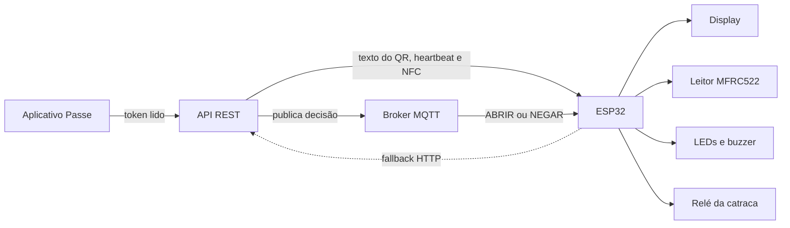
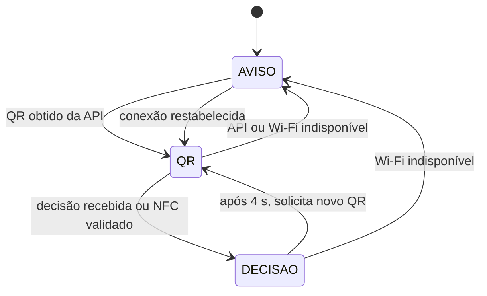
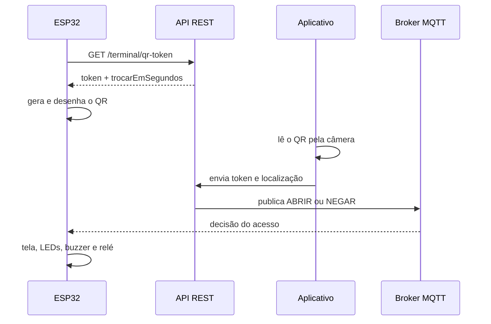
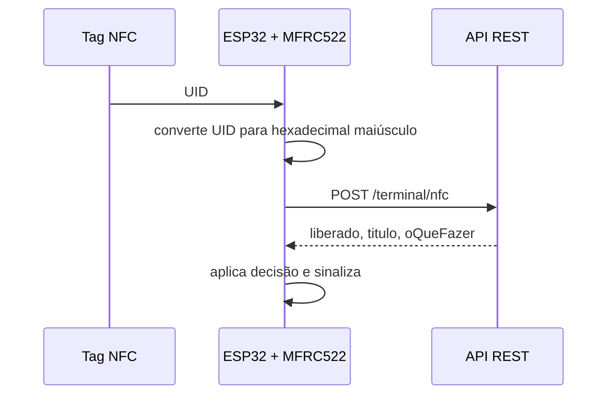

# Documentação técnica do firmware ESP32

| Campo | Valor |
|---|---|
| Projeto | Passe — Controle de acesso por QR Code e NFC |
| Componente | Firmware do terminal físico da catraca |
| Plataforma | ESP32 DevKit (`esp32dev`) |
| Framework | Arduino sobre PlatformIO |
| Revisão | 11/11/2026 |
| Base da documentação | Código atual da pasta `arduino/` |

## 1. Objetivo

O firmware transforma um ESP32 em terminal de controle de acesso do sistema Passe. O dispositivo exibe um QR Code rotativo, lê tags NFC, recebe decisões de acesso, sinaliza o resultado ao usuário e aciona o relé que representa a abertura da catraca.

O ESP32 não decide se uma pessoa pode entrar. Todas as regras de acesso ficam no backend. O terminal apenas:

1. autentica-se como um terminal cadastrado;
2. solicita à API o texto do QR Code;
3. desenha o QR localmente no display;
4. envia o UID das tags NFC para validação;
5. recebe a decisão `ABRIR` ou `NEGAR`;
6. aciona display, LEDs, buzzer e relé;
7. envia sinais periódicos para indicar que está online.

Essa separação evita armazenar no dispositivo o segredo usado para assinar os QR Codes e mantém as regras centralizadas no servidor.

## 2. Responsabilidades e limites

| Responsabilidade | Onde é executada |
|---|---|
| Gerar e assinar o conteúdo do QR | Backend |
| Transformar o texto em imagem QR | ESP32 |
| Ler o QR com a câmera | Aplicativo Flutter |
| Ler o UID de uma tag | ESP32 e MFRC522 |
| Verificar usuário, autorização, horário, local e validade | Backend |
| Publicar a decisão em tempo real | Backend e broker MQTT |
| Executar a abertura física | ESP32 e relé |
| Registrar o evento de acesso | Backend e banco de dados |

O terminal não acessa diretamente o banco de dados e não se comunica diretamente com o aplicativo. API REST e MQTT são as interfaces de integração.

## 3. Tecnologias e bibliotecas

| Tecnologia ou biblioteca | Uso no firmware |
|---|---|
| ESP32 Arduino Core | GPIO, Wi-Fi, SPI, I2C e execução do firmware |
| PlatformIO | Dependências, ambientes, compilação, gravação e monitor serial |
| `HTTPClient` | Chamadas à API REST |
| `WiFiClient` | Transporte HTTP e MQTT sem TLS |
| `WiFiClientSecure` | Transporte HTTPS e MQTT com TLS |
| `PubSubClient` `^2.8` | Cliente MQTT |
| `ArduinoJson` `^7.2.1` | Leitura das respostas e mensagens JSON |
| `MFRC522` `^1.4.11` | Comunicação com o leitor NFC/RFID RC522 |
| `Adafruit GFX` `^1.11.11` | Operações gráficas compartilhadas pelos displays |
| Driver ST7789 `^1.10.4` | Display TFT ST7789 |
| Driver ILI9341 `^1.6.1` | Display TFT ILI9341 |
| Driver SSD1306 `^2.5.13` | Display OLED SSD1306 |
| `qrcodegen` | Geração local dos módulos do QR Code |

O projeto fixa `espressif32@6.9.0`, usa a placa `esp32dev` e configura o monitor serial para `115200` baud.

## 4. Arquitetura



Há dois canais de comunicação com o backend:

- HTTP/HTTPS para QR, heartbeat, NFC e fila de decisões;
- MQTT para entrega imediata das decisões de QR.

Quando o MQTT está indisponível, o firmware continua consultando a fila de decisões por HTTP a cada dois segundos.

## 5. Estrutura do código

| Caminho | Responsabilidade |
|---|---|
| `arduino/platformio.ini` | Placa, bibliotecas e ambientes de compilação |
| `arduino/include/config.h` | Pinagem e tempos do terminal |
| `arduino/include/credenciais.exemplo.h` | Modelo das configurações privadas |
| `arduino/include/credenciais.h` | Configuração local real, ignorada pelo Git |
| `arduino/include/ca_digicert_g2.h` | Autoridade certificadora usada na configuração MQTT em nuvem |
| `arduino/src/main.cpp` | Wi-Fi, API, MQTT, NFC, relé e ciclo principal |
| `arduino/src/tela.h` | Interface do módulo de tela |
| `arduino/src/tela.cpp` | Renderização do QR, avisos e decisões |
| `arduino/lib/qrcodegen/` | Biblioteca de geração de QR Code |
| `arduino/testes/bancada/teste_bancada.cpp` | Testes físicos sem Wi-Fi e sem backend |

## 6. Hardware suportado

O hardware principal previsto pelo projeto é:

- ESP32 DevKit com ESP32-WROOM-32;
- display TFT ST7789 240×240, recomendado para o protótipo;
- display TFT ILI9341 240×320, como alternativa;
- OLED SSD1306 128×64, apenas para testes devido ao QR muito pequeno;
- leitor MFRC522 de 13,56 MHz;
- módulo relé de um canal;
- LED verde e LED vermelho;
- buzzer ativo;
- trava, catraca simulada ou outro atuador ligado ao relé.

O ST7789 usado com o MFRC522 precisa possuir pino `CS`, pois os dois componentes compartilham o barramento SPI.

## 7. Pinagem

### 7.1 Barramento SPI compartilhado

| Sinal | GPIO | Uso |
|---|---:|---|
| SCK | 18 | Clock do TFT e do MFRC522 |
| MISO | 19 | Dados do MFRC522 para o ESP32 |
| MOSI | 23 | Dados do ESP32 para TFT e MFRC522 |

Cada periférico possui seleção independente, evitando conflito no barramento.

### 7.2 Display TFT

| Sinal | GPIO |
|---|---:|
| CS | 5 |
| DC/RS | 16 |
| RST/RES | 17 |

No ST7789, as dimensões padrão declaradas em `config.h` são 240×240. Para um modelo ST7789 240×320, `TFT_ALTURA` deve corresponder à altura física do display.

### 7.3 OLED SSD1306

| Sinal | GPIO ou valor |
|---|---:|
| SDA | 21 |
| SCL | 22 |
| Endereço I2C | `0x3C` |

### 7.4 NFC, relé e sinalização

| Componente | Sinal | GPIO |
|---|---|---:|
| MFRC522 | SS/SDA | 32 |
| MFRC522 | RST | 13 |
| Relé | IN | 26 |
| LED verde | Anodo por resistor | 25 |
| LED vermelho | Anodo por resistor | 27 |
| Buzzer ativo | Positivo | 4 |

O MFRC522 e o TFT são alimentados em 3,3 V. O MFRC522 não deve ser ligado em 5 V. O módulo relé previsto recebe 5 V pelo `VIN`, com GND comum ao ESP32.

O firmware considera, por padrão, um relé ativo em nível baixo:

```cpp
#define RELE_LIGADO LOW
#define RELE_DESLIGADO HIGH
```

Caso o módulo instalado seja ativo em nível alto, essas duas definições precisam ser invertidas antes da gravação.

## 8. Ambientes de compilação

| Ambiente | Display ou finalidade | Símbolo de compilação |
|---|---|---|
| `tft` | ST7789, ambiente padrão | `TELA_ST7789` |
| `ili9341` | ILI9341 | `TELA_ILI9341` |
| `oled` | SSD1306 128×64 | `TELA_SSD1306` |
| `teste` | Teste de bancada com ST7789 | `TELA_ST7789` |

O ambiente `teste` exclui o `main.cpp` normal e compila `tela.cpp` junto com `testes/bancada/teste_bancada.cpp`. Por isso, ele não exige Wi-Fi, backend nem arquivo `credenciais.h`.

## 9. Estados de operação

O firmware mantém três estados visuais:

| Estado | Significado |
|---|---|
| `AVISO` | Conexão em andamento ou falha de Wi-Fi/API |
| `QR` | QR Code atual exibido e aguardando uso |
| `DECISAO` | Resultado de acesso visível e sinalização em execução |



O estado controla principalmente o conteúdo da tela. MQTT, relé e temporizadores também são tratados no ciclo principal.

## 10. Inicialização

Ao ligar ou reiniciar o ESP32, `setup()` executa:

1. inicia o monitor serial em 115200 baud;
2. configura relé, LEDs e buzzer como saídas;
3. coloca imediatamente o relé no estado desligado;
4. inicia o barramento SPI;
5. inicializa o display selecionado;
6. inicializa o MFRC522;
7. configura o certificado da API, quando fornecido;
8. configura o certificado MQTT, quando fornecido;
9. define servidor, callback, buffer e timeout do cliente MQTT;
10. conecta o ESP32 à rede Wi-Fi;
11. envia o primeiro heartbeat;
12. consulta a fila para posicionar o último número de sequência.

Durante a conexão inicial com o Wi-Fi, o código permanece aguardando até obter conexão. O IP local recebido é escrito no monitor serial.

## 11. Configuração privada

O firmware normal inclui `credenciais.h`. Esse arquivo deve ser criado a partir de `credenciais.exemplo.h` e não deve ser versionado.

| Definição | Finalidade |
|---|---|
| `WIFI_SSID` | Nome da rede Wi-Fi |
| `WIFI_SENHA` | Senha da rede Wi-Fi |
| `API_URL` | Endereço base da API, sem barra final |
| `API_CA_CERT` | Certificado CA opcional para validar HTTPS |
| `MQTT_HOST` | Host ou IP do broker |
| `MQTT_PORT` | Porta do broker |
| `MQTT_CA_CERT` | Certificado CA opcional para MQTT com TLS |
| `TERMINAL_ID` | Identificador exclusivo do terminal |
| `TERMINAL_KEY` | Chave privada do terminal |

Exemplo de preparação no PowerShell, sem preencher valores na documentação:

```powershell
Set-Location arduino
Copy-Item include/credenciais.exemplo.h include/credenciais.h
```

Depois da cópia, os valores devem ser preenchidos apenas no arquivo local. `arduino/.gitignore` exclui `include/credenciais.h` do Git.

O script `backend/scripts/provisionar-terminal.mjs` também pode cadastrar ou trocar a chave de um terminal e atualizar o arquivo local. A chave deve ser tratada como segredo e nunca deve aparecer em documentação, captura de tela, commit ou log compartilhado.

## 12. Autenticação do terminal

Todas as chamadas REST incluem os cabeçalhos:

```http
X-Terminal-Id: <identificador-do-terminal>
X-Terminal-Key: <chave-do-terminal>
Content-Type: application/json
```

No MQTT, o mesmo par é usado de outra forma:

| Campo MQTT | Valor usado |
|---|---|
| Usuário | Identificador do terminal |
| Senha | Chave do terminal |
| Client ID | Prefixo `passe-terminal-` e os primeiros oito caracteres do ID |

Cada terminal assina somente o tópico associado ao próprio ID. A autorização efetiva desse limite depende da ACL configurada no broker.

## 13. Integração com a API REST

### 13.1 Cliente HTTP

A função central de acesso à API:

- concatena `API_URL` com o caminho solicitado;
- seleciona cliente comum para HTTP ou cliente seguro para HTTPS;
- aplica timeout de 5 segundos;
- adiciona a identidade do terminal nos cabeçalhos;
- executa `GET` ou `POST`;
- tenta converter a resposta em JSON;
- devolve o status HTTP ao fluxo chamador.

Falhas de transporte retornam valor negativo. Respostas que não contêm JSON válido são informadas no monitor serial.

### 13.2 Endpoints consumidos

| Método | Endpoint | Uso | Corpo enviado |
|---|---|---|---|
| `GET` | `/terminal/qr-token` | Obter o token e o intervalo de troca | Nenhum |
| `POST` | `/terminal/heartbeat` | Informar que o terminal está online | `{}` |
| `GET` | `/terminal/decisions?apos={seq}` | Consultar decisões após uma sequência | Nenhum |
| `POST` | `/terminal/nfc` | Validar o UID lido | `{"uid":"<UID>"}` |

O timeout HTTP é compartilhado por todas essas operações. O firmware não executa chamadas diretamente a endpoints de usuários, autorizações ou banco de dados.

## 14. Fluxo do QR Code



O backend envia texto, não uma imagem. O módulo `tela.cpp` converte esse texto em QR Code no próprio ESP32.

Detalhes da renderização:

- biblioteca `qrcodegen` armazenada no projeto;
- versão máxima de QR configurada como 6;
- correção de erro solicitada no nível médio;
- fundo branco e módulos pretos;
- margem de quatro módulos nos displays maiores;
- escala calculada conforme as dimensões disponíveis;
- rodapé exibido quando a altura do display é suficiente;
- token atual redesenhado conforme `trocarEmSegundos`, com padrão de 10 segundos.

O token compacto atual normalmente cabe na versão 4, com 33×33 módulos. No TFT de 240 pixels ele possui escala adequada para leitura por celular. No OLED 128×64, a escala fica pequena e o ambiente é indicado somente para teste.

Se a API não responder, devolver status diferente de `200` ou não fornecer um token, o terminal mostra `Sem servidor` e tenta novamente após três segundos. Uma resposta `401` é mostrada como recusa da chave do terminal.

## 15. Fluxo MQTT

O tópico de decisão é montado em tempo de execução:

```text
passe/terminais/{TERMINAL_ID}/decisoes
```

O terminal assina esse tópico com QoS 1. O buffer do `PubSubClient` é configurado para 512 bytes e o timeout do socket para três segundos.

Uma mensagem de decisão esperada contém os campos utilizados pelo firmware:

| Campo | Uso |
|---|---|
| `acao` | `ABRIR` libera; qualquer outro valor é tratado como negação |
| `metodo` | Permite distinguir decisões NFC das demais |
| `nome` | Nome exibido na liberação, quando presente |
| `mensagem` | Texto complementar ou motivo da negação |

As decisões com `metodo` igual a `NFC` são ignoradas no callback/fallback, pois a decisão NFC já chega diretamente na resposta do `POST /terminal/nfc`.

Em caso de desconexão do broker, uma nova tentativa MQTT ocorre a cada cinco segundos. Enquanto isso, o terminal utiliza o fallback HTTP.

## 16. Fallback HTTP de decisões

O firmware consulta `/terminal/decisions?apos={ultimoSeq}` a cada dois segundos, inclusive para manter a posição da fila atualizada.

O tratamento evita duplicidade:

1. cada item devolvido possui um número `seq`;
2. `ultimoSeq` avança para o maior valor recebido;
3. com MQTT conectado, a consulta apenas avança a sequência;
4. com MQTT desconectado, as decisões novas são executadas pelo HTTP;
5. na primeira consulta após ligar, decisões antigas são ignoradas.

Essa inicialização impede que o terminal abra a catraca por uma decisão que já estava pendente antes de ele ser ligado.

## 17. Fluxo NFC



O UID é montado byte a byte em hexadecimal, com zero à esquerda quando necessário, e convertido para letras maiúsculas. Depois da leitura, o cartão é colocado em estado de parada com `PICC_HaltA()`.

Para evitar múltiplas solicitações causadas pela permanência da tag sobre o leitor, o mesmo UID é ignorado por três segundos. Uma tag diferente pode ser processada sem aguardar esse intervalo.

Se o endpoint NFC não devolver `200`, o firmware nega localmente a abertura, mostra `Sem servidor` e orienta a tentar novamente. Isso é um comportamento de falha segura: indisponibilidade da API não produz liberação.

## 18. Aplicação da decisão

### 18.1 Acesso liberado

Quando a ação é `ABRIR`, o firmware:

1. mostra uma tela de sucesso;
2. acende o LED verde;
3. mantém o LED vermelho apagado;
4. liga o relé;
5. emite um bipe de 120 ms;
6. desliga o relé após três segundos;
7. mantém a decisão na tela por quatro segundos;
8. solicita um novo QR imediatamente após encerrar a decisão.

Se houver nome na mensagem, o texto exibido é `Bem-vindo(a),` seguido do nome. Sem nome, é usada a mensagem recebida.

### 18.2 Acesso negado

Quando a ação não é `ABRIR`, o firmware:

1. mostra uma tela de acesso negado;
2. acende o LED vermelho;
3. mantém o LED verde apagado;
4. não liga o relé;
5. emite dois bipes de 80 ms;
6. mantém o resultado na tela por quatro segundos;
7. apaga os LEDs e solicita um novo QR.

Nos displays coloridos, sucesso e negação usam fundos diferentes. No OLED monocromático, a distinção depende dos textos e dos símbolos `OK` e `X`.

## 19. Heartbeat e estado online

O terminal envia `POST /terminal/heartbeat` com corpo vazio a cada 30 segundos. A API considera o terminal offline após 90 segundos sem sinal, conforme o comentário de configuração do firmware.

Quando a resposta contém `nome`, esse valor passa a identificar o terminal no rodapé do QR Code. Assim, o nome mostrado pode ser atualizado pelo backend sem recompilar o firmware.

## 20. Tempos configurados

| Constante | Valor atual | Finalidade |
|---|---:|---|
| `TEMPO_RELE_MS` | 3000 ms | Duração da liberação física |
| `TEMPO_DECISAO_MS` | 4000 ms | Duração da tela de resultado |
| `INTERVALO_SINAL_MS` | 30000 ms | Intervalo do heartbeat |
| `INTERVALO_CONSULTA_MS` | 2000 ms | Consulta da fila HTTP |
| `ESPERA_ERRO_MS` | 3000 ms | Nova tentativa após erro da API |
| `ESPERA_MQTT_MS` | 5000 ms | Nova tentativa de conexão MQTT |
| `TIMEOUT_HTTP_MS` | 5000 ms | Limite de uma operação HTTP |
| `NFC_REPETICAO_MS` | 3000 ms | Supressão da mesma tag |

Esses valores ficam centralizados em `arduino/include/config.h`.

## 21. Ciclo principal

Em funcionamento normal, `loop()` executa nesta ordem:

1. verifica o Wi-Fi;
2. tenta conectar ao MQTT quando necessário;
3. processa mensagens MQTT;
4. verifica o momento de desligar o relé;
5. mantém a tela de decisão pelo período configurado;
6. busca ou renova o QR;
7. envia heartbeat quando necessário;
8. consulta a fila de decisões;
9. procura uma nova tag NFC.

Enquanto a tela de decisão ainda está ativa, o ciclo retorna antes das etapas de QR, heartbeat, fallback e NFC. A manutenção do MQTT e a verificação do relé já ocorreram antes desse retorno.

## 22. Wi-Fi e rede

O ESP32 opera em modo estação (`WIFI_STA`) e ativa reconexão automática. No protótipo local:

- ESP32 e computador devem alcançar a mesma API e o mesmo broker;
- `API_URL` e `MQTT_HOST` devem apontar para um endereço acessível pelo ESP32;
- `localhost` no ESP32 representa o próprio microcontrolador e não o computador;
- redes com isolamento entre clientes podem impedir a comunicação;
- as portas da API e do MQTT precisam estar acessíveis na rede usada.

Se o Wi-Fi cair durante o uso, a tela informa `Sem Wi-Fi`, o QR é marcado para renovação e o ciclo aguarda a reconexão automática.

## 23. TLS e segurança

### 23.1 API

Quando `API_URL` começa com `https://`, o firmware usa `WiFiClientSecure`.

- com `API_CA_CERT`, o certificado do servidor pode ser validado;
- sem `API_CA_CERT`, o código atual chama `setInsecure()`.

O segundo caso cifra a conexão, mas não autentica o servidor e fica vulnerável a interceptação. É aceitável apenas como facilidade do protótipo; uma implantação real deve fornecer a CA correta.

### 23.2 MQTT

Quando `MQTT_CA_CERT` está definido, o cliente MQTT é seguro e recebe a CA configurada. Sem essa definição, o firmware usa `WiFiClient` comum. A porta deve corresponder ao listener escolhido no broker.

### 23.3 Segredos

O terminal armazena somente as credenciais necessárias para identificar a própria unidade. Ele não armazena:

- segredo HMAC usado para criar o token QR;
- regras de autorização;
- senhas dos usuários;
- dados completos do banco;
- credenciais de outros terminais.

Mesmo assim, `TERMINAL_KEY` e a senha do Wi-Fi são sensíveis. Em caso de exposição, a chave do terminal deve ser trocada e o firmware deve ser gravado novamente.

## 24. Compilação e gravação

Pré-requisitos:

- VS Code com extensão PlatformIO ou PlatformIO Core instalado;
- placa ESP32 conectada por USB;
- driver USB correspondente à placa;
- `credenciais.h` configurado para os ambientes normais.

Comandos executados dentro de `arduino/`:

```powershell
pio run -e tft -t upload
pio run -e ili9341 -t upload
pio run -e oled -t upload
pio device monitor
```

O ambiente padrão é `tft`, portanto `pio run` sem `-e` compila o ST7789. O monitor serial usa 115200 baud.

Para apenas compilar, sem gravar:

```powershell
pio run -e tft
pio run -e ili9341
pio run -e oled
```

## 25. Teste de bancada

Antes de testar o sistema completo, o projeto permite validar a montagem sem rede e sem credenciais:

```powershell
Set-Location arduino
pio run -e teste -t upload
pio device monitor
```

No monitor serial, o menu oferece:

| Opção | Teste |
|---:|---|
| `1` | Pisca LED verde e LED vermelho três vezes |
| `2` | Emite três bipes |
| `3` | Liga e desliga o relé três vezes |
| `4` | Mostra sucesso, negação e QR de teste |
| `5` | Verifica a comunicação com o MFRC522 |
| `0` | Executa todos os testes em sequência |

Ao iniciar, o teste também pisca o LED azul da própria placa no GPIO 2, quando existente. Uma tag pode ser aproximada a qualquer momento; o UID é exibido no monitor serial para auxiliar o cadastro.

O teste do MFRC522 lê o registrador de versão. Respostas `0x00` ou `0xFF` são tratadas como leitor ausente ou ligação incorreta.

## 26. Logs pelo monitor serial

O firmware informa, entre outros eventos:

- progresso e IP da conexão Wi-Fi;
- conexão MQTT e tópico assinado;
- estado de erro do MQTT;
- falhas HTTP;
- JSON inválido;
- UID lido;
- decisão `ABRIR` ou `NEGAR`;
- token grande demais para o limite do QR.

As credenciais não são impressas pelo código atual. Mesmo assim, logs devem ser revisados antes de serem publicados, pois podem conter IP, ID do terminal, tópico e UID de tag.

## 27. Tratamento de falhas

| Falha | Comportamento atual |
|---|---|
| Wi-Fi ausente na inicialização | Permanece aguardando e mostra conexão em andamento |
| Wi-Fi perdido em execução | Mostra aviso e aguarda reconexão automática |
| API indisponível ao buscar QR | Mostra aviso e tenta novamente após 3 s |
| Chave rejeitada no QR | Mostra que a chave foi recusada |
| MQTT indisponível | Usa fila de decisões por HTTP |
| JSON MQTT inválido | Descarta a mensagem e registra erro |
| API NFC indisponível | Nega o acesso |
| Mesma tag repetida rapidamente | Ignora por 3 s |
| QR maior que a capacidade configurada | Não desenha e registra o tamanho no Serial |
| Relé ativo em nível diferente | Exige ajuste em `config.h` |

## 28. Limitações e cuidados técnicos

### 28.1 Operações bloqueantes

Alguns trechos usam espera bloqueante:

- conexão Wi-Fi inicial sem limite de tempo;
- chamadas HTTP com timeout de até cinco segundos;
- delays curtos do buzzer;
- espera de um segundo durante perda de Wi-Fi.

Durante esses períodos, outras tarefas do ciclo podem ser adiadas.

### 28.2 Relé durante perda de Wi-Fi

No código atual, a verificação do Wi-Fi ocorre antes da verificação do temporizador que desliga o relé. Se a rede cair exatamente enquanto o relé estiver ligado, o ciclo retorna antecipadamente e o desligamento pode ser adiado até a conexão voltar. Para uso além do protótipo, o desligamento do relé deve ser priorizado antes de qualquer retorno por falha de rede ou protegido por mecanismo independente de segurança.

### 28.3 Validação TLS opcional

HTTPS sem `API_CA_CERT` usa modo inseguro, e MQTT sem `MQTT_CA_CERT` trafega sem TLS. Uma implantação real deve validar os certificados e limitar o broker à porta segura.

### 28.4 Dependência do backend

O terminal falha de forma fechada: sem API ele não valida NFC e não cria decisões novas. O QR exibido também depende da renovação fornecida pelo backend. Esse comportamento protege a entrada, mas significa que disponibilidade de rede e servidor é requisito operacional.

### 28.5 OLED apenas para teste

O SSD1306 128×64 consegue executar o código, mas o QR fica pequeno para uma demonstração confiável. O TFT de 240 pixels é a opção recomendada.

## 29. Integração contínua

O job `Firmware ESP32 · build` do GitHub Actions:

1. prepara Python 3.12;
2. restaura o cache do PlatformIO;
3. instala o PlatformIO;
4. cria `credenciais.h` a partir do modelo;
5. compila `tft`, `ili9341`, `oled` e `teste`;
6. recompila o ambiente `tft` com a configuração MQTT TLS.

O CI verifica a compilação das variantes, mas não substitui testes físicos de display, leitor, relé, alimentação, alcance Wi-Fi e leitura do QR por um celular.

## 30. Procedimento recomendado de validação

1. conferir a alimentação e o GND comum;
2. confirmar que o MFRC522 está em 3,3 V;
3. gravar o ambiente `teste`;
4. executar LEDs, buzzer, relé, display e NFC separadamente;
5. anotar o UID de uma tag de teste;
6. configurar Wi-Fi, API, MQTT, ID e chave no arquivo local;
7. gravar o ambiente correspondente ao display;
8. confirmar no Serial o IP e a conexão MQTT;
9. verificar se o terminal aparece online no sistema;
10. ler o QR pelo aplicativo e validar liberação e negação;
11. desconectar temporariamente o broker e validar o fallback HTTP;
12. aproximar uma tag autorizada e uma não autorizada;
13. confirmar que o relé retorna ao estado desligado;
14. conferir a renovação do QR após cada decisão.

## 31. Solução de problemas

### Display branco ou preto

- conferir VCC, GND, SCK/SCL, MOSI/SDA, CS, DC e RST;
- confirmar se o ambiente compilado corresponde ao controlador do display;
- conferir largura e altura no caso do ST7789;
- evitar ST7789 sem `CS` quando o SPI também é usado pelo NFC.

### MFRC522 não encontrado

- alimentar exclusivamente em 3,3 V;
- conferir SS no GPIO 32 e RST no GPIO 13;
- conferir SCK 18, MOSI 23 e MISO 19;
- executar a opção `5` do teste de bancada.

### Relé fica ligado

- confirmar se o módulo é ativo em `LOW` ou em `HIGH`;
- ajustar `RELE_LIGADO` e `RELE_DESLIGADO`;
- confirmar que o firmware coloca o relé no estado seguro logo após configurar o GPIO;
- revisar o comportamento em caso de queda de Wi-Fi durante a abertura.

### MQTT não conecta

- conferir host e porta;
- conferir ID e chave do terminal;
- validar se o broker possui o usuário e a ACL desse terminal;
- quando houver TLS, conferir se a CA corresponde ao certificado do broker;
- observar o código de estado impresso no Serial;
- confirmar se o fallback HTTP continua recebendo decisões.

### API responde `401`

- conferir se ID e chave pertencem ao mesmo terminal;
- trocar ou provisionar novamente a chave quando necessário;
- gravar novamente o firmware após atualizar `credenciais.h`.

### QR não é lido

- usar TFT em vez de OLED;
- confirmar foco, brilho, reflexo e distância da câmera;
- conferir se o display possui resolução e dimensões configuradas corretamente;
- observar no Serial se o token excedeu a versão máxima aceita.

## 32. Arquivos relacionados

| Documento | Conteúdo |
|---|---|
| `docs/hardware.md` | Lista de materiais e pinagem |
| `docs/montagem-terminal.html` | Montagem física passo a passo |
| `docs/terminal-iot.md` | Provisionamento, token QR e segurança do broker |
| `docs/rede-do-prototipo.md` | Rede local, IP e firewall |
| `docs/deploy-nuvem.md` | Configuração do terminal para serviços em nuvem |
| `docs/documentacao-tecnica/api.md` | Contrato e funcionamento da API |
| `docs/documentacao-tecnica/mqtt.md` | Arquitetura MQTT e fallback |

## 33. Resumo técnico

O firmware atual implementa um terminal ESP32 com QR Code, NFC, MQTT, fallback HTTP, heartbeat e acionamento físico. O backend permanece como autoridade das decisões, enquanto o dispositivo se limita à aquisição, apresentação e execução. A estrutura PlatformIO mantém variantes para três displays e um ambiente de teste de bancada, e o CI compila todas elas. Para uma implantação real, os principais reforços necessários são validação TLS obrigatória, proteção adicional do tempo máximo do relé e revisão das operações bloqueantes.
