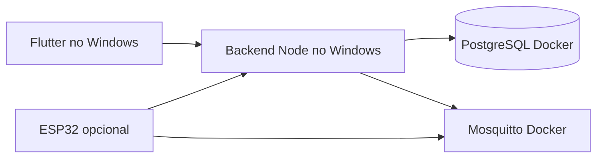

# Instalação e configuração do ambiente

| Campo | Valor |
|---|---|
| Projeto | Passe — Controle de acesso por QR Code e NFC |
| Finalidade | Preparar o ambiente local de desenvolvimento e testes |
| Sistema principal deste guia | Windows com PowerShell |
| Alternativas | Docker, execução híbrida e ferramentas nativas |
| Revisão | 11/11/2026 |
| Base da documentação | Configurações e comandos atuais do repositório |

## 1. Objetivo

Este documento apresenta a instalação e a configuração necessárias para executar o sistema Passe localmente.

O projeto possui quatro áreas que podem ser preparadas separadamente:

- backend Node.js com PostgreSQL e MQTT;
- aplicativo Flutter;
- terminal ESP32 com PlatformIO;
- contêineres Docker usados no desenvolvimento.

Nem todo integrante precisa instalar todas as ferramentas. A escolha depende da parte do projeto que será desenvolvida.

## 2. Formas de executar o projeto

| Opção | Ferramentas locais | Serviços executados | Uso indicado |
|---|---|---|---|
| Tudo no Docker | Git, Docker Desktop e navegador | Banco, broker, backend e Flutter Web | Primeira execução e demonstração rápida |
| Ambiente híbrido | Git, Docker, Node 24 e Flutter | Banco/broker no Docker; backend e app no host | Desenvolvimento diário |
| Backend e simuladores | Git, Docker e Node 24 | Banco, broker, API, console e simulador web | Trabalho sem Flutter e sem ESP32 |
| Firmware ESP32 | VS Code/PlatformIO e ferramentas anteriores conforme integração | Firmware e teste de bancada | Montagem do terminal físico |

O ambiente híbrido oferece melhor recarga, depuração e acesso às ferramentas. A opção totalmente em Docker reduz a instalação inicial.

## 3. Requisitos confirmados pelo projeto

| Ferramenta | Requisito do repositório | Recomendação para paridade |
|---|---|---|
| Git | Não fixado | Versão recente com suporte normal a HTTPS |
| Docker | Compose V2, comando `docker compose` | Docker Desktop com WSL 2 no Windows |
| Node.js | `>=22` | Node 24, usado pelo Docker e pelo CI |
| npm | Compatível com Node e `package-lock.json` | Versão incluída no Node 24 |
| PostgreSQL | Imagem `postgres:16-alpine` | Usar o contêiner do projeto |
| Flutter | Lockfile exige `>=3.47.0` | Canal estável compatível |
| Dart | `>=3.13.5 <4.0.0` | Versão fornecida pelo Flutter compatível |
| Java | Código Android configurado para Java 17 | JDK fornecido pelo Android Studio/Flutter ou JDK 17 |
| Gradle | Wrapper 9.3.1 | Usar o wrapper do projeto |
| Android Gradle Plugin | 9.1.0 | Gerenciado pelo projeto |
| Kotlin | 2.4.0 | Gerenciado pelo projeto |
| PlatformIO | Não fixado como ferramenta | Extensão atual do VS Code ou PlatformIO Core |
| Plataforma ESP32 | `espressif32@6.9.0` | Baixada automaticamente pelo PlatformIO |
| Python | CI usa 3.12 para PlatformIO | Necessário apenas em algumas instalações do CLI |

Não é necessário instalar PostgreSQL ou Mosquitto diretamente no Windows quando eles são executados pelo Docker.

## 4. Requisitos por função

### Backend

- Git;
- Docker Desktop para PostgreSQL e Mosquitto;
- Node 24 quando a API roda fora do contêiner;
- editor de código.

### Frontend Flutter

- Flutter estável compatível;
- navegador Chrome para Flutter Web;
- Android Studio e Android SDK para Android;
- dispositivo físico ou emulador;
- Java 17 disponível para o build Android.

### Firmware

- VS Code;
- extensão PlatformIO IDE ou PlatformIO Core;
- driver USB correspondente à placa ESP32;
- cabo USB com transmissão de dados;
- Git Bash ou WSL se for gerar certificados com scripts `sh`.

### iOS

Build iOS exige macOS e Xcode. No Windows, o workflow GitHub Actions pode gerar o IPA de teste sem assinatura, mas não substitui o ambiente necessário para desenvolvimento e assinatura iOS.

## 5. Estrutura esperada

Na raiz correta do repositório devem existir:

```text
4DSM-ABP-2026-2/
├── .git/
├── .github/
├── arduino/
├── backend/
├── docker/
├── docs/
├── frontend/
├── scripts/
├── docker-compose.dev.yml
└── README.md
```

Os comandos Git e Docker devem ser executados nessa raiz, salvo quando o guia indicar `backend/`, `frontend/` ou `arduino/`.

## 6. Clonar e entrar na pasta correta

Exemplo genérico:

```powershell
git clone <url-do-repositorio>
Set-Location <nome-da-pasta-clonada>
```

Validação:

```powershell
git status
Test-Path -LiteralPath .git
Test-Path -LiteralPath docker-compose.dev.yml
```

Os dois testes devem retornar `True`.

Se `git status` responder `fatal: not a git repository`, o terminal está na pasta externa ao clone. Entre na subpasta do repositório antes de usar `git pull`, `git push` ou outros comandos Git.

Exemplo comum:

```powershell
Set-Location .\4DSM-ABP-2026-2
git status
```

## 7. Atualizar o clone

Antes de instalar dependências, confirme a branch e atualize o código conforme o fluxo adotado pela equipe:

```powershell
git branch --show-current
git status
git pull
```

Não execute `git pull` com alterações locais não compreendidas. Revise `git status` primeiro e preserve o trabalho existente.

## 8. Verificar ferramentas instaladas

Execute somente os comandos das ferramentas que serão usadas:

```powershell
git --version
docker --version
docker compose version
node --version
npm --version
flutter --version
dart --version
flutter doctor -v
pio --version
```

Resultados esperados:

- Docker responde sem erro de conexão ao daemon;
- Docker Compose usa a forma `docker compose`, sem hífen;
- Node atende ao mínimo 22, preferencialmente 24;
- Flutter atende ao mínimo 3.47.0;
- Dart atende ao intervalo do `pubspec.lock`;
- `flutter doctor` identifica os destinos desejados;
- PlatformIO reconhece o comando `pio`, quando o firmware for usado.

## 9. Preparar Docker Desktop no Windows

Configuração recomendada:

1. habilitar virtualização na BIOS/UEFI, quando necessário;
2. habilitar WSL 2 no Windows;
3. instalar uma distribuição WSL compatível;
4. instalar Docker Desktop;
5. selecionar o backend WSL 2;
6. iniciar Docker Desktop;
7. aguardar o mecanismo ficar pronto.

Verificações:

```powershell
wsl --status
docker version
docker info
docker compose version
```

`docker version` precisa mostrar cliente e servidor. Se mostrar apenas o cliente, o mecanismo do Docker ainda não está acessível.

## 10. Recursos e espaço

Na primeira execução, Docker, imagens Flutter, Android SDK, PlatformIO e dependências npm podem consumir vários gigabytes.

O build Android possui `org.gradle.jvmargs` configurado com limite máximo de heap de 8 GB. Isso não significa consumo constante de 8 GB, mas computadores com pouca memória podem apresentar lentidão ou falha durante builds Android simultâneos com Docker.

Para máquinas limitadas:

- execute somente os serviços necessários;
- prefira Flutter Web para validações iniciais;
- evite Android Studio, emulador, Docker e build de firmware simultaneamente;
- mantenha espaço livre para caches e imagens;
- feche processos de desenvolvimento que não pertencem à tarefa atual.

## 11. Portas utilizadas

| Porta padrão | Serviço | Necessária para |
|---:|---|---|
| 5432 | PostgreSQL | Backend local |
| 3000 | API | Aplicativo, navegador e ESP32 |
| 1883 | MQTT sem TLS | ESP32 em desenvolvimento |
| 8883 | MQTT com TLS | Testes TLS e terminal seguro |
| 9001 | MQTT WebSocket | Simulador web |
| 8080 | Flutter Web no Docker | Interface web de desenvolvimento |

Antes de iniciar, portas ocupadas podem ser verificadas no Windows:

```powershell
Get-NetTCPConnection -State Listen -ErrorAction SilentlyContinue |
  Where-Object LocalPort -In 3000,5432,1883,8883,9001,8080 |
  Select-Object LocalAddress,LocalPort,OwningProcess
```

As portas do host podem ser substituídas por variáveis do Compose, sem alterar as portas internas dos contêineres.

## 12. Opção A — tudo no Docker

Essa opção exige apenas Git, Docker Desktop e navegador.

Na raiz do repositório:

```powershell
docker compose -f docker-compose.dev.yml up --build
```

O Compose inicia:

1. PostgreSQL;
2. Mosquitto;
3. backend;
4. Flutter Web.

Na primeira execução, o download da imagem Flutter pode demorar.

## 13. Inicialização automática no Docker

O backend do Compose executa automaticamente:

1. instalação já preparada na imagem;
2. geração do Prisma Client;
3. aplicação das migrations;
4. seed de desenvolvimento;
5. servidor com recarga automática.

Não é necessário executar migrations ou seed manualmente quando o backend está sendo iniciado por esse serviço.

## 14. Endereços da opção Docker

| Recurso | Endereço padrão |
|---|---|
| API | `http://localhost:3000` |
| Healthcheck | `http://localhost:3000/health` |
| Simulador do terminal | `http://localhost:3000/simulador/` |
| Console web | `http://localhost:3000/console/` |
| Flutter Web | `http://localhost:8080` |

Validação pelo PowerShell:

```powershell
Invoke-RestMethod -Uri http://localhost:3000/health
docker compose -f docker-compose.dev.yml ps
```

O healthcheck da API deve devolver um objeto com estado `ok`.

## 15. Executar somente backend, banco e broker no Docker

Quando o aplicativo Flutter será executado fora do contêiner:

```powershell
docker compose -f docker-compose.dev.yml up --build database mqtt backend
```

Para iniciar em segundo plano:

```powershell
docker compose -f docker-compose.dev.yml up -d --build database mqtt backend
```

Logs:

```powershell
docker compose -f docker-compose.dev.yml logs -f backend
```

## 16. Opção B — ambiente híbrido

No ambiente híbrido:

- PostgreSQL e Mosquitto rodam no Docker;
- backend roda com Node no Windows;
- Flutter roda diretamente no host;
- hot reload e depuração ficam disponíveis nas ferramentas nativas.

Fluxo:



## 17. Subir PostgreSQL e Mosquitto

Na raiz do repositório:

```powershell
docker compose -f docker-compose.dev.yml up -d database mqtt
```

Confira:

```powershell
docker compose -f docker-compose.dev.yml ps
docker compose -f docker-compose.dev.yml logs database
docker compose -f docker-compose.dev.yml logs mqtt
```

O PostgreSQL deve aparecer saudável. O Mosquitto não possui healthcheck no Compose, portanto o log confirma sua inicialização.

## 18. Preparar o backend local

Entre em `backend/`:

```powershell
Set-Location backend
Copy-Item -LiteralPath .env.example -Destination .env
npm ci
npx prisma migrate deploy
npm run db:seed
npm run dev
```

Use `npm ci`, e não `npm install`, para instalar exatamente o lockfile sem reescrevê-lo.

O servidor utiliza `tsx watch` e reinicia automaticamente quando os fontes mudam.

## 19. Arquivo `.env` do backend

O arquivo real fica em:

```text
backend/.env
```

Ele é ignorado pelo Git. O modelo `backend/.env.example` contém todas as chaves reconhecidas.

| Grupo | Variáveis |
|---|---|
| Servidor | `PORT`, `NODE_ENV`, `CORS_ORIGIN`, `APP_TIMEZONE` |
| Banco | `DATABASE_URL` |
| Sessão | `JWT_SECRET`, `JWT_EXPIRES_IN` |
| QR | `QR_SECRET`, `QR_ROTATION_SECONDS`, `QR_TOKEN_TTL_SECONDS` |
| MQTT | `MQTT_URL`, `MQTT_USERNAME`, `MQTT_PASSWORD`, `MQTT_CA_FILE`, `MQTT_WS_URL` |

Regras importantes:

- `JWT_SECRET` e `QR_SECRET` precisam ter pelo menos 16 caracteres;
- use segredos diferentes;
- não coloque aspas ou espaços extras sem necessidade;
- não envie `.env` ao Git;
- não use valores de desenvolvimento em produção;
- confirme `DATABASE_URL` antes de executar migration ou seed.

## 20. Migrations

Para instalar uma cópia existente do projeto, use:

```powershell
npx prisma migrate deploy
```

Esse comando aplica migrations já versionadas.

`prisma migrate dev` é voltado à criação de novas migrations durante desenvolvimento do schema. Ele não deve substituir `migrate deploy` no procedimento normal de instalação.

## 21. Seed de desenvolvimento

O comando:

```powershell
npm run db:seed
```

cria ou preserva dados previsíveis para testes. O seed usa operações de atualização/criação e pode ser executado mais de uma vez.

Cuidados:

- execute somente em banco de desenvolvimento ou teste;
- confirme a `DATABASE_URL` antes;
- o seed pode restaurar a chave do terminal de demonstração;
- não execute automaticamente contra produção;
- o Compose de desenvolvimento executa o seed sempre que o backend inicia.

## 22. Validar o backend

Com `npm run dev` em execução, abra outro PowerShell:

```powershell
Invoke-RestMethod -Uri http://localhost:3000/health
```

Para validar o código:

```powershell
Set-Location backend
npm run lint
npm run typecheck
npm run test:coverage
npm run build
```

Esses comandos equivalem às principais verificações do job de backend no CI.

## 23. Teste de fumaça com banco real

Com PostgreSQL, migrations, seed e API em execução:

```powershell
Set-Location backend
node scripts/smoke.mjs
```

O script altera dados de demonstração durante o teste. Use somente o banco local preparado para desenvolvimento.

Ele valida autenticação, usuários, locais, tags, autorizações, QR, NFC, heartbeat, decisões, histórico e painel.

## 24. Instalar Flutter

O projeto exige Flutter `>=3.47.0` e Dart `>=3.13.5 <4.0.0`.

Depois de instalar o SDK Flutter e adicionar `flutter/bin` ao `PATH`, execute:

```powershell
flutter --version
dart --version
flutter doctor -v
```

Para Android, conclua as licenças quando solicitado:

```powershell
flutter doctor --android-licenses
```

Resolva apenas os itens do `flutter doctor` referentes aos destinos utilizados. Xcode ausente é esperado no Windows.

## 25. Preparar o frontend

Na pasta `frontend/`:

```powershell
Set-Location frontend
flutter pub get
flutter analyze
flutter test
flutter devices
```

`flutter pub get` utiliza `pubspec.lock`, preservando as versões resolvidas pelo projeto.

## 26. Endereço da API por destino

| Destino do Flutter | `API_URL` |
|---|---|
| Chrome no mesmo computador | `http://localhost:3000` |
| Aplicativo Windows no mesmo computador | `http://localhost:3000` |
| Emulador Android padrão | `http://10.0.2.2:3000` |
| Celular físico | `http://<ip-do-computador>:3000` |
| Produção | URL HTTPS configurada para o ambiente |

No Android, `localhost` é o próprio emulador ou celular, não o computador que executa a API.

## 27. Executar Flutter Web

```powershell
Set-Location frontend
flutter run -d chrome --dart-define=API_URL=http://localhost:3000
```

Sem `--dart-define`, o aplicativo usa `http://localhost:3000` por padrão.

O navegador solicitará acesso à câmera e localização nas telas correspondentes. Em Flutter Web, câmera e geolocalização dependem das permissões e das regras de contexto seguro do navegador. `localhost` é o cenário indicado para desenvolvimento local.

## 28. Executar no emulador Android

1. Instale Android Studio e os componentes indicados pelo `flutter doctor`.
2. Crie ou inicie um dispositivo virtual.
3. Confira o ID com `flutter devices`.
4. Execute:

```powershell
Set-Location frontend
flutter run -d <id-do-emulador> --dart-define=API_URL=http://10.0.2.2:3000
```

O manifesto de debug permite HTTP local. Builds Android de release continuam exigindo HTTPS.

## 29. Executar em celular Android físico

Requisitos:

- modo desenvolvedor e depuração USB ativos;
- driver USB reconhecido no Windows;
- celular autorizado para depuração;
- celular e computador na mesma rede para acesso à API;
- firewall permitindo a porta 3000 em rede privada.

Descubra o IP do computador:

```powershell
Get-NetIPAddress -AddressFamily IPv4 |
  Where-Object AddressState -eq Preferred |
  Select-Object InterfaceAlias,IPAddress
```

Teste `http://<ip-do-computador>:3000/health` no navegador do celular.

Depois:

```powershell
Set-Location frontend
flutter devices
flutter run -d <id-do-celular> --dart-define=API_URL=http://<ip-do-computador>:3000
```

## 30. Permissões do aplicativo

O Android declara:

- internet;
- câmera;
- localização precisa;
- localização aproximada.

Durante o teste:

- câmera é usada para o QR;
- localização é usada na validação de proximidade;
- permissão negada produz as telas de orientação implementadas;
- GPS desligado ou timeout causa decisão de localização ausente.

## 31. Testes Flutter contra API real

O comando padrão `flutter test` não executa de verdade a suíte que depende da API, pois ela é ignorada quando `API_REAL` não é informado.

Com backend e seed ativos:

```powershell
Set-Location frontend
flutter test test/integracao --dart-define=API_REAL=http://localhost:3000
```

Essa suíte depende dos dados de demonstração. Execute-a apenas contra o banco local de teste.

## 32. Opção C — trabalhar sem instalar Flutter

O backend fornece duas interfaces no navegador:

| Interface | Endereço |
|---|---|
| Simulador de terminal | `http://localhost:3000/simulador/` |
| Console de telas | `http://localhost:3000/console/` |

Para usá-las:

```powershell
docker compose -f docker-compose.dev.yml up --build database mqtt backend
```

Essa opção permite validar API, QR, NFC simulado, MQTT, autorizações e histórico sem Flutter ou hardware físico.

## 33. Preparar o PlatformIO

Forma recomendada:

1. instale VS Code;
2. instale a extensão PlatformIO IDE;
3. abra a pasta `arduino/` como projeto PlatformIO;
4. aguarde o download da plataforma e bibliotecas;
5. conecte a placa ESP32 por USB;
6. confirme a porta serial.

Pelo CLI, a instalação está correta quando:

```powershell
pio --version
pio device list
```

## 34. Teste de bancada sem credenciais

O ambiente `teste` não usa Wi-Fi, backend nem `credenciais.h`.

```powershell
Set-Location arduino
pio run -e teste -t upload
pio device monitor
```

O monitor serial usa 115200 baud e oferece testes de LEDs, buzzer, relé, display e NFC.

Essa etapa deve ser concluída antes do firmware integrado.

## 35. Preparar credenciais do firmware

Na primeira configuração:

```powershell
Set-Location arduino
Copy-Item -LiteralPath include\credenciais.exemplo.h -Destination include\credenciais.h
```

O arquivo local deve receber:

- SSID e senha do Wi-Fi;
- URL da API;
- host e porta MQTT;
- ID e chave do terminal;
- autoridades certificadoras quando houver TLS.

`include/credenciais.h` é ignorado pelo Git. Não publique o conteúdo em documentação, mensagens, screenshots ou commits.

## 36. Compilar e gravar o firmware

Na pasta `arduino/`:

```powershell
pio run -e tft
pio run -e tft -t upload
pio device monitor
```

Outros ambientes:

```powershell
pio run -e ili9341 -t upload
pio run -e oled -t upload
```

Escolha o ambiente correspondente ao display instalado. O padrão `tft` usa ST7789.

## 37. Porta serial e driver USB

Se a placa não aparecer:

- teste outro cabo USB com dados;
- teste outra porta USB;
- verifique o Gerenciador de Dispositivos;
- instale o driver do conversor USB da placa;
- feche outro monitor serial que esteja usando a porta;
- execute `pio device list`;
- pressione o botão BOOT quando o modelo exigir durante a gravação.

Não é possível manter a mesma porta aberta simultaneamente em dois monitores seriais.

## 38. Rede do ESP32

No ambiente local:

- computador e ESP32 devem estar na mesma rede;
- o firmware usa o IP do computador, não `localhost`;
- a rede deve permitir comunicação entre clientes;
- o IP do computador deve permanecer estável durante a demonstração;
- firewall precisa permitir API e MQTT;
- redes institucionais com isolamento podem impedir a comunicação.

Um hotspot privado pode ser usado quando a rede disponível isola dispositivos.

## 39. Preparar o firewall do Windows

O projeto contém um script que altera o firewall para redes privadas:

```powershell
powershell -ExecutionPolicy Bypass -File scripts\preparar-rede-windows.ps1
```

Ele exige PowerShell como administrador e libera 3000, 1883, 8883 e 9001.

Antes de executar:

- confirme que o computador está em uma rede confiável;
- leia o script;
- use somente o perfil de rede privada;
- entenda que a ação modifica regras do Windows.

A opção `-CorrigirPortas` também altera a faixa dinâmica TCP e requer reinicialização. Deve ser usada apenas quando o diagnóstico indicar conflito do Hyper-V/WSL.

## 40. Testar acesso pela rede

No computador:

```powershell
Invoke-RestMethod -Uri http://localhost:3000/health
```

Em outro dispositivo conectado à mesma rede, abra:

```text
http://<ip-do-computador>:3000/health
```

Se funciona em `localhost`, mas não pelo IP:

- confira o firewall;
- confirme o perfil privado;
- confirme o IP da interface correta;
- verifique isolamento de clientes no roteador;
- confira se a API está publicada em 3000.

## 41. MQTT local

Para iniciar apenas o broker:

```powershell
docker compose -f docker-compose.dev.yml up -d mqtt
```

Logs:

```powershell
docker compose -f docker-compose.dev.yml logs -f mqtt
```

O broker exige autenticação e aplica ACL. O backend publica decisões e cada terminal lê apenas o próprio tópico.

O firmware tenta reconectar ao broker e usa a fila HTTP como fallback quando MQTT está indisponível.

## 42. Validar ACL do broker

Com dependências do backend instaladas e broker em execução:

```powershell
Set-Location backend
node scripts/mqtt-acl.mjs
```

O teste verifica acesso anônimo, senha errada, tópico do próprio terminal, isolamento entre terminais e proibição de publicação falsa.

Use somente as credenciais de desenvolvimento preparadas para esse ambiente.

## 43. MQTT com TLS local

O gerador é um script shell. No Windows, execute pelo Git Bash ou WSL:

```bash
sh docker/mosquitto/gerar-certificados.sh <ip-do-computador> <dns-opcional>
```

Depois, no PowerShell:

```powershell
docker compose -f docker-compose.dev.yml restart mqtt
```

O IP ou DNS usado pelos clientes precisa constar no SAN do certificado.

Arquivos gerados em `docker/mosquitto/certs/` e `conf.d/tls.conf` ficam fora do Git.

## 44. Arquivos privados e ignorados

| Arquivo ou diretório | Conteúdo | Regra |
|---|---|---|
| `backend/.env` | Banco, segredos e MQTT | Não versionar |
| `.env` na raiz, se usado | Substituições do Compose | Não versionar |
| `arduino/include/credenciais.h` | Wi-Fi, API e terminal | Não versionar |
| `docker/mosquitto/certs/` | Certificados e chaves | Não versionar |
| `docker/mosquitto/conf.d/*.conf` | Listener TLS gerado | Não versionar |

Antes de um commit:

```powershell
git status --short
```

Nenhum desses arquivos deve aparecer como novo ou modificado para envio.

## 45. Rotina diária recomendada

### Iniciar infraestrutura

```powershell
docker compose -f docker-compose.dev.yml up -d database mqtt
```

### Iniciar backend

```powershell
Set-Location backend
npm run dev
```

### Iniciar frontend em outro terminal

```powershell
Set-Location frontend
flutter run -d chrome --dart-define=API_URL=http://localhost:3000
```

### Encerrar

Interrompa os processos Node e Flutter com `Ctrl+C`. Depois, na raiz:

```powershell
docker compose -f docker-compose.dev.yml stop
```

`stop` preserva contêineres e volumes para a próxima execução.

## 46. Encerrar e preservar dados

Para remover contêineres e rede, preservando volumes:

```powershell
docker compose -f docker-compose.dev.yml down
```

Não acrescente `-v` sem intenção explícita de apagar:

- banco PostgreSQL local;
- dependências Node do contêiner;
- cache de pacotes Flutter.

## 47. Atualizar dependências após `git pull`

Se `backend/package-lock.json` mudou:

```powershell
Set-Location backend
npm ci
npx prisma generate
```

Se migrations novas chegaram:

```powershell
npx prisma migrate deploy
```

Se `frontend/pubspec.lock` ou `pubspec.yaml` mudou:

```powershell
Set-Location frontend
flutter pub get
```

Se `arduino/platformio.ini` mudou, o PlatformIO baixa ou atualiza as dependências no próximo build.

No Compose, mudanças no Dockerfile ou nos manifests podem exigir novo `--build`.

## 48. Não misturar ambientes por acidente

Evite simultaneamente:

- backend no Docker e backend no Node usando a mesma porta 3000;
- PostgreSQL local instalado e contêiner na mesma porta 5432;
- dois brokers na porta 1883;
- Flutter Web do Compose e outro servidor na porta 8080;
- dois monitores na mesma porta serial.

Antes de iniciar outra forma de execução, confira:

```powershell
docker compose -f docker-compose.dev.yml ps
```

## 49. Configuração de produção

Produção não deve reutilizar o `.env` local.

O projeto prevê:

- backend em contêiner no Render;
- PostgreSQL gerenciado no Neon;
- MQTT com TLS em broker gerenciado;
- segredos configurados no painel do serviço;
- imagem publicada no GHCR;
- deploy disparado pelo GitHub Actions.

Itens que precisam ser diferentes do desenvolvimento:

- segredos longos e exclusivos;
- conexão PostgreSQL com TLS;
- API em HTTPS;
- MQTT em TLS;
- ACL configurada no broker externo;
- CORS restrito conforme os clientes;
- credenciais de demonstração removidas ou trocadas;
- seed não executado automaticamente.

## 50. Erros comuns — Git

### `fatal: not a git repository`

Causa: terminal aberto na pasta que contém o clone, e não dentro dele.

Verifique:

```powershell
Get-ChildItem -Force
```

Entre na pasta que possui `.git` e execute `git status` novamente.

### `git pull` encontra alterações locais

Não descarte arquivos automaticamente. Use:

```powershell
git status
git diff
```

Decida com a equipe se as alterações devem ser commitadas, preservadas ou tratadas antes da atualização.

## 51. Erros comuns — Docker

### Docker não responde

- iniciar Docker Desktop;
- esperar o mecanismo ficar pronto;
- conferir WSL 2;
- executar `docker info`;
- reiniciar Docker Desktop quando necessário.

### Porta já está em uso

- identificar o processo com `Get-NetTCPConnection`;
- encerrar somente o serviço conhecido e autorizado;
- ou alterar a porta do host por variável do Compose.

### `bind ... socket ... forbidden`

No Windows, Hyper-V/WSL pode reservar faixas de portas. O script de rede detecta esse cenário. Prefira alterar a porta do host antes de modificar a faixa dinâmica do sistema.

### Dependências antigas dentro do backend Docker

- reconstruir a imagem com `--build`;
- confirmar mudança no lockfile;
- revisar o volume `backend_node_modules`;
- não remover o volume de banco para corrigir dependências.

## 52. Erros comuns — banco e backend

### Prisma `P1001`

Causa comum: PostgreSQL não está acessível.

- conferir `docker compose ps`;
- aguardar o healthcheck;
- conferir `DATABASE_URL`;
- usar `localhost:5432` quando backend roda no Windows;
- usar `database:5432` somente dentro do Compose.

### Variáveis de ambiente inválidas

- comparar `.env` com `.env.example`;
- conferir segredos mínimos;
- remover espaços e aspas acidentais;
- confirmar valores permitidos de `NODE_ENV`;
- não compartilhar o conteúdo do `.env` para pedir ajuda.

### Seed muda o terminal de demonstração

O seed atualiza a chave desse terminal. Depois de provisionar uma chave diferente, executar o seed pode exigir novo provisionamento ou atualização do firmware e do broker.

### API não responde

- ler o terminal de `npm run dev`;
- verificar migrations;
- conferir a porta 3000;
- testar `/health`;
- confirmar conexão com banco;
- lembrar que MQTT indisponível não deveria impedir o backend de operar com fallback.

## 53. Erros comuns — Flutter

### Versão incompatível do Dart

O projeto exige Dart a partir de 3.13.5. Atualize o Flutter para uma versão estável compatível e execute novamente:

```powershell
flutter pub get
```

### Android toolchain incompleta

- revisar `flutter doctor -v`;
- instalar Android SDK e componentes solicitados;
- aceitar licenças;
- confirmar Java compatível;
- reiniciar editor e terminal após alterar o `PATH`.

### Aplicativo não alcança a API

- Chrome: usar `localhost`;
- emulador Android: usar `10.0.2.2`;
- celular físico: usar o IP do computador;
- conferir Wi-Fi, firewall e CORS;
- testar `/health` no mesmo dispositivo.

### HTTP funciona em debug, mas não em release Android

O manifesto libera tráfego HTTP apenas no build de debug. Build de release deve apontar para HTTPS.

### Câmera ou localização não funcionam

- conceder permissões no sistema;
- ligar GPS;
- verificar câmera disponível no emulador;
- testar em dispositivo físico;
- no navegador, conferir permissões e contexto seguro.

## 54. Erros comuns — PlatformIO e ESP32

### `pio` não é reconhecido

- abrir o terminal integrado do PlatformIO;
- conferir instalação da extensão;
- adicionar o PlatformIO Core ao `PATH`, quando instalado por CLI;
- reiniciar o terminal.

### Falha ao compilar por `credenciais.h`

- o ambiente `teste` não exige o arquivo;
- ambientes normais exigem a cópia do modelo;
- conferir o nome exato e a pasta `arduino/include`;
- não enviar o arquivo ao Git.

### Upload falha

- conferir porta serial;
- fechar monitor serial;
- testar cabo;
- verificar driver;
- usar botão BOOT quando necessário;
- confirmar modelo `esp32dev`.

### Firmware conecta ao Wi-Fi, mas não à API

- não usar `localhost` no ESP32;
- conferir IP do computador;
- testar `/health` por outro aparelho;
- revisar firewall e isolamento da rede;
- conferir se o IP mudou após reiniciar o roteador.

## 55. Validação completa do ambiente

### Repositório

- [ ] `git status` funciona na raiz correta.
- [ ] `docker-compose.dev.yml` existe.
- [ ] Arquivos privados continuam ignorados.

### Docker e backend

- [ ] Docker mostra cliente e servidor.
- [ ] Compose V2 responde.
- [ ] PostgreSQL fica saudável.
- [ ] Mosquitto inicia sem erro.
- [ ] Migrations são aplicadas.
- [ ] Seed termina no banco local.
- [ ] API responde em `/health`.
- [ ] Lint, tipos, testes e build passam.

### Flutter

- [ ] Flutter e Dart atendem às versões mínimas.
- [ ] `flutter doctor` não possui bloqueio para o destino escolhido.
- [ ] `flutter pub get` termina.
- [ ] `flutter analyze` passa.
- [ ] `flutter test` passa.
- [ ] Aplicativo alcança a API pelo endereço correto.
- [ ] Câmera e localização foram validadas.

### Firmware

- [ ] PlatformIO reconhece o projeto.
- [ ] ESP32 aparece como porta serial.
- [ ] Ambiente `teste` compila e grava.
- [ ] LEDs, buzzer, relé, display e NFC passam no teste.
- [ ] `credenciais.h` existe apenas localmente.
- [ ] Firmware normal compila e grava.
- [ ] ESP32 alcança API e broker.

## 56. Procedimento mínimo recomendado para um novo integrante

1. clonar o repositório;
2. entrar na raiz correta;
3. verificar `git status`;
4. instalar e iniciar Docker Desktop;
5. iniciar `database`, `mqtt` e `backend` pelo Compose;
6. validar `/health`;
7. abrir simulador e console no navegador;
8. instalar Node 24 se trabalhar no backend fora do Docker;
9. instalar Flutter somente se trabalhar no aplicativo;
10. instalar PlatformIO somente se trabalhar no terminal físico;
11. executar os testes da área;
12. conferir `git status` antes do primeiro commit.

## 57. Arquivos relacionados

| Documento | Conteúdo |
|---|---|
| `README.md` | Execução rápida e visão geral |
| `docs/documentacao-tecnica/docker-cicd.md` | Contêineres e pipeline |
| `docs/documentacao-tecnica/backend.md` | Backend e comandos de validação |
| `docs/documentacao-tecnica/aplicativo.md` | Flutter, plataformas e testes |
| `docs/documentacao-tecnica/firmware-esp32.md` | PlatformIO, hardware e gravação |
| `docs/documentacao-tecnica/mqtt.md` | Broker, ACL e TLS |
| `docs/documentacao-tecnica/banco-de-dados.md` | PostgreSQL, migrations e seed |
| `docs/rede-do-prototipo.md` | Firewall, IP e rede do ESP32 |
| `docs/hardware.md` | Peças e pinagem |
| `docs/deploy-nuvem.md` | Configuração de produção |

## 58. Resumo técnico

O ambiente recomendado para desenvolvimento usa Docker Desktop para PostgreSQL e Mosquitto, Node 24 para o backend e Flutter estável compatível com Dart 3.13.5 para o aplicativo. O projeto também pode ser executado inteiramente pelo Compose, incluindo Flutter Web. O firmware usa PlatformIO com `espressif32@6.9.0` e oferece um teste de bancada sem credenciais. A instalação deve preservar os lockfiles, manter `.env`, certificados e credenciais do ESP32 fora do Git, usar o endereço correto da API para cada dispositivo e limitar seed e credenciais de demonstração ao ambiente local.
