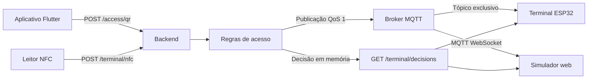

# Documentação técnica do MQTT

| Campo | Valor |
|---|---|
| Projeto | Passe — Controle de acesso por QR Code e NFC |
| Componente | Comunicação entre backend e terminais |
| Revisão | 11/11/2026 |
| Broker local | Eclipse Mosquitto 2 |
| Clientes | Backend Node.js, terminal ESP32 e simulador web |
| Base da documentação | Código e configurações atuais do repositório |

## 1. Objetivo

O MQTT é utilizado pelo sistema Passe para entregar ao terminal a decisão produzida pelo backend após uma tentativa de acesso. A mensagem informa se a catraca deve executar `ABRIR` ou `NEGAR`.

O broker não decide o acesso e o terminal não aplica as regras de autorização. A decisão é sempre calculada pelo backend, que considera usuário, credencial, autorização, datas, horários, usos e localização.

O MQTT é opcional para o funcionamento do backend. Quando ele não está configurado ou fica indisponível, o terminal consulta as decisões pela API HTTP.

## 2. Arquitetura



Componentes envolvidos:

| Componente | Responsabilidade |
|---|---|
| Backend | Calcula a decisão e publica a mensagem |
| Mosquitto | Autentica clientes, aplica a ACL e entrega mensagens |
| ESP32 | Assina o próprio tópico e aciona a sinalização/catraca |
| Simulador | Reproduz o comportamento do terminal no navegador |
| Fallback HTTP | Entrega decisões quando o MQTT não está conectado |

## 3. Fluxo de uma decisão

### 3.1 QR Code

1. O terminal solicita o QR em `GET /terminal/qr-token`.
2. O aplicativo lê o QR e envia a tentativa para `POST /access/qr`.
3. O backend valida a tentativa e grava o evento de acesso.
4. A decisão é enviada simultaneamente aos notificadores em memória e MQTT.
5. O backend responde ao aplicativo sem esperar o broker concluir a entrega.
6. O terminal recebe a mensagem MQTT e executa `ABRIR` ou `NEGAR`.
7. Se o MQTT estiver indisponível, o terminal obtém a mesma decisão pelo fallback HTTP.

### 3.2 NFC

1. O ESP32 lê o UID e chama `POST /terminal/nfc`.
2. O backend valida a tag e a autorização.
3. A resposta HTTP já contém a decisão do NFC.
4. O backend também publica a decisão nos notificadores.
5. No firmware atual, mensagens MQTT com `metodo: "NFC"` são ignoradas para impedir que a mesma leitura seja aplicada duas vezes; o resultado do NFC é tratado pela resposta HTTP.

## 4. Tópico MQTT

Existe um tópico de decisões para cada terminal:

```text
passe/terminais/{terminalId}/decisoes
```

Exemplo com identificador fictício:

```text
passe/terminais/11111111-1111-4111-8111-111111111111/decisoes
```

| Parte | Significado |
|---|---|
| `passe` | Namespace do sistema |
| `terminais` | Grupo de dispositivos |
| `{terminalId}` | UUID do terminal cadastrado |
| `decisoes` | Mensagens de abertura ou negação |

O projeto atual não utiliza tópicos separados para heartbeat, QR ou leitura NFC. Essas operações são realizadas por HTTP.

## 5. Publicadores e assinantes

| Cliente | Publica | Assina |
|---|---|---|
| Backend | `passe/terminais/+/decisoes` | Nenhum tópico |
| Terminal | Nenhum tópico | Somente `passe/terminais/<seu-id>/decisoes` |
| Simulador | Nenhum tópico | Somente o tópico do terminal simulado |
| Cliente anônimo | Nada | Nada |

O caractere `+` é usado somente na regra da API para permitir a publicação no tópico individual de qualquer terminal.

## 6. Payload da decisão

O payload é um objeto JSON UTF-8.

```json
{
  "acao": "ABRIR",
  "metodo": "QR",
  "mensagem": "Acesso liberado",
  "nome": "Pessoa",
  "em": "2026-11-11T20:00:00.000Z"
}
```

Exemplo de negação:

```json
{
  "acao": "NEGAR",
  "metodo": "QR",
  "mensagem": "Fora do horário permitido",
  "motivo": "FORA_DO_HORARIO",
  "nome": "Pessoa",
  "em": "2026-11-11T20:00:00.000Z"
}
```

### 6.1 Campos

| Campo | Tipo | Obrigatório | Descrição |
|---|---|---|---|
| `acao` | String | Sim | `ABRIR` ou `NEGAR` |
| `metodo` | String | Sim | `QR` ou `NFC` |
| `mensagem` | String | Sim | Texto apresentado no terminal |
| `motivo` | String | Não | Código da negação |
| `nome` | String | Não | Primeiro nome do usuário identificado |
| `em` | String ISO 8601 | Sim | Momento em que o evento foi registrado |

O payload atual não contém senha, chave do terminal, token QR, CPF ou JWT.

## 7. Qualidade de serviço e retenção

| Configuração | Valor atual |
|---|---|
| QoS da publicação | 1 |
| QoS da assinatura | 1 |
| Mensagem retida | Não |
| Persistência do broker local | Desativada |

O QoS 1 oferece entrega pelo menos uma vez enquanto a sessão está conectada, mas o protocolo permite mensagens duplicadas. O payload atual não possui identificador ou sequência específica para deduplicação no receptor.

As mensagens não são publicadas como retidas. Assim, um terminal que se conecta posteriormente não recebe uma decisão antiga como se fosse atual.

O Mosquitto local utiliza `persistence false`; sessões e mensagens não são gravadas em disco pelo broker.

## 8. Backend MQTT

### 8.1 Conexão

O backend conecta ao broker somente quando `MQTT_URL` está preenchida. Uma variável vazia é tratada como não informada.

Configuração do cliente:

| Item | Comportamento |
|---|---|
| Client ID | `passe-api-` seguido de oito caracteres aleatórios |
| Reconexão | Nova tentativa a cada 5 segundos |
| Autenticação | Usuário e senha das variáveis de ambiente |
| TLS | CA carregada do arquivo configurado em `MQTT_CA_FILE` |
| Encerramento | Conexão finalizada durante `SIGINT` ou `SIGTERM` |

### 8.2 Publicação

O `MqttTerminalNotifier` verifica se o cliente está conectado antes de publicar. A mensagem é serializada com `JSON.stringify` e enviada com QoS 1.

O backend não espera a confirmação do broker antes de responder ao aplicativo. Uma falha de publicação é registrada no log, mas não transforma uma decisão válida da API em erro HTTP.

Quando o cliente já está desconectado, a publicação MQTT é descartada. Isso evita que uma ordem antiga seja entregue depois da reconexão e abra a catraca com atraso. A decisão continua disponível no fallback HTTP em memória.

### 8.3 Notificador composto

O container cria:

- Um notificador em memória, sempre ativo.
- Um notificador MQTT quando `MQTT_URL` está configurada.

O `CompositeTerminalNotifier` chama todos os notificadores com `Promise.allSettled`. A falha de um canal não impede o outro de receber a decisão.

## 9. Fallback HTTP

Endpoint utilizado pelo dispositivo:

```http
GET /terminal/decisions?apos=<ultima-sequencia>
```

Exemplo de resposta:

```json
[
  {
    "seq": 15,
    "decisao": {
      "acao": "ABRIR",
      "metodo": "QR",
      "mensagem": "Acesso liberado",
      "nome": "Pessoa",
      "em": "2026-11-11T20:00:00.000Z"
    }
  }
]
```

Características:

| Item | Comportamento |
|---|---|
| Autenticação | `X-Terminal-Id` e `X-Terminal-Key` |
| Sequência | Contador crescente dentro do processo do backend |
| Capacidade | 20 decisões recentes por terminal |
| Persistência | Somente memória |
| Reinicialização | A fila e a sequência são perdidas |

O ESP32 consulta a rota a cada 2 segundos. Mesmo com o MQTT conectado, ele acompanha a sequência HTTP sem executar essas mensagens. Dessa forma, se o MQTT cair, o terminal continua a partir da posição mais recente e não repete decisões que já chegaram pelo broker.

Na primeira consulta depois de ligar, o firmware avança a sequência e ignora itens que já estavam na fila, evitando executar uma decisão anterior à inicialização do dispositivo.

## 10. Broker Mosquitto local

O serviço `mqtt` do Compose utiliza a imagem `eclipse-mosquitto:2` e monta `docker/mosquitto` como origem de configuração somente para leitura.

O script `docker/mosquitto/iniciar.sh`:

1. Copia os arquivos para `/mosquitto/config` dentro do container.
2. Define o usuário `mosquitto` como proprietário.
3. Aplica permissão `0600` ao arquivo de senhas, à ACL e à chave privada TLS quando existente.
4. Inicia o Mosquitto com o arquivo do projeto.

Configurações principais:

```text
persistence false
log_dest stdout
per_listener_settings false
allow_anonymous false
```

Como `per_listener_settings` está desativado, a autenticação e a ACL globais valem para todos os listeners locais.

## 11. Portas e protocolos

| Porta padrão | Protocolo | Uso |
|---|---|---|
| `1883` | MQTT sem TLS | Backend e ESP32 no desenvolvimento/rede local |
| `9001` | MQTT sobre WebSocket sem TLS | Simulador no navegador local |
| `8883` | MQTT com TLS | Backend e ESP32 após geração dos certificados |

As portas externas podem ser alteradas pelas variáveis do Compose:

| Variável | Porta interna |
|---|---|
| `MQTT_PORT` | 1883 |
| `MQTT_WS_PORT` | 9001 |
| `MQTT_TLS_PORT` | 8883 |

A porta 8883 só passa a ter um listener funcional depois que o arquivo TLS é gerado em `docker/mosquitto/conf.d`.

## 12. Autenticação

O broker local não aceita conexões anônimas.

| Cliente | Usuário | Senha |
|---|---|---|
| Backend | Identidade própria da API | Segredo configurado no ambiente |
| ESP32 | UUID do terminal | Chave gerada para o terminal |
| Simulador | UUID do terminal simulado | Chave do mesmo terminal |

O arquivo `docker/mosquitto/passwd` armazena hashes no formato Mosquitto PBKDF2-SHA512. Esta documentação não reproduz o conteúdo nem as credenciais de desenvolvimento desse arquivo.

A chave original do terminal também não é armazenada em texto puro no PostgreSQL; o banco guarda somente o hash usado pela autenticação HTTP. O broker precisa de seu próprio hash no arquivo de senhas local ou de uma credencial correspondente no provedor MQTT.

## 13. ACL

Arquivo: `docker/mosquitto/acl`.

Regra lógica da API:

```text
user <usuario-da-api>
topic write passe/terminais/+/decisoes
```

Regra lógica dos terminais:

```text
pattern read passe/terminais/%u/decisoes
```

`%u` é substituído pelo nome do usuário autenticado. Como o usuário do terminal é seu UUID, ele só consegue ler o tópico que contém o próprio identificador.

Consequências:

- A API pode publicar decisões para qualquer terminal.
- Um terminal não pode publicar uma ordem de abertura.
- Um terminal não recebe decisões de outro terminal.
- Clientes sem regra correspondente ficam sem acesso.

## 14. TLS local

O script `docker/mosquitto/gerar-certificados.sh` cria:

- Uma autoridade certificadora própria.
- Uma chave e um certificado para o broker.
- SANs para `localhost`, `mqtt`, `127.0.0.1` e os IPs/nomes informados.
- O arquivo `conf.d/tls.conf` com listener MQTT TLS na porta 8883.

Exemplo de geração, usando valores substituíveis:

```powershell
sh docker/mosquitto/gerar-certificados.sh <ip-do-computador> <nome-dns-opcional>
docker compose -f docker-compose.dev.yml restart mqtt
```

O listener gerado exige TLS 1.2 ou superior e utiliza o certificado e a chave armazenados fora do versionamento.

### 14.1 Backend com TLS

```text
MQTT_URL=mqtts://<host>:8883
MQTT_CA_FILE=<caminho-para-ca.crt>
```

### 14.2 ESP32 com TLS

O firmware utiliza `WiFiClientSecure` quando `MQTT_CA_CERT` está definido. A porta deve ser alterada para 8883, e a CA confiável deve ser incluída em `arduino/include/credenciais.h`, que permanece fora do Git.

O endereço usado pelo ESP32 deve existir nos SANs do certificado; caso contrário, a validação TLS pode falhar.

### 14.3 Simulador em produção

Navegadores utilizam MQTT por WebSocket. Em uma página HTTPS, o endpoint deve usar `wss://` para evitar bloqueio de conteúdo misto. O WebSocket seguro depende da configuração do broker ou provedor de produção; o script TLS local atual cria somente o listener MQTT da porta 8883.

## 15. Variáveis de ambiente

### 15.1 Backend

| Variável | Obrigatória | Finalidade |
|---|---|---|
| `MQTT_URL` | Não | URL `mqtt://` ou `mqtts://` do broker |
| `MQTT_USERNAME` | Não | Usuário da API no broker |
| `MQTT_PASSWORD` | Não | Senha da API no broker |
| `MQTT_CA_FILE` | Não | Caminho da CA para uma conexão `mqtts://` |
| `MQTT_WS_URL` | Não | URL `ws://` ou `wss://` entregue ao simulador |

Sem `MQTT_URL`, o backend não cria o cliente MQTT e usa somente a fila de decisões em memória.

### 15.2 Firmware

| Constante | Finalidade |
|---|---|
| `MQTT_HOST` | Host/IP do broker |
| `MQTT_PORT` | Porta MQTT, normalmente 1883 ou 8883 |
| `MQTT_CA_CERT` | CA opcional para TLS |
| `TERMINAL_ID` | Usuário MQTT e identificador HTTP |
| `TERMINAL_KEY` | Senha MQTT e chave HTTP |

Esses valores ficam em `arduino/include/credenciais.h`, criado a partir do exemplo e não versionado.

## 16. Terminal ESP32

O firmware usa a biblioteca PubSubClient.

Configurações atuais:

| Item | Valor |
|---|---|
| Tentativa de reconexão MQTT | A cada 5 segundos |
| QoS da assinatura | 1 |
| Buffer MQTT | 512 bytes |
| Timeout do socket | 3 segundos |
| Consulta HTTP de fallback | A cada 2 segundos |
| Tempo do relé aberto | 3 segundos |

O client ID segue o formato `passe-terminal-` mais os oito primeiros caracteres do UUID.

Ao receber uma mensagem:

1. O firmware tenta interpretar o payload como JSON.
2. Mensagens ilegíveis são registradas e ignoradas.
3. Decisões NFC recebidas pelo MQTT são ignoradas, pois já foram tratadas pela resposta HTTP.
4. `ABRIR` aciona relé, LED verde e sinal sonoro.
5. `NEGAR` aciona LED vermelho e dois sinais sonoros.
6. Após a decisão, o terminal solicita um novo QR.

## 17. Simulador web

O simulador obtém `MQTT_WS_URL` em `/simulador/config.json` e conecta com MQTT.js.

Configurações atuais:

| Item | Valor |
|---|---|
| Client ID | `simulador-` mais oito caracteres aleatórios |
| Reconexão | A cada 3 segundos |
| Timeout de conexão | 5 segundos |
| Autenticação | ID e chave do terminal simulado |
| QoS de assinatura | 1 |

A política de conteúdo da página permite conexões `ws:` e `wss:` e workers do tipo `blob:` somente na rota do simulador.

O simulador continua consultando a fila HTTP. Enquanto o MQTT está conectado, ele somente atualiza a sequência; quando o MQTT fica offline, passa a exibir as decisões recebidas por HTTP.

## 18. Provisionamento e rotação de chave

Cada ponto de acesso pode possuir um terminal. No cadastro ou na rotação, a API apresenta uma chave nova uma única vez.

O script `backend/scripts/provisionar-terminal.mjs` pode:

- Listar terminais e seu estado.
- Cadastrar um terminal para uma catraca.
- Trocar a chave de um terminal existente.
- Atualizar `TERMINAL_ID` e `TERMINAL_KEY` do firmware local.
- Atualizar a entrada correspondente no arquivo de senhas do Mosquitto local.

Depois de alterar o arquivo de senhas, o broker precisa ser reiniciado:

```powershell
docker compose -f docker-compose.dev.yml restart mqtt
```

A rotação invalida a chave HTTP antiga imediatamente no backend. Para o MQTT, a nova credencial passa a valer após a atualização do provedor ou arquivo de senhas e o reinício/recarregamento correspondente.

## 19. Execução local

Na raiz do repositório:

```powershell
docker compose -f docker-compose.dev.yml up -d mqtt
```

Para acompanhar o broker:

```powershell
docker compose -f docker-compose.dev.yml logs -f mqtt
```

Para iniciar broker, banco e API:

```powershell
docker compose -f docker-compose.dev.yml up --build database mqtt backend
```

O broker utiliza a configuração e as credenciais de desenvolvimento já preparadas no projeto. Elas não devem ser reutilizadas em produção.

## 20. Geração de entradas de senha

O script `backend/scripts/mqtt-senha.mjs` gera entradas compatíveis com o arquivo de senhas do Mosquitto, sem gravar a senha em texto puro no arquivo.

Formato de uso:

```powershell
Set-Location .\backend
node scripts/mqtt-senha.mjs <usuario> <senha> ..\docker\mosquitto\passwd
```

O comando insere ou substitui a entrada do usuário. Como a senha pode ficar no histórico do terminal, o fluxo automatizado de provisionamento é preferível quando aplicável.

## 21. Testes

### 21.1 Testes unitários e de API

Os testes verificam:

- Construção correta do tópico.
- Serialização JSON do payload.
- Publicação com QoS 1.
- Descarte da publicação quando o cliente está desconectado.
- Carregamento opcional das variáveis MQTT.
- Publicação de uma decisão gerada pelo fluxo NFC.
- Configuração e política de conteúdo do simulador.

### 21.2 Teste de autenticação e ACL

O script `backend/scripts/mqtt-acl.mjs` verifica um broker real:

1. Cliente anônimo é recusado.
2. Senha incorreta é recusada.
3. Terminal recebe a decisão publicada pela API.
4. Terminal não recebe a decisão destinada a outro terminal.
5. Terminal não consegue publicar uma ordem falsa de abertura.

O pipeline de CI executa esse teste tanto em MQTT local sem TLS quanto em MQTT com TLS e CA própria.

## 22. Produção

Em produção, a documentação de deploy do projeto prevê:

- MQTT com TLS para backend e ESP32.
- MQTT sobre WebSocket seguro para o simulador.
- Uma credencial exclusiva da API.
- Uma credencial por terminal.
- ACL equivalente à configuração local.

A ACL do Mosquitto local não é transferida automaticamente para um broker externo. As regras precisam ser cadastradas no provedor. A documentação atual de deploy marca a ACL do broker em nuvem como pendente; enquanto ela não for aplicada, não se deve considerar que o isolamento entre terminais esteja confirmado nesse ambiente.

Para produção com Mosquitto próprio, a recomendação registrada no projeto é expor somente o listener TLS necessário e substituir todas as credenciais de desenvolvimento.

## 23. Segurança

- Conexões anônimas são recusadas.
- A API é a única identidade autorizada a publicar decisões.
- Cada terminal pode ler somente o próprio tópico no Mosquitto local.
- Terminais não possuem permissão de publicação.
- Senhas são armazenadas como hashes no arquivo do broker.
- Chaves e certificados privados não devem ser versionados.
- Produção deve usar `mqtts://` e `wss://`.
- Mensagens não são retidas, reduzindo o risco de executar uma ordem antiga.
- Quando o broker está desconectado, o backend não acumula uma publicação MQTT para envio tardio.
- O fallback HTTP exige as credenciais do terminal.

## 24. Confiabilidade e limites atuais

- QoS 1 permite duplicidade; o terminal atual não deduplica mensagens MQTT por identificador de evento.
- A fila HTTP possui somente as 20 decisões mais recentes por terminal.
- A fila e sua sequência são perdidas quando o backend reinicia.
- O broker local não persiste sessões ou mensagens.
- Uma falha MQTT não impede a resposta da API nem o registro da tentativa de acesso.
- A saúde de `/health` não verifica explicitamente a conexão com o broker.
- O payload não possui versão formal de contrato.
- O buffer de 512 bytes do ESP32 deve ser considerado caso novos campos sejam acrescentados.

## 25. Diagnóstico de problemas

| Sintoma | Verificação |
|---|---|
| Backend informa MQTT desconectado | Conferir `MQTT_URL`, broker, porta, usuário e senha |
| URL sem protocolo | Usar `mqtt://`, `mqtts://`, `ws://` ou `wss://`, conforme o cliente |
| Timeout de conexão | Confirmar que a porta corresponde ao protocolo esperado |
| Terminal não autentica | Conferir ID, chave, arquivo de senhas e reinício do broker |
| Terminal conecta, mas não recebe | Conferir tópico, ACL e se o ID usado como usuário é o mesmo do tópico |
| Simulador não conecta | Conferir `MQTT_WS_URL`, listener WebSocket e conteúdo misto HTTPS/WS |
| TLS falha no ESP32 | Conferir CA, validade do certificado e SAN correspondente ao host/IP |
| Decisão chega somente por HTTP | Conferir estado da conexão MQTT; o fallback é o comportamento esperado |
| Decisão é repetida | Considerar a semântica de QoS 1 e verificar reconexões |

## 26. Arquivos relacionados

- `docker/mosquitto/mosquitto.conf`: listeners e segurança do broker local.
- `docker/mosquitto/acl`: permissões por tópico.
- `docker/mosquitto/iniciar.sh`: preparação do container.
- `docker/mosquitto/gerar-certificados.sh`: CA e certificado TLS local.
- `backend/src/modules/terminals/mqtt-notifier.ts`: cliente e publicação MQTT.
- `backend/src/modules/terminals/terminal-notifier.ts`: notificador composto e fallback em memória.
- `backend/scripts/mqtt-acl.mjs`: teste de autenticação, ACL e TLS.
- `backend/scripts/mqtt-senha.mjs`: geração do arquivo de senhas.
- `backend/public/simulador/app.js`: cliente MQTT WebSocket.
- `arduino/src/main.cpp`: cliente MQTT do ESP32.
- `arduino/include/credenciais.exemplo.h`: configuração esperada do firmware.
- `docs/terminal-iot.md`: funcionamento e provisionamento do terminal.
- `docs/deploy-nuvem.md`: configuração do broker externo.

