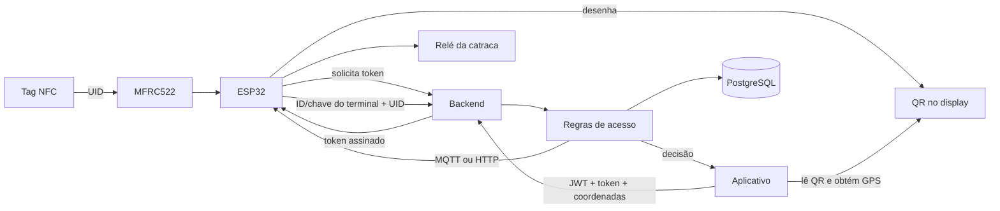
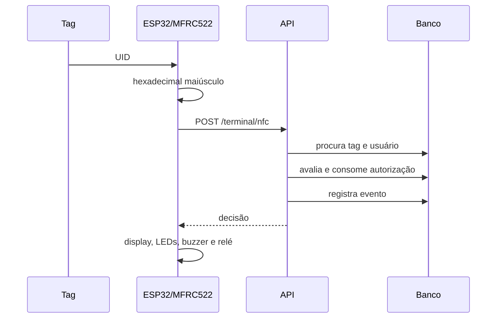
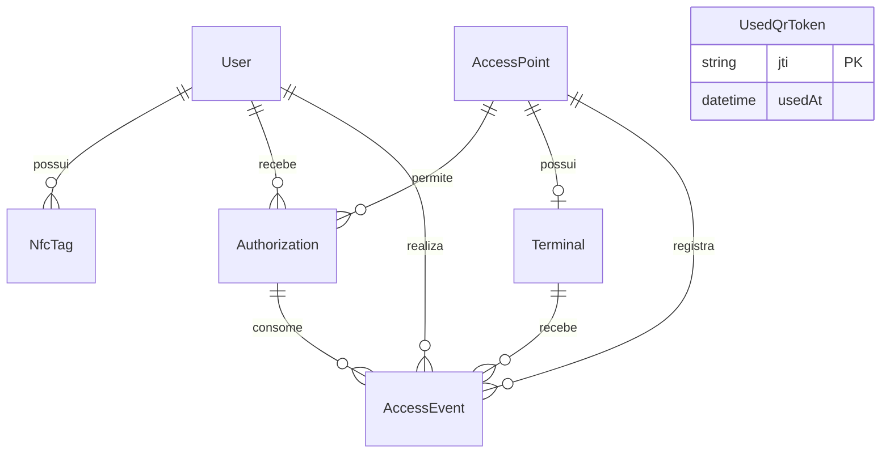

# Documentação técnica de QR Code e NFC

| Campo | Valor |
|---|---|
| Projeto | Passe — Controle de acesso por QR Code e NFC |
| Componente | Credenciais e fluxos de validação de acesso |
| Métodos documentados | QR Code e tag NFC. O celular Android como chave NFC está em `celular-nfc.md` |
| Revisão | 11/11/2026 |
| Base da documentação | Backend, aplicativo Flutter, firmware ESP32 e banco de dados atuais |

## 1. Objetivo

O sistema Passe oferece duas formas de apresentar uma credencial na catraca:

- QR Code rotativo exibido pelo terminal e lido pelo aplicativo;
- tag NFC aproximada do leitor MFRC522 conectado ao ESP32.

Os métodos identificam a tentativa de formas diferentes, mas não decidem o acesso sozinhos. QR e NFC são encaminhados ao mesmo serviço de validação do backend, que verifica usuário, catraca, autorização, período, horário e quantidade de usos.

Esta documentação descreve:

- geração e estrutura do token QR;
- leitura do QR no aplicativo;
- validação de localização;
- uso único do QR;
- leitura e normalização do UID NFC;
- cadastro, bloqueio e remoção de tags;
- regras compartilhadas de autorização;
- retorno da decisão ao aplicativo e ao terminal;
- registros no banco de dados;
- segurança, limitações e testes.

## 2. Comparação dos métodos

| Característica | QR Code | NFC |
|---|---|---|
| Credencial apresentada | Token temporário assinado | UID fixo da tag |
| Quem apresenta | Aplicativo do usuário | Tag física |
| Quem realiza a leitura | Câmera do celular | MFRC522 do terminal |
| Identidade do usuário | JWT da sessão do aplicativo | Associação do UID no banco |
| Identidade da catraca | Terminal codificado no QR | Terminal autenticado que leu a tag |
| Localização | Coordenadas do celular são obrigatórias para liberar | Não usa localização do celular |
| Validade própria | Curta, por padrão 30 segundos | Permanece até bloqueio ou remoção |
| Proteção contra repetição | JTI registrado como usado | Firmware ignora repetição imediata por 3 segundos |
| Endpoint de decisão | `POST /access/qr` | `POST /terminal/nfc` |
| Autenticação HTTP | JWT do usuário | ID e chave do terminal |
| Resposta principal | Aplicativo recebe a decisão | Terminal recebe a decisão na mesma chamada |
| Notificação ao terminal | MQTT ou fallback HTTP | Também é emitida, mas o firmware evita execução duplicada |

## 3. Componentes envolvidos



| Componente | Papel |
|---|---|
| Backend | Gera e valida QR, localiza tag, avalia autorização e registra evento |
| Aplicativo Flutter | Lê o QR, obtém a localização e apresenta a decisão |
| ESP32 | Exibe QR, lê NFC e executa a decisão física |
| Broker MQTT | Entrega decisões de QR ao terminal em tempo real |
| PostgreSQL | Armazena tags, autorizações, eventos e JTIs de QR usados |

## 4. Arquivos principais

### Backend

| Arquivo | Responsabilidade |
|---|---|
| `backend/src/modules/terminals/qr-token.ts` | Formato, assinatura, geração e verificação do QR |
| `backend/src/modules/access/access.controller.ts` | Contrato HTTP do acesso por QR |
| `backend/src/modules/access/access.service.ts` | Validação central de QR e NFC |
| `backend/src/modules/access/access.rules.ts` | Regras de autorização e textos de negação |
| `backend/src/modules/terminals/terminals.controller.ts` | Endpoints usados pelo terminal |
| `backend/src/modules/terminals/terminal-notifier.ts` | Fila HTTP de decisões |
| `backend/src/modules/terminals/mqtt-notifier.ts` | Publicação das decisões MQTT |
| `backend/src/modules/users/users.service.ts` | Cadastro e gestão das tags |
| `backend/src/shared/geo.ts` | Cálculo da distância por Haversine |
| `backend/src/database/repositories.prisma.ts` | Persistência, uso único do QR e consumo atômico de uso |

### Aplicativo

| Arquivo | Responsabilidade |
|---|---|
| `frontend/lib/views/user/scanner_qr_view.dart` | Câmera, leitura e pré-validação do QR |
| `frontend/lib/controllers/acesso_qr_controller.dart` | Localização e envio para `/access/qr` |
| `frontend/lib/views/user/validando_acesso_view.dart` | Estado de validação e tratamento de erros |
| `frontend/lib/views/user/acesso_liberado_view.dart` | Apresentação da liberação |
| `frontend/lib/views/user/acesso_negado_view.dart` | Motivo da negação e nova tentativa |
| `frontend/lib/views/teams/tags_view.dart` | Gestão de tags pela equipe |
| `frontend/lib/views/user/minha_tag_view.dart` | Consulta e bloqueio da própria tag |

### Firmware

| Arquivo | Responsabilidade |
|---|---|
| `arduino/src/main.cpp` | Comunicação, leitura NFC e aplicação da decisão |
| `arduino/src/tela.cpp` | Geração e desenho do QR |
| `arduino/include/config.h` | Pinagem e intervalo de repetição NFC |

## 5. Serviço central de decisão

QR e NFC são processados por `AccessService`. Isso garante que as regras de autorização sejam aplicadas de forma consistente, independentemente da credencial apresentada.

Todo pedido que passa pela autenticação e pela validação do contrato produz uma decisão de negócio:

- `liberado: true`, quando a entrada pode ocorrer;
- `liberado: false`, acompanhado de um código e de textos explicativos.

Cada decisão processada cria um evento de acesso. Requisições recusadas antes do serviço, como JSON inválido, contrato incorreto ou ausência de autenticação, retornam erro HTTP e não representam uma decisão registrada pelo `AccessService`.

## 6. Visão geral do QR Code

O QR exibido pela catraca não contém dados do usuário. Ele identifica o terminal, possui prazo de validade, inclui um valor aleatório de uso único e é assinado pelo backend.

O fluxo usa três identidades distintas:

| Identidade | Origem | Finalidade |
|---|---|---|
| Terminal | Conteúdo assinado do QR | Determinar a catraca onde o QR foi exibido |
| Usuário | JWT do aplicativo | Determinar quem está solicitando acesso |
| Uso único | Nonce/JTI do QR | Impedir reutilização depois do consumo |

O terminal não recebe `QR_SECRET` e não cria a assinatura. Ele solicita o texto pronto e apenas o transforma em imagem.

## 7. Geração do QR

O ESP32 autenticado chama:

```http
GET /terminal/qr-token
X-Terminal-Id: <id-do-terminal>
X-Terminal-Key: <chave-do-terminal>
```

Resposta:

```json
{
  "token": "P1.<terminal>.<validade>.<nonce>.<assinatura>",
  "expiraEm": "<data-hora-ISO-8601>",
  "trocarEmSegundos": 10
}
```

Valores padrão de ambiente:

| Variável | Padrão | Uso |
|---|---:|---|
| `QR_ROTATION_SECONDS` | 10 s | Intervalo para o terminal solicitar e exibir outro QR |
| `QR_TOKEN_TTL_SECONDS` | 30 s | Prazo máximo de validade do token |
| `QR_SECRET` | Sem padrão seguro | Segredo do HMAC, mínimo de 16 caracteres |

Rotação e expiração são conceitos separados. Um QR pode deixar de ser o mais novo na tela e ainda permanecer criptograficamente válido até o fim do TTL. A proteção adicional de localização e o uso único continuam sendo aplicados.

## 8. Formato do token QR

Formato lógico:

```text
P1.<terminal>.<vence>.<nonce>.<assinatura>
```

| Parte | Codificação | Tamanho atual | Finalidade |
|---|---|---:|---|
| `P1` | Texto fixo | 2 caracteres | Versão do formato |
| `terminal` | Base32 RFC 4648 sem `=` | 26 caracteres | UUID do terminal |
| `vence` | Segundos Unix em base 36 | 1 a 8 caracteres | Expiração |
| `nonce` | 10 bytes aleatórios em Base32 | 16 caracteres | Identificador de uso único, o JTI |
| `assinatura` | HMAC-SHA256 truncado para 14 bytes e codificado em Base32 | 23 caracteres | Integridade e autenticidade |

O conteúdo tem 77 caracteres (até 2038, quando o `vence` passa a ter 7) e usa letras maiúsculas, números compatíveis e pontos. Isso permite o modo alfanumérico do QR. Com correção L, 77 caracteres é o máximo da versão 3 (29×29 módulos), que o OLED 128×64 desenha com 2 pontos por módulo; o TFT usa correção M, na versão 4 (33×33). Até 25/11/2026 a assinatura tinha 15 bytes e o token 78 caracteres, o que obrigava a versão 4 no OLED, com 1 ponto por módulo (uns 6 mm de QR).

O formato anterior baseado em JWT seria maior. O formato compacto reduz a densidade da imagem e melhora a leitura no display do ESP32.

## 9. Assinatura e verificação do QR

O backend calcula HMAC-SHA256 sobre:

```text
P1.<terminal>.<vence>.<nonce>
```

Somente os primeiros 14 bytes da saída são utilizados, resultando em uma assinatura de 112 bits antes da codificação Base32. Para um token que vale 30 segundos e só pode ser conferido pela API, 112 bits continuam muito acima do necessário.

Na verificação, o backend:

1. remove espaços nas extremidades;
2. confere o formato completo por expressão regular;
3. recalcula a assinatura com `QR_SECRET`;
4. compara assinatura esperada e recebida com `timingSafeEqual`;
5. compara o instante atual com o campo de validade;
6. reconstrói o UUID do terminal;
7. devolve o terminal e o JTI para o serviço de acesso.

Falha de formato ou assinatura produz `QR_INVALIDO`. Token fora da validade produz `QR_EXPIRADO`.

## 10. Renderização no ESP32

O backend não envia PNG, bitmap ou matriz de pixels. A biblioteca `qrcodegen`, incluída em `arduino/lib/qrcodegen/`, converte o texto no próprio dispositivo.

Configuração atual:

- correção de erro solicitada no nível médio;
- versão mínima 1 e máxima 6;
- máscara selecionada automaticamente;
- fundo branco e módulos pretos;
- margem de quatro módulos nos displays maiores;
- escala calculada conforme a área disponível;
- rodapé com o nome do terminal;
- ST7789 ou ILI9341 recomendado;
- SSD1306 suportado apenas para teste, devido ao tamanho reduzido.

O ESP32 solicita outro token conforme `trocarEmSegundos`. Depois de uma decisão, ele força a obtenção de um QR novo.

## 11. Leitura do QR no aplicativo

O aplicativo usa `mobile_scanner` para abrir a câmera e obter `rawValue`.

Comportamento atual:

1. a câmera procura um código;
2. o aplicativo aceita inicialmente textos entre 10 e 2000 caracteres;
3. textos fora desse intervalo são tratados como QR de outro lugar;
4. após a primeira leitura aceita, novas detecções são bloqueadas;
5. a câmera é interrompida;
6. o aplicativo abre a tela de validação;
7. em uma nova tentativa, o scanner e a câmera são reativados.

A pré-validação do aplicativo verifica somente o comprimento. A validação real do prefixo, estrutura e assinatura ocorre no backend.

Se a câmera estiver sem permissão, a interface orienta o usuário a abrir as configurações do aplicativo. A tela também permite ligar a lanterna quando o aparelho oferece esse recurso.

## 12. Localização no acesso por QR

Antes de enviar o token, o aplicativo tenta obter uma posição de alta precisão usando `geolocator`.

Regras do aplicativo:

- verifica se o serviço de localização está ligado;
- consulta ou solicita permissão;
- usa precisão alta;
- limita a espera padrão a oito segundos;
- devolve ausência de posição se o GPS estiver desligado, a permissão for negada ou ocorrer timeout.

Corpo enviado:

```json
{
  "token": "<token-lido-sem-alteração>",
  "latitude": -23.000000,
  "longitude": -45.000000
}
```

Quando não há posição, o aplicativo envia apenas o token. O backend processa e responde com `LOCALIZACAO_AUSENTE`.

## 13. Referência e cálculo de distância

A referência geográfica é escolhida nesta ordem:

1. coordenadas do terminal, quando latitude e longitude foram registradas pelo heartbeat;
2. coordenadas cadastradas do ponto de acesso, como alternativa.

O limite permitido vem de `raioMetros` do ponto de acesso, cujo padrão no banco é 100 metros.

A distância é calculada pela fórmula de Haversine, considerando raio terrestre de 6.371.000 metros. O resultado é arredondado para ser armazenado e apresentado na decisão.

Quando a distância excede o raio, a resposta usa `LONGE_DO_TERMINAL` e inclui `distanciaMetros`.

## 14. Autenticação do acesso por QR

O aplicativo chama:

```http
POST /access/qr
Authorization: Bearer <jwt-da-sessão>
Content-Type: application/json
```

A rota exige uma sessão JWT válida. Ela permite que um usuário recentemente desativado chegue ao serviço de acesso, para que a tentativa seja registrada como `USUARIO_INATIVO` em vez de ser descartada sem evento.

O token QR não identifica o usuário. Compartilhar o conteúdo do QR não compartilha a sessão: o backend ainda considera o usuário autenticado no aplicativo que fez a chamada.

## 15. Ordem de validação do QR

O serviço executa as verificações na seguinte ordem:

1. localiza o usuário da sessão;
2. verifica formato, assinatura e validade do token;
3. busca o terminal codificado no token;
4. busca a catraca ligada ao terminal;
5. confirma que o usuário está ativo;
6. procura autorização para usuário e catraca;
7. avalia data, horário, cancelamento e usos;
8. exige latitude e longitude do celular;
9. calcula a distância até a referência;
10. confere o raio permitido;
11. marca o JTI como usado;
12. consome um uso da autorização de forma atômica;
13. registra o evento;
14. devolve a decisão ao aplicativo;
15. envia a decisão ao terminal.

O JTI só é marcado depois das verificações de usuário, autorização e localização. Portanto, uma tentativa negada por distância ou falta de localização não consome o QR. O token ainda precisa estar dentro da validade em uma nova tentativa.

## 16. Uso único do QR

O modelo `UsedQrToken` armazena:

| Campo | Tipo | Regra |
|---|---|---|
| `jti` | Texto | Chave primária |
| `usedAt` | Data e hora | Preenchida na criação |

O repositório usa inserção com `skipDuplicates`. Somente a primeira inserção do JTI retorna sucesso. Requisições simultâneas com o mesmo QR não conseguem liberar duas vezes pelo mesmo identificador.

Se o JTI já existir, a decisão é `QR_JA_UTILIZADO`.

O código atual não implementa limpeza automática dos registros antigos de `used_qr_tokens`.

## 17. Resultado do QR no aplicativo

A decisão de negócio usa HTTP `200`, tanto para liberação quanto para negação. O campo `liberado` determina o resultado.

Campos possíveis:

| Campo | Presença | Conteúdo |
|---|---|---|
| `liberado` | Sempre | Resultado booleano |
| `motivo` | Na negação | Código estável da regra |
| `titulo` | Sempre | Texto principal para a interface |
| `oQueFazer` | Normalmente na negação | Orientação ao usuário |
| `catraca` | Quando identificada | ID, nome e caminho físico |
| `usosRestantes` | Na liberação | Saldo após consumir o acesso |
| `distanciaMetros` | Após cálculo de localização | Distância arredondada |
| `eventoId` | Sempre na decisão processada | ID do histórico |
| `em` | Sempre | Instante da decisão |

Na liberação, o aplicativo mostra uma tela verde, a catraca, o horário e o saldo de usos. Na negação, apresenta o motivo, a orientação e, quando aplicável, a distância calculada.

Quando falta localização, a tela oferece a ação de solicitar permissão ou abrir as configurações. Se a sessão expirou, ela é removida e o usuário volta ao login.

## 18. Entrega da decisão de QR ao terminal

Além de responder ao aplicativo, o backend envia ao terminal:

```json
{
  "acao": "ABRIR",
  "metodo": "QR",
  "mensagem": "Acesso liberado",
  "nome": "<primeiro-nome>",
  "em": "<data-hora-ISO-8601>"
}
```

Em caso de negação, `acao` é `NEGAR` e `motivo` pode ser incluído.

Canal principal:

```text
passe/terminais/{terminalId}/decisoes
```

O MQTT usa QoS 1. Se o broker estiver desconectado, a publicação não fica retida para abertura futura; o terminal obtém a decisão pela consulta HTTP `GET /terminal/decisions`.

A fila em memória mantém as últimas 20 decisões de cada terminal. O firmware acompanha a sequência para não executar novamente uma decisão já observada.

## 19. Visão geral do NFC

No fluxo NFC, a pessoa não precisa abrir o aplicativo. Ela aproxima uma tag do MFRC522 e o terminal envia o UID à API.



O telefone e sua conexão não participam desse fluxo. Entretanto, o ESP32 ainda precisa conseguir alcançar a API. A mensagem do aplicativo de que a tag continua funcionando “sem internet” refere-se à falta de internet no celular, não à indisponibilidade do backend ou da rede do terminal.

## 20. Leitura NFC no firmware

O leitor MFRC522 compartilha o barramento SPI com o display. A seleção do NFC usa GPIO 32 e o reset usa GPIO 13.

Processamento do UID:

1. detecta um novo cartão;
2. lê o número de série;
3. percorre cada byte;
4. adiciona zero à esquerda para valores menores que `0x10`;
5. converte o resultado para letras maiúsculas;
6. chama `PICC_HaltA()`;
7. compara com a última tag lida;
8. envia o UID à API.

Exemplo apenas de formato:

```text
04A1B2C3
```

O mesmo UID é ignorado por três segundos no firmware para evitar múltiplas chamadas quando a tag permanece sobre o leitor.

## 21. Autenticação do NFC

O endpoint NFC pertence à API do dispositivo:

```http
POST /terminal/nfc
X-Terminal-Id: <id-do-terminal>
X-Terminal-Key: <chave-do-terminal>
Content-Type: application/json
```

Corpo:

```json
{
  "uid": "<uid-da-tag>"
}
```

O contrato aceita texto entre 4 e 40 caracteres. Antes da consulta ao banco, o serviço remove caracteres que não são hexadecimais e converte as letras para maiúsculas.

O terminal autenticado determina a catraca da tentativa. Não existe JWT de usuário nesse fluxo; a associação entre UID e usuário cumpre esse papel.

## 22. Normalização do UID

A função de normalização executa:

```text
remover tudo que não seja 0-9 ou A-F → converter para maiúsculas
```

Assim, entradas com separadores diferentes podem representar a mesma tag:

| Entrada | Valor armazenado e consultado |
|---|---|
| `04:a1:b2:c3` | `04A1B2C3` |
| `04-A1-B2-C3` | `04A1B2C3` |
| `04 A1 B2 C3` | `04A1B2C3` |

A gestão de tags restringe a entrada a caracteres hexadecimais, espaços, dois-pontos e hífen. O campo `uid` possui índice único no banco, portanto uma mesma tag não pode ser vinculada a duas pessoas.

## 23. Cadastro e gestão de tags

### 23.1 Vincular

```http
POST /users/{userId}/tags
Authorization: Bearer <jwt-da-equipe>
```

O administrador pode gerenciar qualquer perfil. O controlador de acesso pode gerenciar tags de condôminos e visitantes.

Antes de criar a associação, o serviço:

1. confirma que o usuário existe;
2. verifica a permissão sobre o perfil;
3. normaliza o UID;
4. verifica se o UID já está vinculado;
5. cria a tag ativa por padrão.

### 23.2 Bloquear ou desbloquear pela equipe

```http
PATCH /users/{userId}/tags/{tagId}
```

Corpo:

```json
{
  "ativa": false
}
```

A equipe pode enviar `true` ou `false`, respeitando a permissão sobre o perfil do usuário.

### 23.3 Remover

```http
DELETE /users/{userId}/tags/{tagId}
```

A remoção desfaz a associação. O endpoint responde `204` sem corpo.

### 23.4 Bloquear a própria tag

```http
PATCH /me/tags/{tagId}
```

O próprio usuário pode enviar somente:

```json
{
  "ativa": false
}
```

Ele não pode reativar a tag por essa rota. O desbloqueio deve ser realizado pela equipe. Na interface atual, o morador recebe a opção de bloquear; a tela do visitante apenas apresenta as tags.

## 24. Ordem de validação do NFC

O serviço executa:

1. recebe um terminal já autenticado;
2. busca a catraca ligada ao terminal;
3. normaliza o UID;
4. procura a tag pelo UID;
5. procura o usuário associado;
6. confirma que a catraca existe;
7. confirma que tag e usuário foram encontrados;
8. verifica se a tag está ativa;
9. verifica se o usuário está ativo;
10. procura autorização para a catraca;
11. avalia período, horário, cancelamento e usos;
12. consome um uso de forma atômica;
13. registra o evento;
14. responde diretamente ao terminal;
15. publica a decisão pelos notificadores.

O NFC não exige GPS do celular nem calcula distância. A segurança física depende de a leitura ter sido enviada pelo terminal autenticado e associado à catraca correta.

## 25. Resposta NFC e prevenção de duplicidade

O `POST /terminal/nfc` devolve o mesmo objeto `DecisaoAcesso` usado pelo QR. O firmware aplica essa resposta imediatamente.

O backend também envia a decisão aos notificadores para manter o histórico de entrega consistente. Para não acionar o relé duas vezes, o firmware ignora mensagens recebidas por MQTT ou fallback cujo campo `metodo` seja `NFC`.

Resumo:

| Origem da decisão NFC | Firmware executa? |
|---|---|
| Resposta direta de `POST /terminal/nfc` | Sim |
| Mensagem MQTT com `metodo: NFC` | Não |
| Fila HTTP com `metodo: NFC` | Não |

Se a API não responder com status `200`, o firmware mostra `Sem servidor`, nega a abertura e pede nova tentativa.

## 26. Regras compartilhadas de autorização

Depois de identificar usuário e catraca, QR e NFC usam as mesmas regras.

Uma autorização válida precisa:

- pertencer ao usuário;
- pertencer à catraca;
- não estar cancelada;
- ter a data atual entre início e fim, inclusive;
- incluir o horário atual;
- possuir uso disponível.

O fuso usado é `APP_TIMEZONE`, cujo padrão é `America/Sao_Paulo`.

### 26.1 Datas

O primeiro e o último dia são aceitos. Uma autorização que termina hoje ainda pode ser usada, desde que as outras regras sejam atendidas.

### 26.2 Horários

O horário inicial é inclusivo e o horário final é exclusivo.

Exemplo:

```text
08:00 até 18:00 → 08:00 é válido; 18:00 não é válido
```

Janelas que atravessam a meia-noite são suportadas:

```text
22:00 até 06:00 → 23:00 e 05:00 são válidos
```

### 26.3 Múltiplas autorizações

Se houver várias autorizações para a mesma pessoa e catraca, o serviço usa a primeira que estiver válida. Se nenhuma estiver válida, escolhe um motivo representativo entre as candidatas, priorizando a que chegou mais perto de permitir o acesso.

### 26.4 Consumo concorrente

O uso é incrementado por uma atualização condicional no PostgreSQL:

```text
incrementar somente se status = ATIVA e usosRealizados < maxUsos
```

Isso impede que duas tentativas simultâneas ultrapassem `maxUsos`. Se outra requisição consumir o último uso antes da atualização, a decisão é `SEM_USOS`.

## 27. Motivos de negação

### 27.1 Motivos do QR

| Código | Significado |
|---|---|
| `QR_INVALIDO` | Estrutura ou assinatura inválida |
| `QR_EXPIRADO` | Validade encerrada |
| `QR_JA_UTILIZADO` | JTI já registrado |
| `LOCALIZACAO_AUSENTE` | Aplicativo não forneceu coordenadas |
| `LONGE_DO_TERMINAL` | Distância acima do raio permitido |

### 27.2 Motivos do NFC

| Código | Significado |
|---|---|
| `TAG_DESCONHECIDA` | UID não está vinculado |
| `TAG_BLOQUEADA` | Tag existe, mas está inativa |

### 27.3 Motivos comuns

| Código | Significado |
|---|---|
| `TERMINAL_DESCONHECIDO` | Terminal ou catraca não localizado |
| `USUARIO_INATIVO` | Cadastro desativado |
| `SEM_AUTORIZACAO` | Nenhuma autorização para a catraca |
| `AUTORIZACAO_CANCELADA` | Autorização cancelada |
| `AUTORIZACAO_EXPIRADA` | Data final ultrapassada |
| `AUTORIZACAO_NAO_INICIADA` | Data inicial ainda não alcançada |
| `FORA_DO_HORARIO` | Horário fora da janela |
| `SEM_USOS` | Quantidade máxima atingida |

Cada código possui `titulo` e `oQueFazer` definidos no backend. O aplicativo não recria esses textos; ele apresenta a resposta da API.

## 28. Registro de eventos

Cada decisão processada cria um `AccessEvent`.

| Campo | QR | NFC |
|---|---|---|
| `metodo` | `QR` | `NFC` |
| `resultado` | `LIBERADO` ou `NEGADO` | `LIBERADO` ou `NEGADO` |
| `motivo` | Código na negação | Código na negação |
| `userId` | Usuário da sessão, quando encontrado | Usuário da tag, quando encontrado |
| `accessPointId` | Catraca do token | Catraca do terminal |
| `terminalId` | Terminal do token | Terminal que leu a tag |
| `authorizationId` | Autorização consumida na liberação | Autorização consumida na liberação |
| `credencial` | JTI do QR | UID normalizado |
| `latitude` e `longitude` | Coordenadas recebidas do celular | `null` |
| `distanciaMetros` | Distância calculada, quando possível | `null` |
| `createdAt` | Momento da decisão | Momento da decisão |

Campos opcionais permitem registrar tentativas incompletas. Por exemplo, uma tag desconhecida gera evento sem usuário, e um QR inválido gera evento sem terminal.

## 29. Modelos de banco relacionados



O UID é único em `nfc_tags`. A exclusão de um usuário remove suas tags por `ON DELETE CASCADE`. O JTI é a chave primária em `used_qr_tokens`.

## 30. Estados e respostas HTTP

| Situação | Status HTTP | Decisão de negócio |
|---|---:|---|
| Acesso liberado | `200` | `liberado: true` |
| Acesso negado por regra | `200` | `liberado: false` |
| Corpo fora do contrato | `400` | Não chega ao serviço de decisão |
| JWT ausente ou inválido no QR | `401` | Não chega ao serviço de decisão |
| ID/chave do terminal ausentes ou inválidos | `401` | Não chega ao serviço de decisão |
| Erro inesperado | `500` | Falha técnica |

Uma negação esperada não é erro de transporte. O cliente deve observar `liberado` e não interpretar todo `200` como abertura.

## 31. Segurança do QR

Proteções implementadas:

- segredo de assinatura fica no backend;
- HMAC protege o conteúdo contra alteração;
- comparação de assinatura com tempo constante;
- validade curta;
- nonce aleatório de 80 bits;
- JTI de uso único no banco;
- terminal incorporado ao conteúdo assinado;
- JWT identifica o usuário que escaneou;
- localização limita uso distante;
- consumo de autorização é atômico;
- todas as decisões processadas são auditadas.

Cuidados operacionais:

- `QR_SECRET` não deve ser versionado nem reutilizado como `JWT_SECRET`;
- troca de `QR_SECRET` invalida tokens ainda ativos;
- relógio e fuso do servidor precisam estar corretos;
- HTTPS deve validar o certificado;
- acesso ao banco de JTIs deve permanecer disponível;
- coordenadas enviadas pelo celular não substituem controles contra GPS adulterado em cenários de alta segurança.

## 32. Segurança do NFC

Proteções implementadas:

- endpoint exige terminal cadastrado e chave válida;
- UID é normalizado antes da busca;
- UID é único no banco;
- tag pode ser bloqueada imediatamente;
- usuário desativado não passa;
- regras de autorização continuam obrigatórias;
- firmware reduz repetição acidental;
- tentativas são registradas.

Limitação importante: o sistema usa somente o UID apresentado pelo MFRC522. Não há desafio criptográfico com a tag. Tags compatíveis que permitam copiar ou emular o UID podem representar risco de clonagem. Para um ambiente de maior segurança, seria necessário adotar credenciais com autenticação criptográfica e leitor compatível.

A supressão de três segundos ocorre no firmware, não no backend. O código atual não implementa rate limit específico para leituras NFC no servidor.

## 33. Privacidade

Dados relacionados a acesso incluem:

- identidade do usuário;
- catraca e terminal;
- horário;
- resultado e motivo;
- JTI do QR ou UID NFC;
- coordenadas e distância no QR.

O aplicativo de gestão mostra o UID completo à equipe. Na área pessoal, a interface apresenta apenas o final da tag. Logs e exportações devem evitar exposição desnecessária desses identificadores.

Políticas de retenção para eventos e JTIs usados não estão automatizadas no código atual e devem ser definidas conforme os requisitos do projeto e a legislação aplicável.

## 34. O que está e o que não está implementado

| Funcionalidade | Estado atual |
|---|---|
| QR rotativo no terminal | Implementado |
| Leitura do QR pelo aplicativo | Implementado |
| Validação de GPS no QR | Implementado |
| QR de uso único | Implementado |
| Abertura por NFC no terminal | Implementado |
| Cadastro e bloqueio de tags | Implementado |
| Histórico por QR e NFC | Implementado |
| Entrar no aplicativo com NFC | Não implementado; a opção de login informa “em construção” |
| NFC funcionando sem internet no celular | Sim, porque o celular não participa |
| NFC funcionando sem rede no terminal/backend | Não; a API precisa decidir |
| Autenticação criptográfica da tag | Não implementada; somente UID |

## 35. Testes automatizados existentes

### Backend

Os testes cobrem:

- terminal autenticado recebendo novo QR;
- rejeição de chave incorreta do terminal;
- liberação por QR;
- desconto de uso;
- registro do evento;
- envio de `ABRIR` ao terminal;
- negação por distância;
- negação por falta de localização;
- uso das coordenadas informadas pelo terminal;
- QR expirado;
- QR reutilizado;
- horário inválido;
- ausência de autorização;
- usos esgotados;
- autorização cancelada;
- QR forjado;
- exigência de login no QR;
- NFC com separadores no UID;
- tag desconhecida;
- tag bloqueada;
- usuário inativo;
- exigência de autenticação do terminal;
- janelas de horário comuns e atravessando meia-noite;
- seleção entre múltiplas autorizações.

### Aplicativo

Os testes verificam:

- envio do token sem alteração;
- envio das coordenadas;
- envio apenas do token quando não há localização;
- telas de liberação e negação;
- textos de todos os motivos esperados;
- apresentação da distância;
- solicitação de permissão de localização;
- tratamento de falta de internet;
- tratamento de sessão expirada;
- retorno ao scanner para nova leitura;
- layout com escala de fonte ampliada.

## 36. Testes manuais recomendados

### 36.1 QR Code

1. confirmar que o terminal aparece online;
2. verificar a troca do QR no intervalo configurado;
3. escanear com usuário autorizado e próximo;
4. conferir tela verde no aplicativo e no terminal;
5. confirmar o acionamento e desligamento do relé;
6. tentar reutilizar o mesmo token;
7. tentar usar uma captura antiga;
8. negar permissão de localização;
9. testar fora do raio;
10. testar usuário sem autorização;
11. testar autorização fora do horário;
12. desconectar o MQTT e validar o fallback HTTP;
13. conferir o evento no histórico.

### 36.2 NFC

1. executar o teste de bancada do MFRC522;
2. ler o UID pelo monitor serial;
3. vincular a tag ao usuário correto;
4. aproximar uma tag autorizada;
5. manter a tag sobre o leitor e confirmar a supressão de repetição;
6. testar tag não cadastrada;
7. bloquear a tag e tentar novamente;
8. reativar pela equipe e repetir;
9. desativar o usuário e validar a negação;
10. testar autorização expirada ou sem usos;
11. remover a rede do terminal e confirmar que não ocorre abertura;
12. conferir os eventos no histórico.

## 37. Solução de problemas

### QR é reconhecido como sendo de outro lugar

- confirmar que existe conteúdo em `rawValue`;
- conferir se o texto possui entre 10 e 2000 caracteres;
- testar diretamente o QR exibido pelo terminal;
- observar se a tela do terminal conseguiu gerar o código.

### QR retorna `QR_INVALIDO`

- solicitar um QR novo ao terminal;
- conferir se aplicativo e terminal estão apontando para o mesmo backend;
- verificar se `QR_SECRET` não foi alterado entre geração e validação;
- evitar modificar, recortar ou transcrever o conteúdo.

### QR retorna `QR_EXPIRADO`

- escanear o código atual da tela;
- conferir o relógio do servidor;
- revisar TTL e intervalo de rotação;
- verificar demora excessiva para obter GPS ou resposta de rede.

### QR retorna `LOCALIZACAO_AUSENTE`

- ligar o serviço de localização;
- permitir localização para o aplicativo;
- sair de ambiente sem recepção adequada;
- repetir a leitura, pois o QR pode ter mudado durante a configuração.

### QR retorna `LONGE_DO_TERMINAL`

- conferir as coordenadas da catraca;
- conferir as coordenadas registradas pelo terminal;
- revisar `raioMetros`;
- verificar a precisão da posição do celular.

### Tag aparece como desconhecida

- obter o UID pelo teste de bancada;
- conferir a normalização sem separadores;
- vincular o UID ao usuário;
- confirmar se não houve erro de digitação;
- verificar se a tag foi removida.

### Tag aparece como bloqueada

- confirmar se o usuário informou perda da tag;
- somente a equipe deve reativá-la;
- validar a identidade do portador antes do desbloqueio.

### NFC não lê

- alimentar o MFRC522 em 3,3 V;
- conferir SCK 18, MISO 19, MOSI 23, SS 32 e RST 13;
- executar `pio run -e teste -t upload`;
- observar o registrador de versão no monitor serial;
- testar outra tag compatível.

### Terminal recebe a decisão, mas não abre

- conferir se `acao` é `ABRIR`;
- verificar o nível ativo do relé;
- testar relé, LED e buzzer pelo ambiente de bancada;
- conferir se a mensagem NFC não está sendo corretamente ignorada por já ter sido aplicada na resposta direta;
- revisar alimentação e GND comum.

## 38. Checklist de segurança

- [ ] `QR_SECRET` possui valor forte e não está no Git.
- [ ] JWT e QR usam segredos diferentes.
- [ ] API usa HTTPS com certificado validado.
- [ ] MQTT usa TLS e ACL por terminal.
- [ ] Chaves dos terminais não aparecem em documentação ou logs públicos.
- [ ] Coordenadas e raio das catracas foram conferidos.
- [ ] Tags perdidas podem ser bloqueadas rapidamente.
- [ ] Equipe valida a identidade antes de reativar uma tag.
- [ ] Histórico de acesso possui acesso restrito.
- [ ] Retenção de eventos e JTIs foi definida.
- [ ] Limitações de clonagem de UID são aceitas para o protótipo.
- [ ] Testes de QR reutilizado e expirado estão passando.
- [ ] Testes de consumo simultâneo não ultrapassam o limite de usos.

## 39. Arquivos relacionados

| Documento | Conteúdo |
|---|---|
| `docs/documentacao-tecnica/api.md` | Contratos HTTP completos |
| `docs/documentacao-tecnica/backend.md` | Arquitetura e serviços do backend |
| `docs/documentacao-tecnica/banco-de-dados.md` | Tabelas, relações e índices |
| `docs/documentacao-tecnica/mqtt.md` | Entrega MQTT e fallback HTTP |
| `docs/documentacao-tecnica/aplicativo.md` | Scanner, localização e interfaces |
| `docs/documentacao-tecnica/firmware-esp32.md` | Display, MFRC522, relé e ciclo do ESP32 |
| `docs/terminal-iot.md` | Decisão de arquitetura do token compacto |
| `docs/hardware.md` | Pinagem e componentes físicos |

## 40. Resumo técnico

O QR Code do Passe é temporário, assinado e associado a um terminal, enquanto o usuário é identificado pela sessão do aplicativo. A liberação exige autorização, localização próxima e JTI ainda não utilizado. O NFC identifica o usuário por um UID previamente vinculado e identifica a catraca pelo terminal autenticado, sem depender do celular. Os dois métodos compartilham as mesmas regras de autorização, o consumo atômico de usos, o registro de eventos e a notificação do terminal. As principais limitações atuais são a confiança na localização informada pelo celular, a ausência de limpeza automática dos JTIs antigos e o uso de UID NFC sem autenticação criptográfica.
