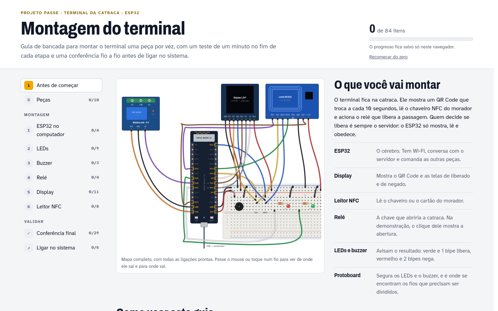
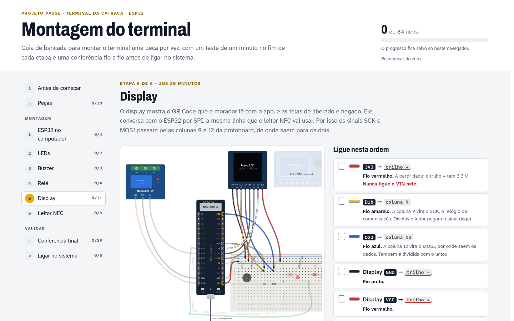

# Passe · Sprint 2

O que mudou de 21/10 a 11/11/2026, depois da Sprint Review 1.

## Resumo

Na Sprint 1 tínhamos a API, o simulador web do terminal e um app que fazia login e mostrava
os menus. A maioria das opções abria "tela em construção".

Na Sprint 2 o projeto saiu do protótipo local:

- **O terminal virou hardware.** Fizemos o firmware do ESP32 em C++, que mostra o QR no display,
  lê a tag NFC e aciona o relé. Também fizemos o teste de bancada e um guia de montagem passo a passo.
- **O sistema foi para a nuvem e ficou seguro.** A API roda no Render, o banco no Neon e o broker
  MQTT no EMQX Cloud, com TLS. Testamos de ponta a ponta em produção em 23/10.
- **O app ficou completo nos quatro perfis.** O morador lê o QR da catraca. A equipe cadastra
  usuários, locais, autorizações, tags e terminais e acompanha o histórico.

Todos os itens do roadmap que apresentamos na Sprint 1 foram entregues no código: as issues #6 a
#10, o firmware e o deploy em nuvem.

## Sprint 1 × Sprint 2

| | Sprint 1 (20/10) | Sprint 2 (11/11) |
|---|---|---|
| Terminal | Simulador web | Firmware ESP32 (4 versões de display) + teste de bancada + guia de montagem |
| Onde roda | Só na máquina, com Docker | Nuvem: Render (API), Neon (banco), EMQX Cloud (MQTT com TLS) |
| Broker MQTT | Sem senha, sem ACL, sem TLS | Login por terminal, ACL por tópico e TLS |
| Telas do app | 7 (login, cadastro e menus) | 28 nos quatro perfis |
| Testes do backend | 78 | 110 |
| Testes do app | 75 | 251 |
| Jobs no CI | 5 | 7 (+ broker MQTT e firmware) e um workflow do IPA para iOS |
| Gestão | Issues no GitHub | Trello com 7 épicos, 17 histórias de usuário, 8 técnicas e critérios de aceite |

## O que entregamos

### 1. Terminal ESP32 (22/10, PRs #14 e #15)

- **Firmware** em C++ (PlatformIO com framework Arduino), na pasta [`arduino/`](../../arduino/).
  Ele mantém Wi-Fi e MQTT conectados, pede o QR à API a cada 10 s e desenha no display. Recebe
  `ABRIR`/`NEGAR` pelo MQTT e consulta a API por HTTP se o MQTT cair. Lê a tag NFC (MFRC522),
  aciona o relé, os LEDs e o buzzer, e manda heartbeat a cada 30 s.
- **QR menor.** O conteúdo do QR era um JWT de 263 caracteres, que vira um QR de 57×57 módulos,
  grande demais para um display de 240 px. Trocamos por um token assinado com HMAC de 78
  caracteres, que cabe num QR de 33×33. Cada módulo fica com 5 px e o celular lê de uns 20 cm.
  O app não precisou mudar.
- **Teste de bancada** (09/11). É um firmware separado que testa LEDs, buzzer, relé, display e
  NFC um de cada vez, pelo monitor serial, sem Wi-Fi nem servidor.
- **Guia de montagem** ([`docs/montagem-terminal.html`](../montagem-terminal.html)). Tem desenho
  das ligações, teste no fim de cada etapa e conferência fio a fio antes de ligar no sistema.
- **Pasta organizada** (11/11). O código do terminal fica em `arduino/`, com o firmware em `src/`
  e o teste de bancada em `testes/bancada/`.

### 2. Segurança do broker e cadastro do terminal (22/10, issues #8 e #10)

- **Login no broker.** O acesso anônimo foi desligado. Cada terminal entra com o próprio Id e a
  própria chave.
- **ACL.** Só a API publica decisões. Cada terminal só lê o próprio tópico, então ninguém
  consegue mandar um `ABRIR` falso.
- **TLS** na porta 8883, também na nuvem.
- **Teste no CI.** Um teste automático confere tudo isso a cada push: acesso anônimo recusado,
  senha errada recusada e terminal sem conseguir publicar.
- **Script de provisionamento.** Ele cadastra o terminal ou troca a chave e já grava a chave no
  firmware e no broker. A chave aparece uma vez só.
- **Rede local** (issue #7). Fizemos um script que libera o firewall do Windows e um guia de rede
  para o protótipo (hotspot de 2,4 GHz).

### 3. Nuvem (23/10, PR #16)

- A API roda no Render, o PostgreSQL no Neon e o broker no EMQX Cloud com TLS. O firmware leva o
  certificado da CA do broker.
- Teste em produção em 23/10: acesso liberado, QR reutilizado negado, celular a 1 km negado e tag
  NFC liberada.
- O deploy na `main` publica a imagem no GitHub Container Registry e dispara o Render. Em 11/11
  ele passou a tentar de novo quando o Render demora (PR #23). O job de deploy está verde.

### 4. App

- **Leitura do QR** (26/10, PR #17, issue #6). O app abre o scanner, mostra "validando" e depois
  "acesso liberado" ou "acesso negado" com o motivo.
- **Telas da equipe** (29/10, PR #20, e 04/11, PR #22): Painel, Usuários e formulário, Locais e
  catraca, Autorizações com filtros, formulário e cancelamento, Histórico e Acessos negados, Tags
  NFC, Terminais, Visitantes e Relatórios.
- **Telas do morador e do visitante** (04/11, PR #22): Início, Minhas autorizações, Detalhe da
  autorização, Perfil, Minha tag NFC, Ajuda e Histórico.
- **"Tentar novamente"** quando a conexão cai, e menus e rotas conforme o perfil, com teste de
  permissão.
- Seguimos o design em Material 3 pensado para o público idoso ([`docs/Design.pdf`](../Design.pdf)).

### 5. Backend (02/11 e 04/11, PR #22)

- Os eventos de acesso trazem o motivo em texto, então o app não precisa de tabela própria.
- Quem é desativado perde o acesso na hora, mesmo com o login ainda aberto.
- O filtro "Ativa" conta só a autorização que vale hoje. Agendadas e sem usos têm filtro próprio.
- O morador pode bloquear a própria tag.

### 6. Processo

- **Trello** com épicos, histórias e critérios de aceite. Em 11/11 conferimos cada critério contra
  o código da `main` e abrimos cards para o que faltava.
- **CI** com jobs novos: broker MQTT (login, ACL e TLS) e firmware (as 4 versões, e uma com TLS).
- **Builds do app.** Há um workflow que gera o IPA de teste para iOS e um container Docker que gera
  o APK de release sem instalar o Flutter.

## Critérios de aceite dos épicos

Conferência feita em 11/11 contra o código da `main`.

| Épico | Critérios | Falta |
|---|---|---|
| EP01 Usuários e locais | 5 de 5 | — |
| EP02 Autorizações | 5 de 5 | — |
| EP03 App e autenticação | 5 de 5 | — |
| EP04 Terminal e QR | 5 de 6 | Receptor GPS no terminal (RF11) e o kit montado rodando o firmware |
| EP05 Validação e decisão | 7 de 7 | — |
| EP06 Histórico | 5 de 5 | — |
| EP07 Qualidade e infraestrutura | 8 de 11 | Diagramas (RP07) e eficiência energética (RNF07). O deploy voltou a passar em 11/11 |

## Fotos

As fotos ficam em [`fotos/`](fotos/). As duas primeiras são do guia de montagem; as outras são para
tirar antes da apresentação, com os nomes da lista abaixo.

### Guia de montagem

*Mapa de todas as ligações do terminal: ESP32, display, leitor NFC, relé, LEDs e buzzer.*

*Cada etapa tem a ordem dos fios, um teste de um minuto e o que fazer se algo não funcionar.*

### Terminal e app em uso

<table>
  <tr>
    <td></td>
    <td></td>
  </tr>
  <tr>
    <td>Terminal montado mostrando o QR</td>
    <td>Acesso liberado: tela verde, LED verde e relé</td>
  </tr>
</table>

<table>
  <tr>
    <td></td>
    <td></td>
    <td></td>
  </tr>
  <tr>
    <td>Leitura do QR</td>
    <td>Acesso liberado</td>
    <td>QR reutilizado: negado</td>
  </tr>
  <tr>
    <td></td>
    <td></td>
    <td></td>
  </tr>
  <tr>
    <td>Início do morador</td>
    <td>Autorizações (equipe)</td>
    <td>Histórico e acessos negados</td>
  </tr>
</table>

### Processo

### Lista de fotos para tirar

| Arquivo | O que mostrar |
|---|---|
| `terminal-montado.jpg` | O terminal na protoboard, de cima, com o QR no display e os fios visíveis |
| `terminal-liberado.jpg` | A tela verde "Pode passar" com o LED verde aceso. Sem o kit pronto, use um print do simulador (`/simulador/`) |
| `app-scanner.png` | O app lendo o QR do terminal |
| `app-liberado.png` | O resultado "acesso liberado" |
| `app-negado.png` | O mesmo QR lido de novo: "QR já utilizado" |
| `app-inicio.png` | O Início do morador com as autorizações |
| `app-autorizacoes.png` | A lista de autorizações da equipe com os filtros |
| `app-historico.png` | O histórico com acessos liberados e negados |
| `ci-verde.png` | O GitHub Actions com os 7 jobs verdes. Abra o run logado, senão o gráfico não aparece |
| `trello.png` | O board com as listas e os épicos |

Antes de salvar as fotos:

- **Celular:** foto em `.jpg`, até 1 MB e uns 1280 px de largura. Print de tela em `.png`.
- **Dados:** use os dados de demonstração do seed. Não fotografe a chave do terminal (ela aparece
  na tela Terminais), a senha do Wi-Fi no `credenciais.h` nem o `.env`.
- **Arquivo faltando:** a foto aparece quebrada neste documento. Se uma foto não for tirada,
  apague a linha dela.

## Para a Sprint 3

| Card | O quê |
|---|---|
| #34 | Montar o kit e confirmar o firmware rodando no ESP32 |
| #33 | Receptor GPS no terminal, para completar o RF11 |
| #35 | Diagramas de casos de uso, de componentes e de sequência do QR e do NFC (RP07) |
| #36 | Eficiência energética do terminal (RNF07) |
| #37 | Deploy: o job voltou a passar em 11/11, falta confirmar o Render recebendo a versão nova |

Também ficam para a Sprint 3:

- **App:** "Entrar com NFC" e "Registrar" no login ainda estão em construção, e o nome do app no
  Android aparece como "public".
- **Backend:** editar e apagar edifício, portaria e porta, e uma rota de relatório agregado.
- **Decisões do grupo:** cadastro pelo app, Comunicados e Configurações, e Meus visitantes
  ([`docs/telas-pendentes.md`](../telas-pendentes.md)).
- **GitHub:** fechar as issues #8 e #10, já entregues. As issues #7 e #9 fecham quando o kit estiver
  montado.
